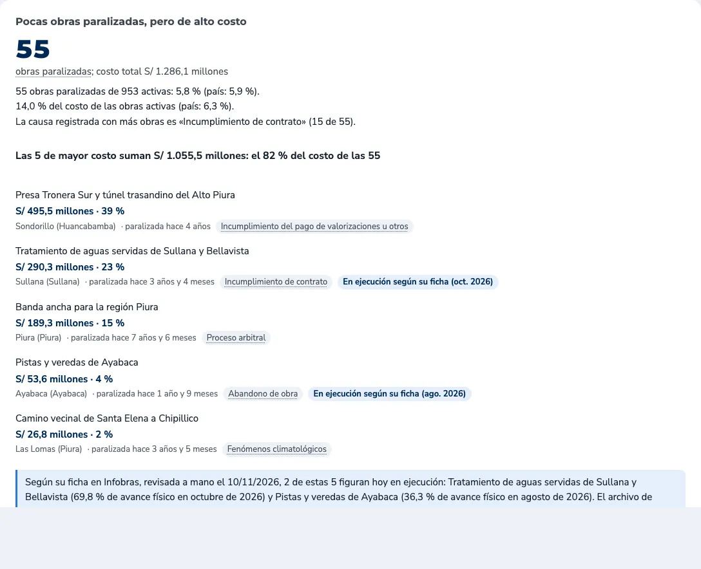
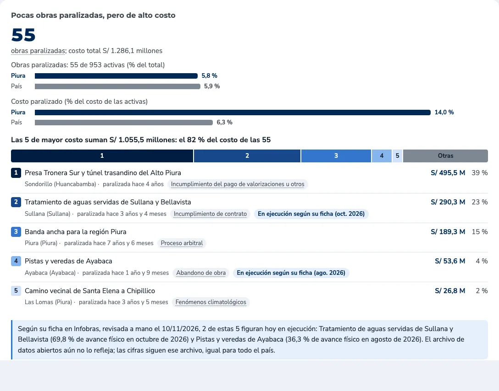
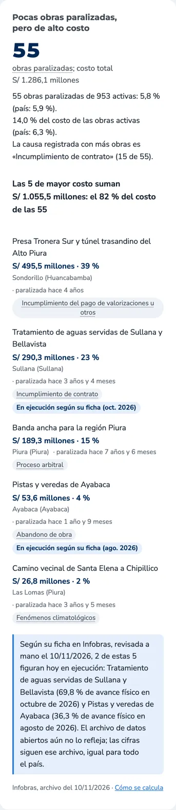
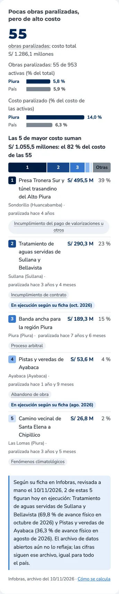
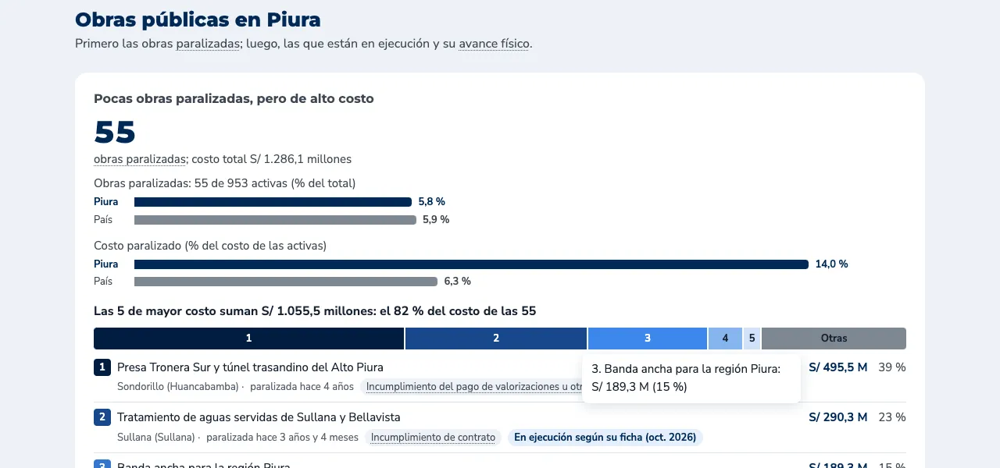
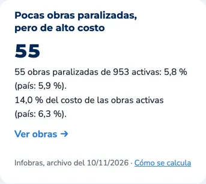
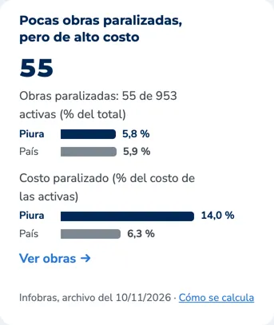
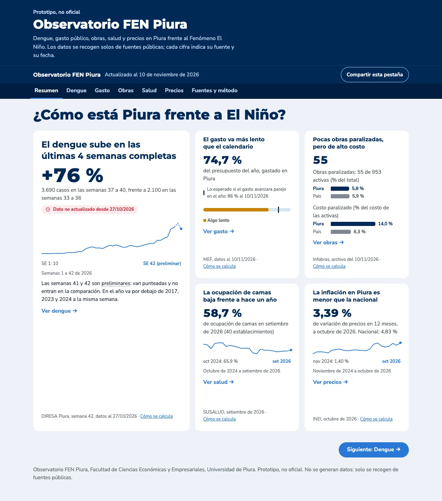

# Avance: ronda 11, rediseño del bloque de obras paralizadas

Fecha: 11 de noviembre de 2026. Los cambios están en el repositorio local, sin commit ni push. Falta tu revisión.

Para verla en local: `python3 -m http.server 8000 -d docs` y abrir http://localhost:8000/#obras.

## 0. Fechas de Infobras

Piura y el país ya salían del mismo archivo, el del 10/11/2026, desde la ronda 10, que está publicada. El pie dice «Infobras, archivo del 10/11/2026». El texto con dos fechas era una copia vieja guardada en el navegador. Ninguna cifra cambia:

- 55 obras paralizadas de 953 activas: 5,8 % en Piura y 5,9 % en el país.
- 14,0 % del costo de las activas en Piura y 6,3 % en el país.
- Las 5 de mayor costo suman S/ 1.055,5 millones, el 82 % de S/ 1.286,1 millones.

Son 953 activas y no 954 porque la Refinería de Talara se deja aparte en toda la página.

## A. Encabezado

- Se mantienen el título calculado, la cifra 55 y «costo total S/ 1.286,1 millones».
- Se quitó la línea «La causa registrada con más obras…», porque el gráfico de causas ya lo muestra.

## B. Piura frente al país: pares de barras

Las dos líneas de porcentajes se reemplazaron por dos pares de barras, en la pestaña Obras y en la tarjeta del Resumen.

- **Rótulos:**
  - «Obras paralizadas: 55 de 953 activas (% del total)». Así se conserva el conteo.
  - «Costo paralizado (% del costo de las activas)».
- **Escala común:** las cuatro barras van de 0 a 15 %, así que la barra del costo de Piura se ve más del doble de larga que la del país.
- **Colores:** Piura va siempre en azul marino y el país en gris. El rojo queda solo en la cifra, cuando Piura supera al país.
- **Rótulos y valores:** «Piura» o «País» va junto a cada barra y el valor al final. No hay ejes ni leyenda aparte.
- **Lector de pantalla:** recibe una sola frase con los cuatro valores.

## C. Concentración: barra apilada

Debajo del titular «Las 5 de mayor costo suman…» hay una barra del costo total de las 55.

- **Tramos:** 5 tramos, uno por obra, en azul marino de oscuro a claro, y un tramo gris «Otras» con las 50 restantes (S/ 230,6 millones, 18 %). Van separados por 2 px.
- **Números:** dentro de cada tramo va su número, 1 a 5, cuando cabe:
  - en 375 px caben el 1, el 2, el 3 y «Otras»;
  - en 1280 px caben todos.
- **Detalle:** al pasar el cursor, al tocar o al llegar con el teclado, se muestran el nombre corto y el monto en la misma ventana que las definiciones. Esc la cierra.
- **Paleta:** se validó con el validador de dataviz.
  - Entre tramos vecinos, la diferencia es ΔE ≥ 15 con visión normal y ≥ 14 con daltonismo.
  - El número de cada tramo tiene contraste ≥ 4,5:1, en blanco sobre los oscuros y en tinta sobre los claros.
  - Para lograrlo, el primer tramo usa el azul marino más oscuro de la paleta (#001d40).
- **Espacio:** se quitó el espacio vacío entre el titular, la barra y la lista.

## D. Lista compacta

- **Línea 1:**
  - una muestra del color del tramo con su número;
  - el nombre corto;
  - a la derecha, el monto («S/ 495,5 M») y el porcentaje («39 %»), en columnas, con cifras tabulares.
- **Línea 2, más tenue:** distrito (provincia), el tiempo paralizada y la causa como etiqueta. En Sullana y Ayabaca sigue además la etiqueta «En ejecución según su ficha».
- **Filas:** van separadas por una línea fina.
- **En 375 px:**
  - el monto y el porcentaje siguen a la derecha;
  - el nombre salta de línea, sin cortarse;
  - la línea 2 usa todo el ancho.

## E. Monto pendiente: no se agregó

El archivo de Infobras trae «Monto de valorización Ejecutado Acumulado» y «Monto de ejecución financiera». Con el valorizado, el pendiente sería:

| # | Obra | Costo (ET) | Valorizado acumulado | Pendiente | Mes del dato |
|---|---|---:|---:|---:|---|
| 1 | Presa Tronera Sur y túnel trasandino | S/ 495,5 M | 88,2 M | 407,4 M | nov. 2022 |
| 2 | Aguas servidas de Sullana y Bellavista | 290,3 M | 164,1 M | 126,2 M | feb. 2026 |
| 3 | Banda ancha para la región Piura | 189,3 M | S/ 0,01 | 189,3 M | dic. 2025 |
| 4 | Pistas y veredas de Ayabaca | 53,6 M | 0,6 M | 53,0 M | jul. 2025 |
| 5 | Camino vecinal Santa Elena–Chipillico | 26,8 M | 1,1 M | 25,6 M | set. 2023 |
| | **Las 55** | **1.286,1 M** | **375,4 M** | **910,7 M** | de 2018 a 2026 |

No es confiable, por cuatro razones:

1. **Fechas distintas.** Cada obra informa en una fecha distinta, entre 2018 y 2026, así que el total mezcla fechas.
2. **Valor de relleno.** La banda ancha registra S/ 0,01.
3. **Sullana no cuadra.**
   - Su ejecución financiera (305,4 M) supera su costo (290,3 M).
   - Su ficha da 69,8 % de avance en octubre de 2026, pero el archivo tiene el dato de febrero.
4. **Obra 71901.** Tiene un valorizado mayor que su costo.

Como acordamos, no se muestra.

## F. Verificación

- **Pruebas** (`scripts/test_pagina.py`): pasan.
  - Hay una prueba nueva: la barra tiene 6 tramos, sus anchos suman el total, y al tocar el primero se abre «1. Presa Tronera Sur…».
  - En una corrida, la prueba del aviso de datos viejos falló una vez y pasó al repetirla. No tiene relación con este cambio.
- **Cifras sin cambio:**
  - 55 obras y S/ 1.286,1 millones;
  - 82 %;
  - 39, 23, 15, 4 y 2 % para cada obra;
  - 5,8, 5,9, 14,0 y 6,3 % en la comparación con el país.
- **Revisión web-design-guidelines:**
  - Se agregaron un estado al pasar el cursor y `touch-action: manipulation` a los tramos.
  - Cada tramo es un botón con nombre accesible y foco visible.
- **Capturas:** se tomaron las 7 pestañas en 375 y 1280 px, sin errores en la consola.
- **Modo oscuro:** tiene tonos propios, también validados. La página hoy se fuerza a modo claro (`data-theme="light"`), así que no se ve.

Bloque, antes y después, en escritorio:

En celular:

Ventana de un tramo:

Tarjeta del Resumen:

