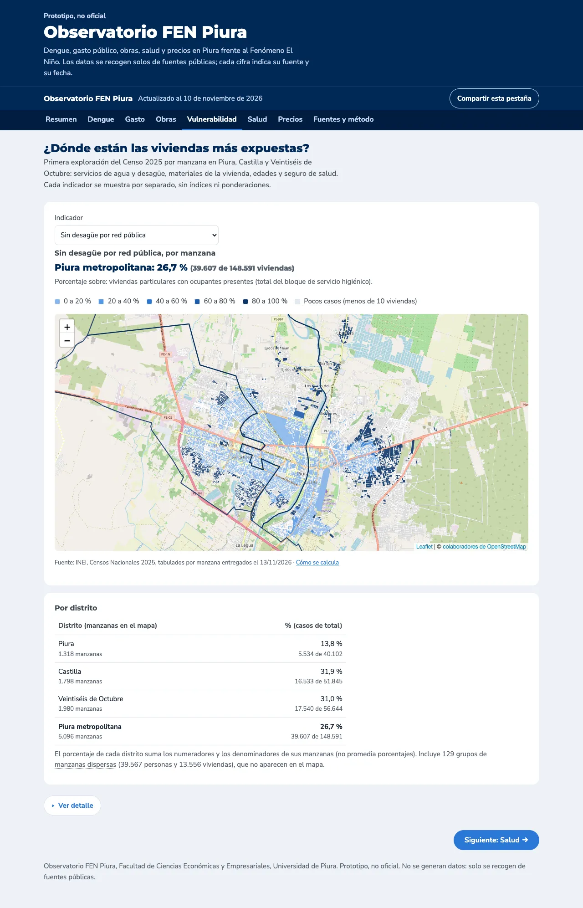
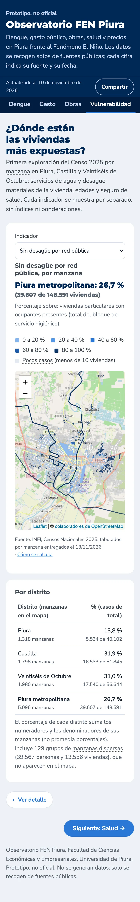
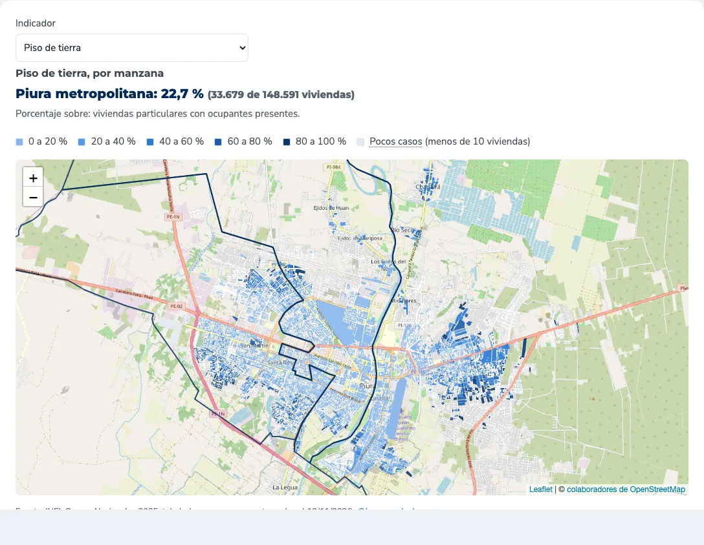
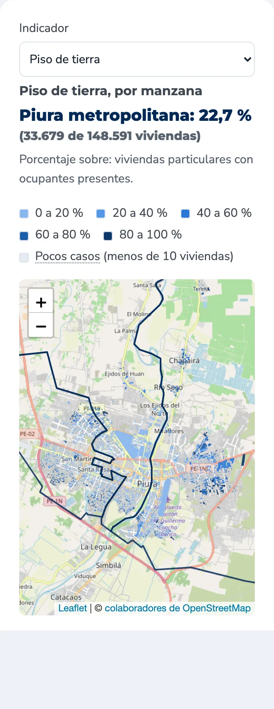
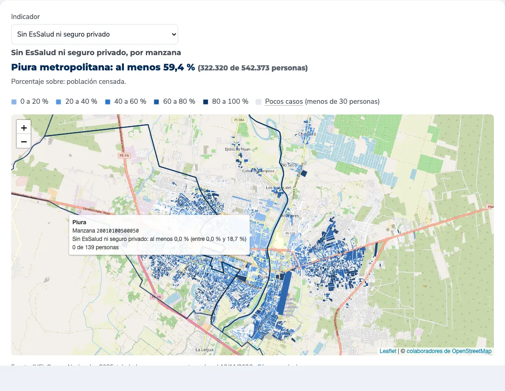
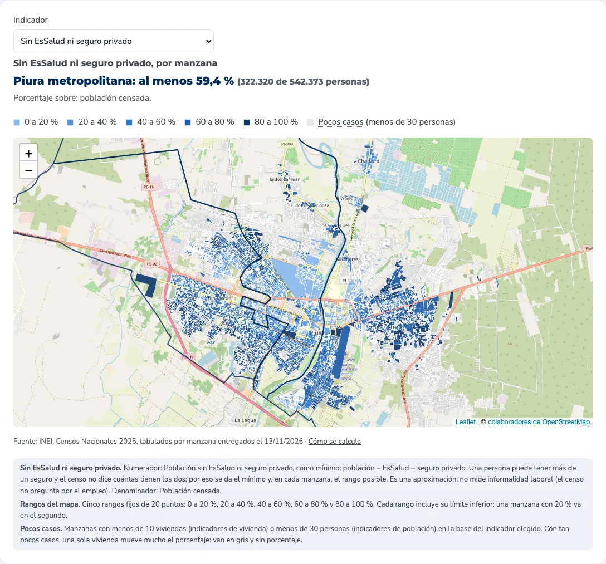
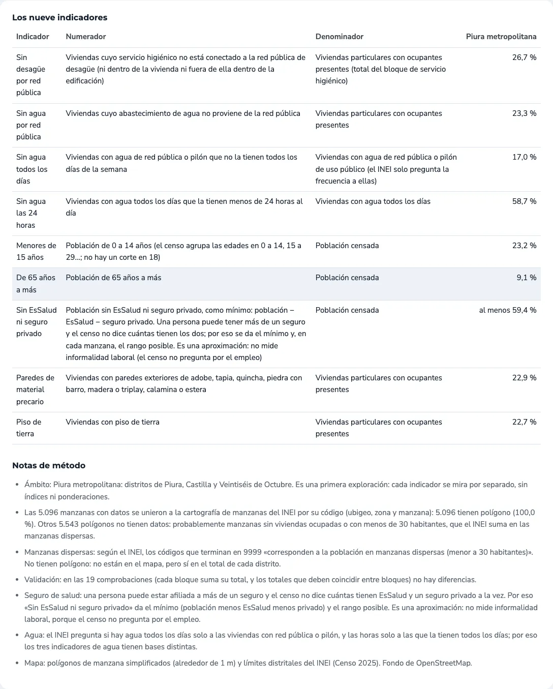

# Avance: ronda 12, pestaña Vulnerabilidad (Censo 2025 por manzana)

Fecha: 16 de noviembre de 2026. Los cambios tienen un commit local, sin push. Falta tu revisión.

Para verla en local: `python3 -m http.server 8000 -d docs` y abrir http://localhost:8000/#vulnerabilidad.

Es una primera exploración de los datos que pidió Germán: mapas por manzana de Piura metropolitana (Piura, Castilla y Veintiséis de Octubre), un indicador a la vez, sin índices ni ponderaciones.

## 0. Antes de empezar

- **Espacio en disco:** había 687 MB libres. Con `conda clean --all` y el borrado de los cachés de Spotify y pip (decisiones tuyas) quedaron 3,5 GB.
- **Librerías:** se instalaron geopandas, pyogrio, shapely y pyproj para leer la cartografía. La primera instalación subió numpy a 2.5 y rompió pandas en Anaconda; se volvió a numpy 1.26.4 con versiones compatibles. Las cuatro pruebas del proyecto pasan. Las librerías quedan anotadas en `requirements-local.txt`, aparte de `requirements.txt` para que GitHub Actions no las instale.

## A. Los datos del INEI

| Archivo | Qué trae |
| --- | --- |
| `tabulados/CPV 2025 - Pob viv hogar - Mz Agrupadas - Piura.xlsx` | Hojas POBLACION (116 columnas), VIVIENDA (106) y HOGAR (59), 18 339 manzanas de la región. Encabezado en las filas 5 a 8, datos desde la fila 10 y de 4 a 7 filas de notas al pie |
| `cartografia/manzanas/base MANZANA CPV2025.gdb` | Una capa, `TB_MANZANA_15072026`: 665 661 manzanas de todo el país en WGS84 (EPSG:4326). No trae un campo llave único: la llave es `UBIGEO + ZONA + MANZANA` |
| `cartografia/distritos/Límites distritales - CPV2025/DISTRITOS26.shp` | 1893 distritos en WGS84, con `UBIGEO`. El archivo está en esa subcarpeta, no directamente en `distritos/` |

- **Llave:** el código de manzana tiene 14 caracteres, o 15 cuando la manzana lleva letra (por ejemplo `20010100100012B`, también con Ñ) y en las dispersas. Se forma con ubigeo (6), zona (5) y manzana (3 o 4).
- **Ubigeos, verificados en los datos:** Piura `200101`, Castilla `200104` y Veintiséis de Octubre `200115`.
- **Columnas:** el script las ubica por el texto completo de su encabezado, no por su posición. Si el INEI cambia un texto, se detiene con un mensaje.

## B. Validaciones

En las 5225 filas de los tres distritos, las 19 comprobaciones dan **cero diferencias**:

- **13 bloques suman su total:** sexo, grupos de edad, paredes, techos, pisos, abastecimiento de agua, distribución por red pública, agua todos los días, horas (con agua diaria), días y horas (con agua algunos días), servicio higiénico y energía eléctrica.
- **6 cruces entre bloques:**
  - el total de distribución es igual a red pública;
  - el total de la pregunta de agua todos los días es igual a red pública + pilón;
  - el total con agua diaria es igual a «Sí»;
  - el total con agua algunos días es igual a «No»;
  - el total de servicio higiénico es igual a las viviendas con ocupantes presentes;
  - «al menos un seguro» + «sin seguro» es igual a la población.
- **Seguros:** no son excluyentes. La suma de los tipos supera a «al menos un seguro» en 17 045 personas (ver la sección D).

## C. Unión con la cartografía

- **Tasa de coincidencia: 100 %.** Las 5096 manzanas con datos (sin contar las dispersas) tienen polígono, y no hay manzanas sin pareja.
- **5543 polígonos sin datos.** Por la forma de los códigos, son probablemente manzanas sin viviendas ocupadas o con menos de 30 habitantes, que el INEI suma en las dispersas. No se dibujan.
- **Manzanas dispersas (9999):** son 129 grupos, con 39 567 personas (7,3 %) y 13 556 viviendas (9,1 %). Según la nota del INEI, «corresponden a la población en manzanas dispersas (menor a 30 habitantes)». No están en el mapa, pero sí en el total de cada distrito (decisión Q7).
- **Archivo:** `docs/data/censo_piura.json`, 1,81 MB, GeoJSON en WGS84. Los polígonos se simplificaron a alrededor de 1 m. Además de cada manzana, el archivo trae los límites de los tres distritos según el censo, los totales por distrito, las definiciones y las validaciones.

## D. Indicadores (confirmados en la ronda de preguntas)

| | Indicador | Numerador | Denominador | Piura metro | Piura | Castilla | 26 de Octubre |
|---|---|---|---|---|---|---|---|
| a | Sin desagüe por red pública | Servicio higiénico total − red dentro − red fuera dentro de la edificación | Total de servicio higiénico (= viviendas con ocupantes) | 26,7 % | 13,8 % | 31,9 % | 31,0 % |
| b | Sin agua por red pública | Viviendas con ocupantes − red pública | Viviendas con ocupantes | 23,3 % | 13,0 % | 29,4 % | 24,9 % |
| c | Sin agua todos los días | «No» | Viviendas con red pública o pilón | 17,0 % | 13,1 % | 15,2 % | 21,7 % |
| d | Sin agua las 24 horas | Con agua diaria − 24 horas | Con agua todos los días | 58,7 % | 59,8 % | 64,7 % | 52,0 % |
| e | Menores de 15 años | 0 a 14 años | Población | 23,2 % | 20,3 % | 23,8 % | 24,7 % |
| f | De 65 años a más | 65 a más | Población | 9,1 % | 12,2 % | 8,0 % | 7,8 % |
| g | Sin EsSalud ni seguro privado | Población − EsSalud − privado (mínimo) | Población | ≥ 59,4 % | ≥ 49,3 % | ≥ 61,2 % | ≥ 65,2 % |
| h | Paredes de material precario | Adobe, tapia, quincha, piedra con barro, madera, triplay/calamina/estera | Viviendas con ocupantes | 22,9 % | 12,5 % | 23,9 % | 29,4 % |
| i | Piso de tierra | Tierra | Viviendas con ocupantes | 22,7 % | 10,8 % | 27,5 % | 26,6 % |

- **Sentido de los indicadores:** a, b, c y d se expresan como carencia, para que en todo el mapa más oscuro signifique más vulnerable.
- **Indicador g:** su valor real está entre 59,4 % y 62,3 % en Piura metropolitana. El mapa usa el mínimo, rotulado «al menos», y la ventana de cada manzana da el rango. La nota dice que es una aproximación y que no mide informalidad laboral.

## E. La pestaña

Va después de Obras, con el título «¿Dónde están las viviendas más expuestas?». Es una pregunta porque no hay una regla que diga el hallazgo.

- **Mapa en Leaflet:**
  - Reutiliza `cargarLeaflet()` y `mapaBase()`; a `mapaBase()` se le agregó la opción de no dibujar los distritos de 2007.
  - Las manzanas se dibujan en canvas y sin borde.
  - Encima van los límites distritales del censo, que sí separan Veintiséis de Octubre.
  - El encuadre toma el 96 % central de las manzanas. Si toma todas, las rurales de Castilla alejan tanto el mapa que la ciudad casi no se ve.
- **Selector** con los 9 indicadores.
- **Colores:** cinco rangos fijos (0 a 20 … 80 a 100 %; cada rango incluye su límite inferior), en una escala nueva, `--v1` a `--v5`, validada con dataviz (`--ordinal`).
  - No se usó la escala `--q`, porque su paso más claro (1,29:1 sobre blanco) desaparecía en manzanas pequeñas.
  - «Pocos casos» va en el gris `--neutro`, que se distingue de cada azul con ΔE de 16,7 o más incluso con daltonismo.
- **«Pocos casos»** se decide por el denominador del indicador elegido: menos de 10 viviendas o menos de 30 personas. La ventana de esas manzanas no da porcentaje, solo «pocos casos (n viviendas)».
  - En los indicadores de población no hay ninguna manzana gris, porque el INEI ya agrupó las de menos de 30 habitantes.
  - En la mayoría de los de vivienda hay 214.
  - En «Sin agua las 24 horas» son 1613 (32 %), porque pocas viviendas tienen agua todos los días.
  - En «Sin agua todos los días» son 1143.
- **Ventana de la manzana:** distrito, código, porcentaje y «n de N viviendas» (o personas). Se abre al pasar el cursor; en celular, al tocar.
- **Tabla por distrito:** el porcentaje suma numeradores y denominadores, y el número de manzanas va debajo del nombre del distrito. En celular quedó en dos columnas para que quepa sin desplazarse. Cuenta en una nota cuántas manzanas dispersas incluye.
- **Pie:** «Fuente: INEI, Censos Nacionales 2025, tabulados por manzana entregados el 13/11/2026 · Cómo se calcula», con el numerador y el denominador del indicador, los rangos y la regla de «Pocos casos».
- **Detalle:** tabla de los 9 indicadores y notas de método (coincidencia, dispersas, validación, seguros, bases distintas del agua y simplificación del mapa).
- **Fuentes y método:** una fila nueva en la tabla y un criterio nuevo. Para no pasar de 15 filas visibles (regla de la página), las dos fuentes pendientes (vacunación y SISAP) quedaron juntas en una fila.
- **Carga:** el archivo se descarga solo al abrir la pestaña. Si se entra directamente a `#vulnerabilidad`, espera a la carga inicial para escribir bien «Veintiséis».

## F. Pruebas

- **`scripts/test_censo_inei.py`:** revisa el archivo de salida, sin necesitar los datos del INEI:
  - porcentajes de 0 a 100 y mínimo ≤ máximo en seguros;
  - totales por distrito iguales a manzanas + dispersas;
  - validaciones en cero, coincidencia de 99 % o más, menos de 3 MB y coordenadas en WGS84.
  - Se agregó al workflow diario (`actualizar.yml`).
- **`scripts/test_pagina.py`:** suma la pestaña nueva a las demás (8 pestañas en 1280 y 375 px, sin desplazamiento lateral ni errores) y revisa en ella:
  - que el mapa se dibuje en canvas;
  - que la leyenda tenga 6 elementos;
  - que el total de la tabla sume numeradores y denominadores;
  - que el corte en 20 % caiga en el segundo rango y el 100 % en el quinto;
  - que una manzana con 3 viviendas salga gris y sin porcentaje.
- Las 5 pruebas del proyecto pasan.

## G. Capturas

## H. Decisiones pendientes

1. **Teclado en el mapa.** El selector, la tabla, los términos y «Cómo se calcula» funcionan con teclado, y el mapa se mueve con las flechas. Pero no se puede llegar con teclado al dato de una manzana: son más de 5000 polígonos en canvas. ¿Basta con la tabla por distrito o agregamos un buscador por código de manzana?
2. **«Sin agua las 24 horas»:** un tercio de las manzanas sale en gris. ¿Lo dejamos así, bajamos el umbral para este indicador o lo cambiamos por «Sin agua las 24 horas, todos los días» sobre las viviendas con red pública o pilón (numerador = sin agua diaria + con agua diaria por menos de 24 horas)?
3. **Hoja HOGAR:** no se usó. Trae régimen de tenencia, combustible para cocinar y baño de uso exclusivo, por si interesan más adelante.
4. **Polígonos sin datos (5543):** su explicación es una inferencia; solo el INEI la puede confirmar.
5. **Resumen:** la pestaña no tiene tarjeta en la portada (decisión Q9).
6. **Resto de la región:** el Excel trae toda la región Piura; el script se puede extender a otros distritos cambiando la lista `DISTRITOS`, pero el archivo pesaría más.
