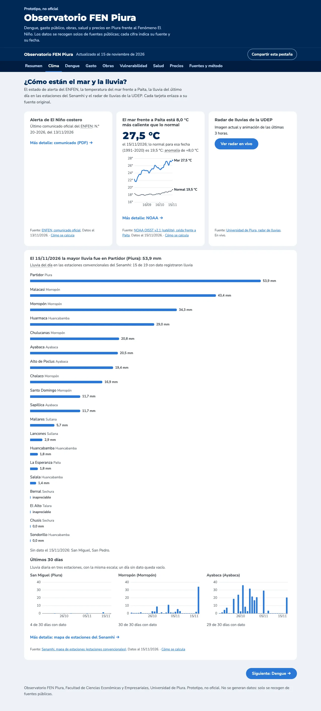
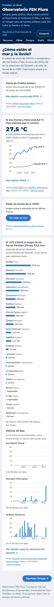
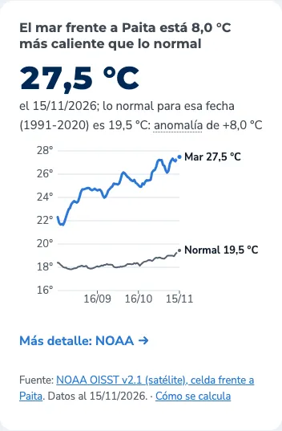
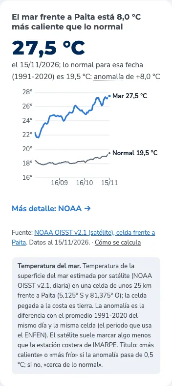
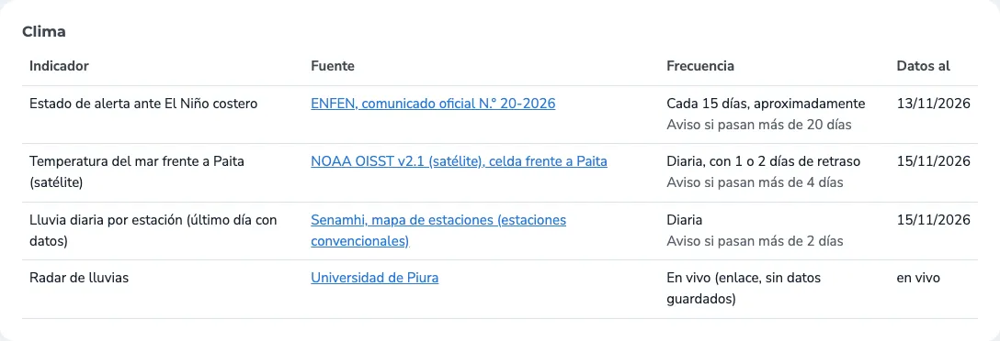

# Avance: ronda 13, pestaña Clima

Fecha: 16 de noviembre de 2026. Los cambios tienen un commit local, sin push. Falta tu revisión.

Para verla en local: `python3 -m http.server 8000 -d docs` y abrir http://localhost:8000/#clima.

## Lo decidido

- **Ubicación:** una pestaña «Clima» en segundo lugar, entre Resumen y Dengue. La portada no cambia por ahora.
- **Tarjetas:** cuatro, con su pie «Fuente, datos al dd/mm/aaaa · Cómo se calcula» y un enlace «Más detalle» a la fuente original:
  1. el estado de alerta del ENFEN;
  2. la temperatura del mar frente a Paita;
  3. el radar de lluvias de la UDEP;
  4. la lluvia del último día por estación, con las series de 30 días.
- **Scripts:** uno por fuente, como pasos opcionales (`continue-on-error`) de `actualizar.yml`, que corre a las 10:00. Si uno falla, no escribe nada y la tarjeta sigue mostrando el último dato con su fecha.
- **Aviso «Dato no actualizado»:** a los 2 días en la lluvia, a los 4 en la temperatura del mar y a los 20 en el ENFEN.

## 1. Radar de lluvias de la UDEP

- **Contenido:** una tarjeta con la descripción que da la propia página («Imagen actual y animación de las últimas 3 horas») y el botón «Ver radar en vivo», que abre https://ecrmm.udep.edu.pe/Radar/lluvia.html en otra pestaña.
- **Para incrustarlo cuando den permiso:** en `docs/index.html`, cambiar `const RADAR_IFRAME = false;` a `true`. La tarjeta muestra entonces el radar (iframe con `loading="lazy"` y título accesible) y deja el botón debajo.
- **Cabeceras:** el servidor del radar no envía `X-Frame-Options` ni `Content-Security-Policy`, así que técnicamente se puede incrustar.

## 2. Lluvia (Senamhi)

### Opciones revisadas (desde una conexión peruana)

| Fuente | Formato | ¿Sirve? |
| --- | --- | --- |
| Ventana de cada estación en el mapa (`mapas/mapa-estaciones-2/map_red_graf.php?cod=…`) | HTML con los datos de un gráfico | **Sí.** Sin captcha ni bloqueos (83 pedidos seguidos sin problemas). Las convencionales traen la lluvia diaria de unos 31 días; las automáticas, solo las últimas 24 h corridas |
| Lista de estaciones (HTML del mapa) | Objetos JSON dentro del HTML | Sí: 985 estaciones con código, categoría, coordenadas y estado |
| Tabla mensual por estación | Formulario HTML | **No:** pide un captcha (Cloudflare Turnstile) |
| Descarga de históricos | — | **No:** pide registrarse |
| datosabiertos.gob.pe (estaciones automáticas) | CSV de 50 MB | No: los datos llegan solo hasta junio de 2024 |
| `robots.txt` | — | No existe (da 404); no encontré términos de uso |

- **Qué se usó:** las estaciones convencionales al día (estado «REAL») de Piura. Son 21, de las que 19 tienen dato del 15/11. Se confirma que cada una es de Piura con el texto «Dep.: PIURA» de su ventana.
- **Qué se descartó:** las automáticas, porque sus «24 h» dependen de la hora de la consulta, y las «diferidas», que llegan con un mes de retraso.
- **Barras:** la lluvia del último día con datos, de mayor a menor. Las estaciones sin dato van aparte, nunca como 0.
- **Series:** 30 días de calendario, con la misma escala, de San Miguel (ciudad de Piura, código 105063), Morropón (105106) y Ayabaca (104058).
- **Título (regla fija):** nombra la estación con más lluvia; si ninguna llovió, lo dice.
- **Resultado:** `scripts/lluvia_senamhi.py` → `docs/data/lluvia_piura.json` (14 KB). Si lee menos de 10 estaciones o cambia el formato de la página, se detiene sin guardar.

## 3. Temperatura del mar en Paita

| Fuente | ¿Sirve? |
| --- | --- |
| IMARPE (estaciones costeras) | No: 403 con un desafío de Cloudflare |
| DHN (boletín diario) | No: pide una verificación de persona |
| ENFEN (informe técnico) | Trae Paita, pero dentro de un PDF de 16 MB y cada 15 días |
| **NOAA OISST v2.1 (satélite)**, servidor OPeNDAP de NOAA PSL | **Sí, fuente principal.** Diario, con 1 día de retraso |
| NOAA Coral Reef Watch (satélite, 5 km) | **Sí, respaldo.** Diario, con 2 días de retraso; se probó la lectura |

- **Celda:** 5,125° S y 81,375° O, unos 25 km mar adentro; la celda más pegada a la costa es tierra.
- **Anomalía:** la calculo contra el promedio diario 1991-2020 del mismo OISST, el periodo que usa el ENFEN. El archivo de NOAA trae su propia anomalía, pero contra 1971-2000, y daba +7,4 °C.
- **15/11/2026:** 27,5 °C, frente a 19,5 °C normales: **+8,0 °C**. El informe técnico N° 20 del ENFEN da +8,6 °C en la estación costera de Paita (1 al 9 de noviembre); el satélite marca algo menos, y la nota lo dice.
- **Gráfico:** 90 días, con la temperatura y la línea de lo normal.
- **Título (regla fija):** «más caliente» o «más frío» que lo normal si la anomalía pasa de 0,5 °C; si no, «cerca de lo normal».
- **Detalle técnico:** el promedio 1991-2020 se pide en 4 tramos, porque pedido de una vez el servidor tarda más de 60 s y responde con error 502. Se guarda en el JSON y no se vuelve a pedir.
- **Resultado:** `scripts/tsm_paita.py` → `docs/data/tsm_paita.json` (8 KB).

## 4. Estado de alerta del ENFEN

- **De dónde sale:** de la portada del ENFEN, que enlaza el último comunicado oficial (PDF). Del encabezado del PDF se leen el número, la fecha y el estado. Hoy: **Alerta de El Niño costero**, comunicado N° 20-2026 del 13/11/2026.
- **El RSS del sitio no sirve:** va atrasado y su último comunicado es el N° 19.
- **Resultado:** `scripts/enfen.py` → `docs/data/enfen.json`.

## 5. Cambios en la página

- **Gráficos por día:** `graficoMeses()` ahora admite días, un eje que no parte de 0, una escala común a varios gráficos y días sin dato. Los gráficos mensuales de siempre no cambian.
- **Fuentes y método:**
  - una tabla «Clima» aparte, para que ninguna tabla pase de 15 filas;
  - las reglas de los títulos;
  - en el glosario: ENFEN, temperatura del mar, anomalía y lluvia del día.
- **Actualizado al:** la barra superior ahora considera también las fuentes del clima.

## 6. Pruebas

- **`scripts/test_clima.py` (sin red, también en el workflow), con textos de ejemplo:**
  - un día sin dato queda como null y no como 0;
  - una estación de otro departamento queda fuera;
  - si la página cambia, falla en vez de guardar ceros;
  - el valor de relleno de OPeNDAP no se toma como dato;
  - número, fecha y estado del comunicado se leen bien.
- **`scripts/test_pagina.py`:** suma la pestaña nueva (9 pestañas en 1280 y 375 px) y revisa:
  - que haya 4 tarjetas y 3 «Más detalle»;
  - que esté el botón del radar;
  - que se dibujen las 3 series;
  - que haya una barra por estación con dato;
  - la regla del título del mar;
  - que, si falta la temperatura del mar, esa tarjeta diga que no cargó y las demás sigan.
- Las 6 pruebas del proyecto pasan.

## 7. Capturas

## 8. Pendientes y riesgos

1. **¿GitHub Actions llega al Senamhi y al ENFEN?** Solo se sabrá en la primera ejecución después del push; el resumen del workflow dirá qué paso falló. Los dos son servidores del Estado peruano, como Infobras y SUSALUD, que no responden a GitHub. Si fallan, decidimos con esa evidencia (pasarlos a `actualizar_local.sh` o dejar solo el enlace). NOAA es de EE. UU. y no debería tener ese problema.
2. **Estación de la ciudad de Piura:** San Miguel publica un dato por semana, no por día (4 de los últimos 30 días). Miraflores (Castilla) tiene un retraso de dos semanas. ¿La cambiamos por Chulucanas, que es diaria pero no está en la ciudad, o la dejamos con su nota «4 de 30 días con dato»?
3. **Hora de corte del día y valores de 0,01 mm:** el Senamhi no publica en esa página si el día va de 7:00 a 7:00, ni qué significa 0,01 mm. Se muestra como «inapreciable» y no cuenta como lluvia. Conviene preguntárselo al Senamhi.
4. **Permiso del radar:** cuando llegue, se cambia una línea (`RADAR_IFRAME`).
5. **Lectura frágil:** si el Senamhi o el ENFEN cambian su página, el script falla con un mensaje y la tarjeta conserva el último dato.
