# Avance: ronda 15, correcciones y rediseño de Vulnerabilidad y Clima

Fecha: 17 de noviembre de 2026. Los cambios tienen un commit local, sin push. Falta tu revisión.

Para verla en local: `python3 -m http.server 8000 -d docs` y abrir http://localhost:8000/#vulnerabilidad y http://localhost:8000/#clima.

## A. Diagnóstico del mapa por manzanas

**La causa no era un nulo ni un 0/0.** El campus de la UDEP y el aeropuerto están dentro de manzanas reales del INEI, trazadas de calle a calle, que sí tienen viviendas en los tabulados. El color cubría toda la manzana.

| Revisión | Resultado |
| --- | --- |
| Campus de la UDEP | Manzana `20010100300059`, **con pareja** en los tabulados: 280 viviendas, 875 personas, **1,43 km²**. Son 195 viviendas por km²; la mediana de las demás es de 6332 |
| Aeropuerto | Manzana `20010401400006A`, con pareja: 159 viviendas en 1,02 km². La pista no cae en ninguna manzana con datos |
| Polígonos frente a tabulados (3 distritos) | 10 639 polígonos: 5096 con pareja y 5543 sin pareja. Los sin pareja no se dibujan (ya era así) |
| Polígonos sin pareja | El 98 % (5438) está en zonas que tienen un grupo de manzanas dispersas (9999). Cuadra con manzanas de menos de 30 habitantes que el INEI sumó en esos grupos |
| Denominador 0 | 8 manzanas con 0 viviendas; 546 en «sin agua todos los días» y 699 en «sin agua las 24 horas». Iban en gris («Pocos casos»), **no** como 0 %. Ahora no se dibujan |
| Unión | Correcta: todo es texto, zona de 5 dígitos, manzana de 3 o 4 con letra (y Ñ), sin duplicados. Normalizar ceros o mayúsculas no agrega ninguna pareja |
| Manzanas muy extensas | Con más de 0,05 km² y menos de 1000 viviendas por km² hay **24**: cubren 4,9 de 31,4 km² del área pintada, pero tienen solo 1085 viviendas (0,7 %) |
| Caso raro | La manzana `20010101400055B` tiene 0 viviendas con ocupantes y 234 personas; probablemente es vivienda colectiva. Solo aparece en los indicadores de población |

**Corrección (decisión Q1):**
- Las 24 manzanas extensas se dibujan solo con contorno punteado y dicen por qué al pasar el cursor.
- No entran en los hexágonos, pero sí en el total de cada distrito.
- Las de denominador 0 no se dibujan; «Pocos casos» sigue en gris.

**Pruebas nuevas:**
- **`test_censo_inei.py`:** el campus y el aeropuerto son extensas; cada extensa cumple la regla; ninguna manzana grande y vacía queda sin marca; ningún numerador mayor que 0 sobre 0. Calcula el área sin librerías externas, así que corre también en GitHub Actions.
- **`test_pagina.py`:** no se dibuja nada con denominador 0, y las extensas van sin relleno.

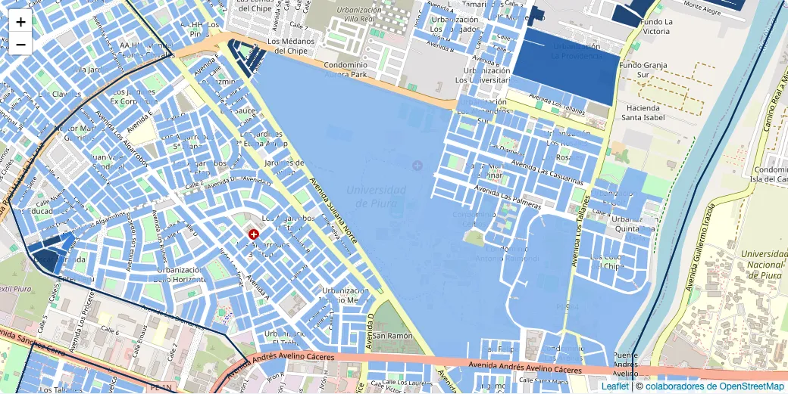
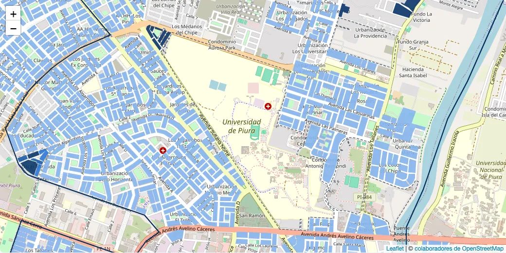
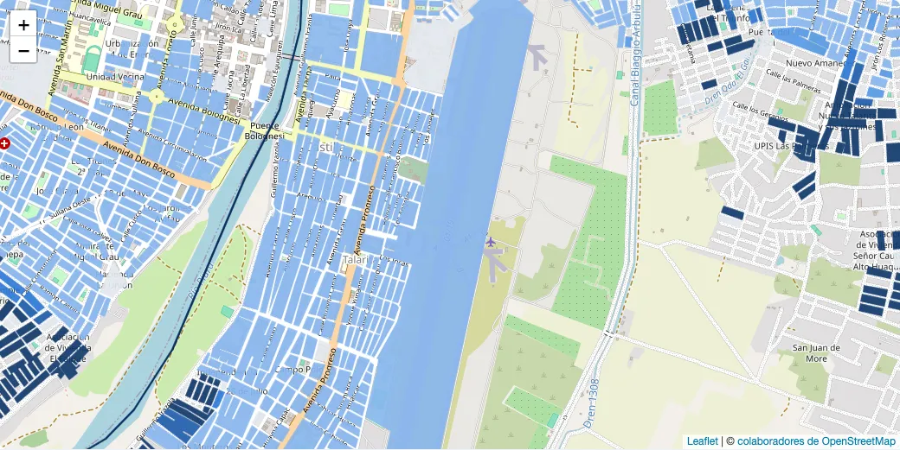
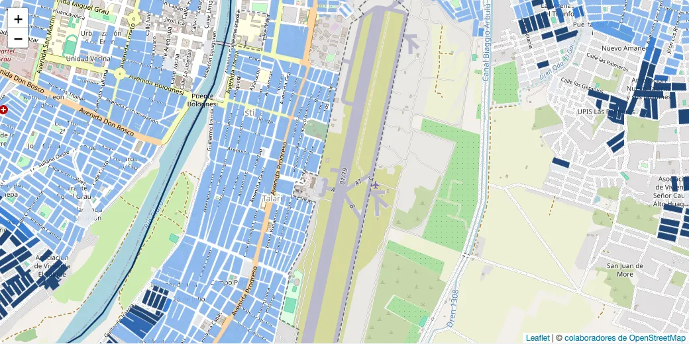

## B. Vulnerabilidad más fácil de leer

1. **Hexágonos H3, resolución 9.**
   - Miden unos 350 m (arista media de 201 m); la resolución 8 medía unos 900 m.
   - Son 599 sectores. Cada manzana va al hexágono donde cae su centroide, y se suman numeradores y denominadores. La prueba confirma que la suma de los hexágonos es igual a la de sus manzanas.
   - No se dibujan los de menos de 30 viviendas (o personas) en la base del indicador.
   - Con zoom 16 o más se ven las manzanas.
2. **Paleta de calor:** `#f89d15` → `#640000`, generada en OKLCH.
   - Pasa `--ordinal` de dataviz: tono dentro de 40°, claridad monótona, saltos de 0,06 o más y el paso más claro a 2:1 o más sobre blanco. Con daltonismo, los vecinos se separan con ΔE de 9 o más.
   - **Diferencia con lo pedido:** empieza en ámbar, no en amarillo pálido, que llega solo a 1,3:1 y se perdería sobre el mapa.
3. **Tres frases generadas de los datos:**
   - el distrito más alto (por ejemplo, «En Castilla, 1 de cada 3 viviendas no tiene desagüe por red pública (31,9 %)»);
   - el más bajo;
   - el total.
   - Cada indicador tiene su sujeto y su verbo en singular y en plural; el de seguro dice «al menos».
4. **Los 5 sectores críticos:**
   - Son los que superan el porcentaje de Piura metropolitana, ordenados por número de afectados.
   - Los nombres vienen de OpenStreetMap (Overpass, una consulta al procesar el censo; 535 de 599 sectores tienen nombre). Se toma la zona residencial que contiene el centro; si no hay, el barrio a menos de 400 m; si no, «cerca de [vía]» a menos de 300 m.
   - Cada nombre es un botón que lleva el mapa al sector, también con teclado.
   - Overpass rechaza los agentes que imitan un navegador (406): el script se identifica como `observatorio-fen-piura/1.0`.
5. **«Ver: Porcentaje | Número de viviendas afectadas»** (decisión Q3: hexágonos por número, sin mapa de calor).
   - Cortes: 25, 50, 100 y 200 viviendas; en población, 75, 150, 300 y 600 personas.
   - Una nota dice que esa vista muestra concentración, no porcentaje.
6. **«Ver por distrito»:** la tabla pasó a un desplegable y conserva la nota de manzanas dispersas.

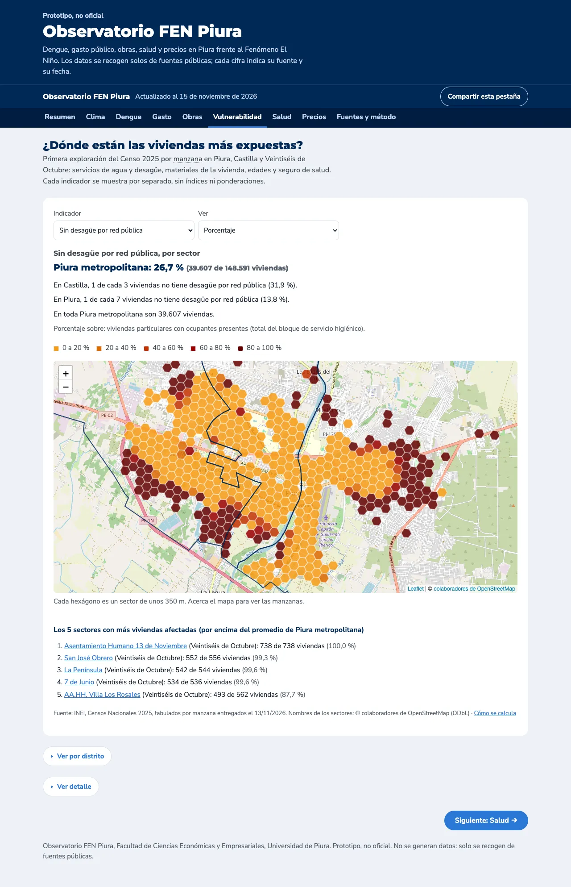
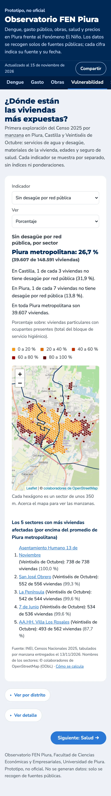
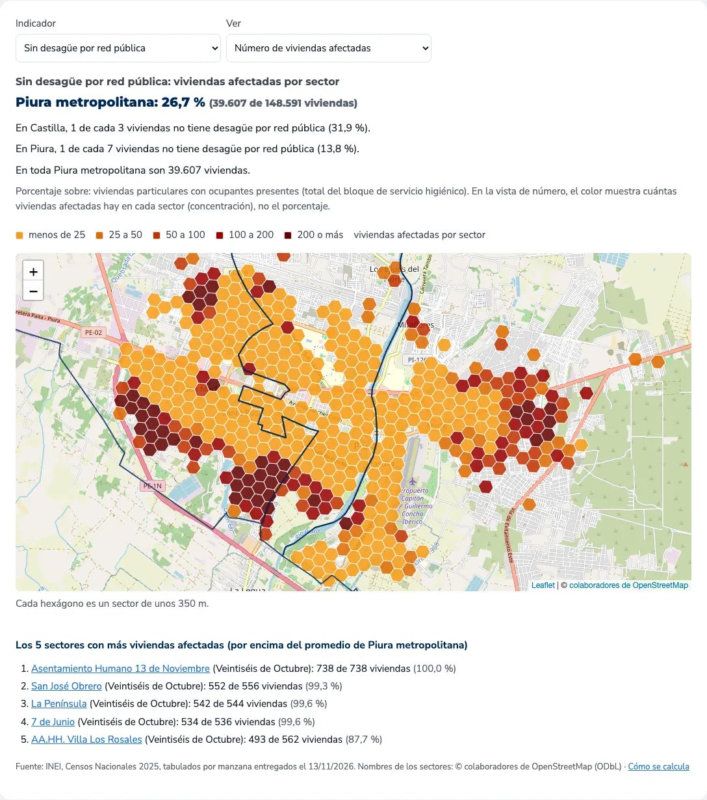
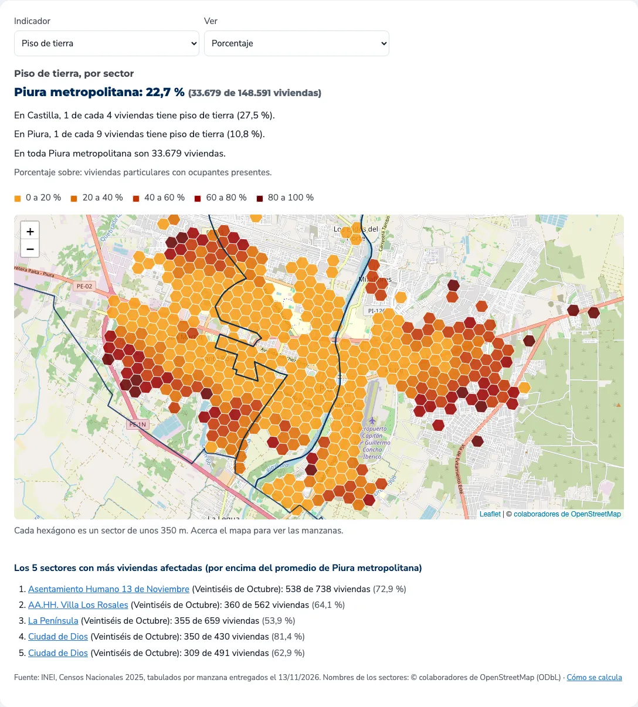
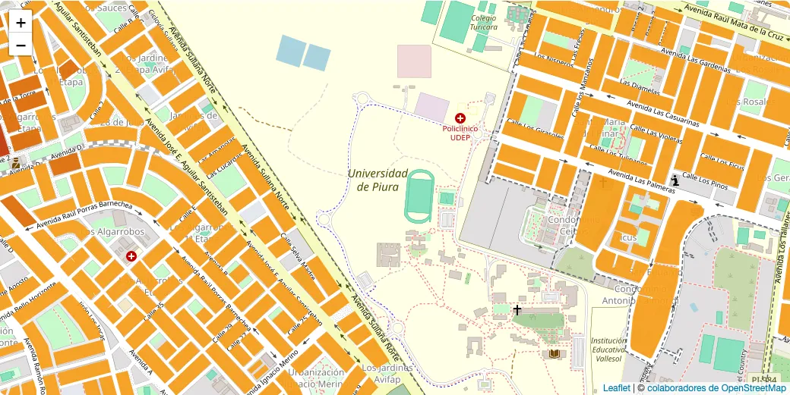

## C. Clima

1. **Lluvia como mapa.**
   - **Estaciones:** el Senamhi como círculos con el color de su clase y el tamaño según los mm; la cifra va junto a las 5 con más lluvia.
   - **Escala:** 0 (menos de 1 mm, círculo blanco), 1-5, 5-10, 10-20, 20-50 y más de 50 mm. Sin dato, contorno punteado. Al costado, el top 5 en texto.
   - **Fondo IMERG** (`scripts/imerg_piura.py` y workflow `imerg.yml`): **IMERG Early (V07)**. El Late sale unas 14 h después y no llegaría a tiempo; el Early, unas 4 h después.
   - **Ventana:** suma las 48 medias horas de 12:00 a 12:00 UTC, que es de 7:00 a 7:00 de Lima. Por eso corre aparte, a las 12:30 de Lima. La nota del mapa dice si la ventana coincide con la del día de las estaciones.
   - **Recorte:** solo las celdas dentro del departamento (límites de `piura_distritos.json`).
   - **Token:** se lee del secreto `EARTHDATA_TOKEN` y solo viaja en la cabecera; no se escribe ni se imprime.
   - **Si IMERG falla o está viejo,** el mapa sigue con las estaciones y lo dice.
   - **Leyenda:** distingue «medido en estación» de «estimación satelital».
2. **Serie de la ciudad: Bernal** (código 105012). Ninguna estación convencional de la ciudad publica a diario: San Miguel tiene 4 de 30 días.
   - Bernal tiene 30 de 30, está a 31 km, en el Bajo Piura, la misma cuenca que la ciudad.
   - Alternativas revisadas: Mallares (39 km, valle del Chira) y Chulucanas (52 km).
   - El gráfico la rotula «Bernal (Sechura; Bajo Piura, a 31 km de la ciudad de Piura)».
3. **ENFEN a mano:** `docs/data/enfen_comunicado.json`. Va en `docs/data/` y no en `data/`, porque la página se sirve desde `docs/`. Llenado con el comunicado **N.° 20-2026** (leído del PDF):
   - **estado:** «Alerta de El Niño costero» (etiqueta roja);
   - **magnitud:** «Extraordinaria»;
   - **horizonte:** «Hasta febrero de 2027; se debilitaría hasta julio de 2027»;
   - **puntos:** (1) «Lluvias sobre lo normal en la costa norte hasta enero, con episodios moderados a fuertes»; (2) «Caudales muy superiores a lo normal en los ríos Piura y Tumbes»; (3) «Temperatura del aire muy superior a lo habitual en la costa, con posibles récords en verano»;
   - **próximo comunicado:** 30/11/2026 (lo dice el PDF);
   - **url_pdf:** el enlace del comunicado sin `&refresh`.
   - **Cómo actualizarlo:** en `docs/actualizacion_local.md`.
   - **`enfen.py` ahora solo avisa:** falla si la portada del ENFEN tiene un comunicado más reciente que el del JSON.
   - **Gráfico Niño 1+2** (`scripts/nino12_cpc.py`): anomalía semanal de NOAA CPC (`wksst9120.for`), últimas 53 semanas, con el cero marcado y una línea punteada en +0,4 °C. La semana del 11/11/2026 marca +5,4 °C.
4. **Mar frente a Paita:**
   - **Satélite:** +8,0 °C.
   - **Estación costera de Paita (IMARPE):** +8,6 °C del 1 al 9 de noviembre, frente a 1991-2020, según el Informe Técnico ENFEN N.° 20, pág. 18. Está en el mismo JSON manual.
   - **Diferencia:** 0,6 °C, menos de 1 °C. La tarjeta muestra las dos cifras y «Cómo se calcula» explica por qué difieren.
   - **La celda OISST es mar:** su centro (5,125° S, 81,375° O) está a unos 29 km de Paita, y la celda vecina hacia la costa es tierra (sin dato).
   - **Fuente descargable de la estación costera:** no la hay. IMARPE responde 403 por Cloudflare y la DHN pide una verificación de persona; por eso el dato costero se copia del Informe Técnico.
5. **Radar UDEP incrustado:**
   - Su servidor no envía `X-Frame-Options` ni CSP, así que se puede incrustar.
   - Alto de 600 px en escritorio y 460 px en celular, con el botón «Ver radar en vivo» y el crédito debajo.
   - Probado en tu Chrome: carga bien. El navegador sin ventana de las pruebas no logra conectarse al servidor del radar, ni dentro ni fuera de un iframe, así que en la captura automática se ve vacío.

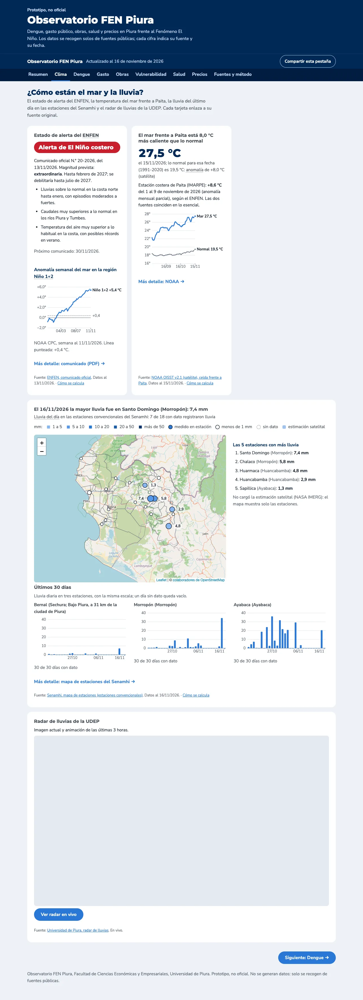

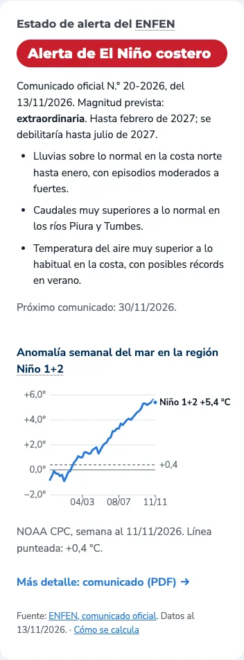
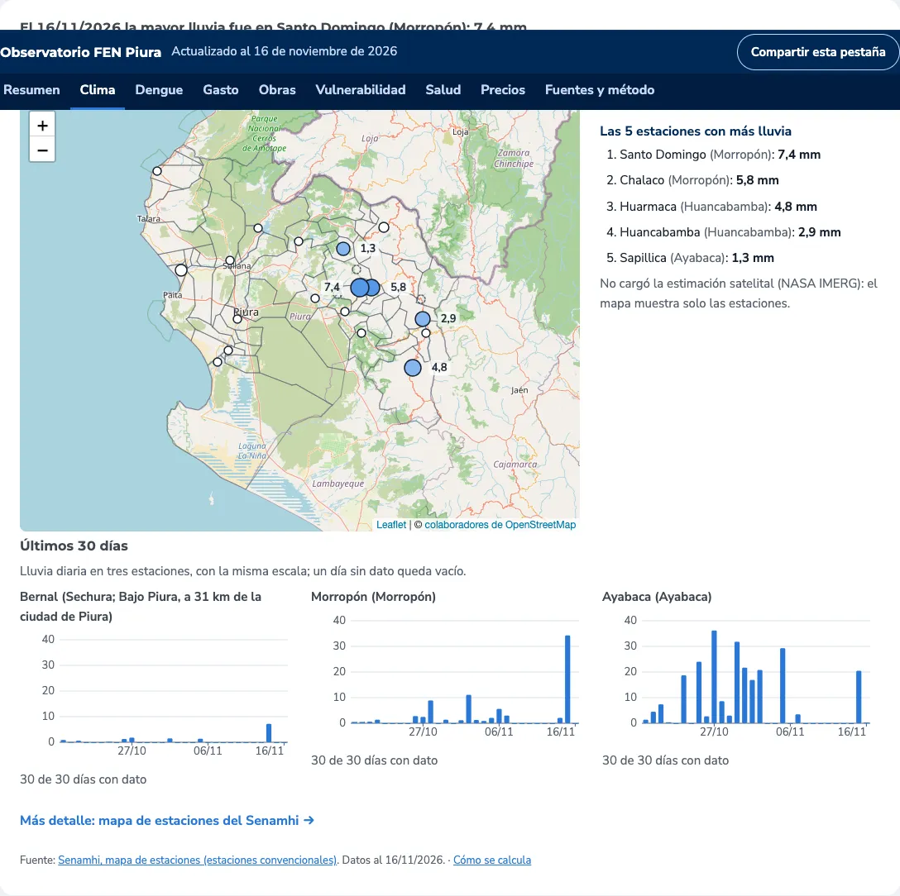
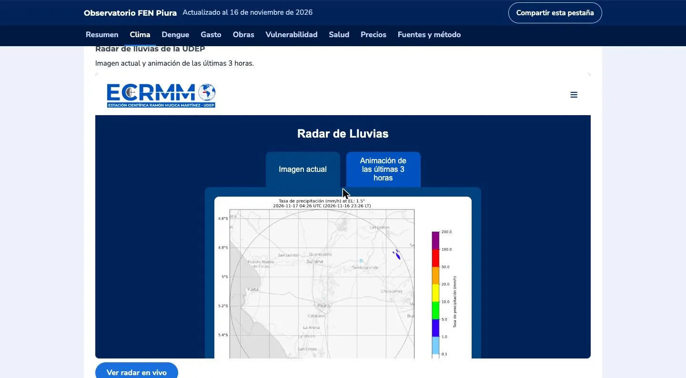

## Pruebas

Pasan las 6 pruebas del proyecto. `test_clima.py` revisa, sin red:
- el lector del Niño 1+2;
- la rejilla y el recorte de IMERG;
- los números de comunicado;
- los campos del JSON del ENFEN (puntos de 20 palabras como máximo).

`test_pagina.py` revisa la pestaña Clima y las 9 pestañas en 1280 y 375 px.

## Pendientes

1. **IMERG sin probar con datos reales:** aquí no estaba el token, así que la descarga no se probó. La lista de archivos y la estructura OPeNDAP sí se verificaron, y la descarga sin token responde con un redireccionamiento al login. La primera prueba es correr `imerg.yml` a mano después del push, o cargar el token en esta sesión con `! export EARTHDATA_TOKEN=…`.
   - Hasta entonces la página dice que no cargó la estimación.
   - `test_pagina.py` ignora solo el 404 de `imerg_piura.json`; conviene quitar esa excepción después de la primera ejecución.
2. **Bellavista (Sullana):** no tiene polígono en los límites de 2007, así que sus celdas IMERG quedan fuera del recorte.
3. **Ventana de la lluvia:** que el día del Senamhi vaya de 7:00 a 7:00 sigue siendo un supuesto; conviene confirmarlo con el Senamhi.
4. **Nombres repetidos:** algunos sectores comparten nombre (tres «La Península»); el distrito entre paréntesis los distingue.
5. **Clases más oscuras parecidas:** 60-80 y 80-100 % se parecen en el mapa, aunque pasan la prueba con daltonismo.
6. **Caso intermedio del Senamhi** (ronda 14): sigue pendiente de revisar con la regla de endpoints.
