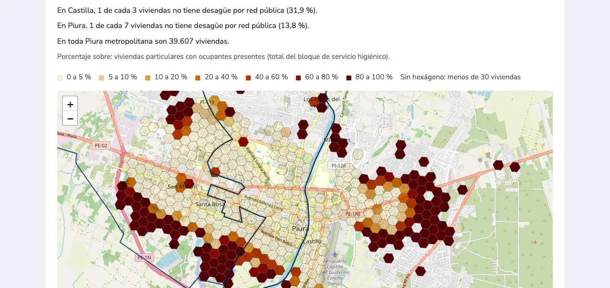
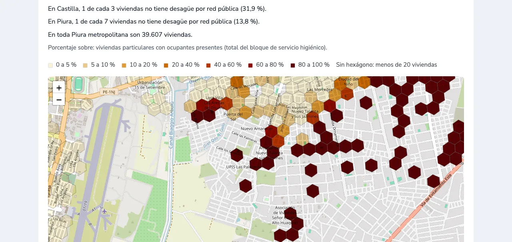
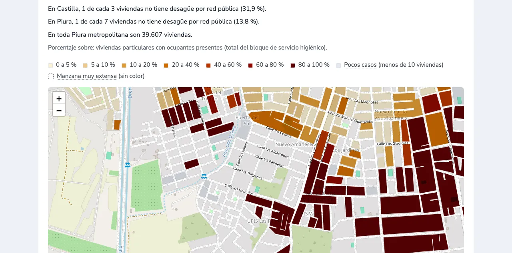
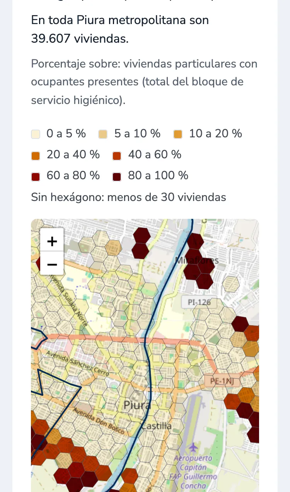
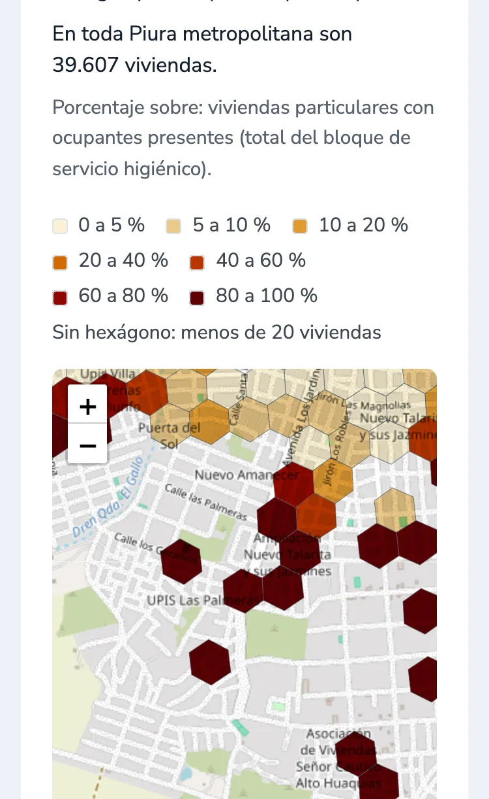
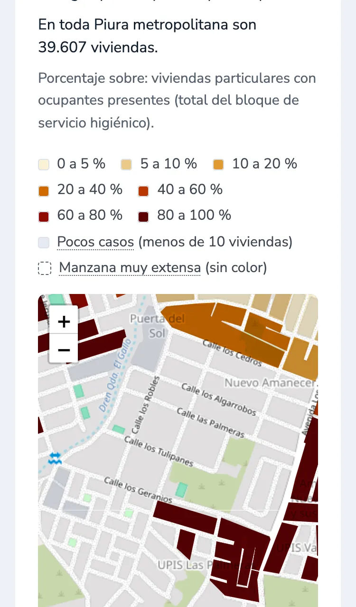
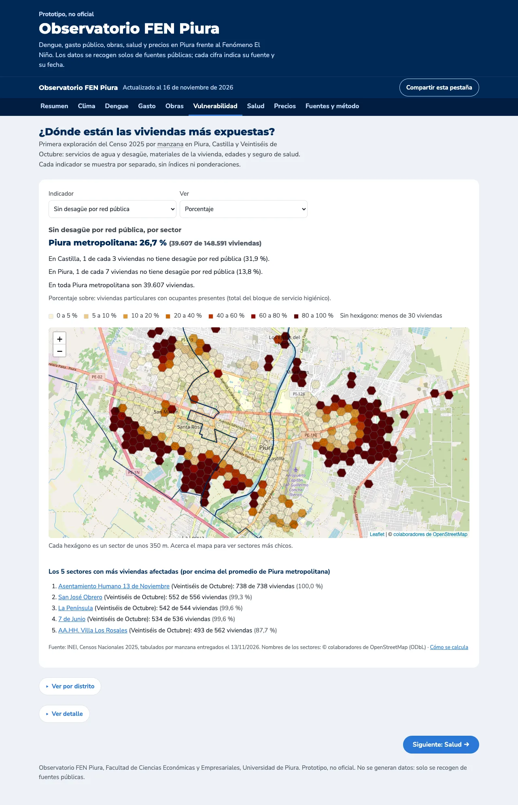
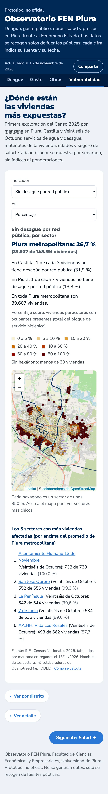

# Avance: ronda 15b, mapa de Vulnerabilidad más fácil de leer

Fecha: 17 de noviembre de 2026. Los cambios tienen un commit local, sin push. Falta tu revisión.

Para verla en local: `python3 -m http.server 8000 -d docs` y abrir http://localhost:8000/#vulnerabilidad.

## 1. Siete clases

Antes de aplicarlas, así caían los hexágonos de 350 m (con su base) en 0-5, 5-10, 10-20, 20-40, 40-60, 60-80 y 80-100 %. El primer número es la cantidad de hexágonos; entre paréntesis, el porcentaje de la base del indicador (viviendas o personas).

| Indicador | 0-5 | 5-10 | 10-20 | 20-40 | 40-60 | 60-80 | 80-100 |
| --- | --- | --- | --- | --- | --- | --- | --- |
| Sin desagüe por red pública | 279 (67 %) | 17 (4 %) | 14 (2 %) | 17 (5 %) | 17 (3 %) | 11 (3 %) | 133 (16 %) |
| Sin agua por red pública | 277 (65 %) | 30 (7 %) | 15 (3 %) | 25 (6 %) | 22 (4 %) | 20 (4 %) | 99 (11 %) |
| Sin agua todos los días | 137 (32 %) | 62 (17 %) | 79 (21 %) | 74 (20 %) | 28 (6 %) | 10 (2 %) | 14 (1 %) |
| Sin agua las 24 horas | 16 (2 %) | 20 (6 %) | 26 (7 %) | 45 (11 %) | 70 (19 %) | 73 (22 %) | 127 (33 %) |
| Menores de 15 años | 1 (0 %) | 3 (0 %) | 144 (31 %) | 444 (69 %) | 7 (0 %) | 0 | 0 |
| De 65 años a más | 272 (33 %) | 143 (24 %) | 158 (41 %) | 26 (3 %) | 0 | 0 | 0 |
| Sin EsSalud ni seguro privado | 20 (1 %) | 7 (1 %) | 37 (3 %) | 98 (12 %) | 117 (27 %) | 202 (46 %) | 118 (11 %) |
| Paredes de material precario | 177 (38 %) | 48 (14 %) | 58 (14 %) | 84 (15 %) | 50 (9 %) | 35 (7 %) | 36 (4 %) |
| Piso de tierra | 166 (34 %) | 55 (17 %) | 43 (11 %) | 83 (18 %) | 82 (13 %) | 42 (6 %) | 17 (1 %) |

- **Sin cortes nuevos:** el desagüe y el agua por red pública son bimodales (barrios formales frente a asentamientos). Es el patrón real.
- **Cortes propios (aprobados):** las edades quedaban casi enteras en dos clases.

| Indicador | Cortes | Personas por clase |
| --- | --- | --- |
| Menores de 15 años | 0-15, 15-20, 20-25, 25-30, 30-35, 35-40, 40+ | 5 / 26 / 36 / 18 / 12 / 2 / 0 % |
| De 65 años a más | 0-4, 4-6, 6-8, 8-10, 10-13, 13-16, 16+ | 25 / 14 / 9 / 9 / 13 / 16 / 14 % |

- **Dónde quedan los cortes:** viajan con cada indicador en `censo_piura.json`. La leyenda cambia con el indicador y dice «Cortes propios: las edades varían poco entre barrios».

## 2. Paleta y opacidad

- **Paleta:** `#faf2d4` (crema) → `#eac989` → `#e09b33` → `#cf6b00` → `#b83600` → `#8f0900` → `#5c0204` (rojo muy oscuro), con claridad pareja en OKLCH (0,96 a 0,30).
- **Opacidad:** con cualquier transparencia, del 70 % al 85 %, los dos rojos más oscuros se confundían con protanopía (ΔE de 4 a 6, por debajo del mínimo de 8), probé varias paletas y siempre pasaba.
  - **Solución:** relleno opaco y la capa de calles encima, en modo «multiplicar». Los colores quedan intactos y las calles y nombres del mapa se leen sobre ellos (ver las capturas).
- **Validación con dataviz sobre el fondo del mapa:**
  - claridad monótona y saltos de 0,06 o más;
  - vecinos con ΔE de 8,8 o más con daltonismo.
- **Reglas que falla a propósito (aprobado):**
  - la crema casi no contrasta con el mapa: cada hexágono lleva un borde gris fino para no confundirlo con un lugar sin datos;
  - el tono pasa de amarillo a rojo (65°).
- **Vista de número:** usa 5 de los 7 tonos, sin la crema.

## 3. Tamaño según el zoom

| Zoom | Qué se ve | Mínimo para dibujar | Viviendas ocultas | Archivo | Se carga |
| --- | --- | --- | --- | --- | --- |
| 14 o menos | Hexágonos H3 9, unos 350 m (599) | 30 | 1,3 % | `censo_piura.json`, 0,28 MB | al abrir la pestaña |
| 15 | Hexágonos H3 10, unos 130 m (2498) | 20 | 4,8 % (con 30 sería 10,1 %) | `censo_hex10.json`, 1,01 MB | al llegar a zoom 15 |
| 16 o más | Manzanas | denominador mayor que 0 | — | `censo_manzanas.json`, 1,79 MB | al llegar a zoom 16 |

- **Tamaño de 130 m y no 175:** H3 no tiene un nivel de 175 m. El 10 mide unos 131 m de lado a lado y mantiene el mismo método.
- **Umbral de 20 en el nivel de 130 m:** con 30 quedaba oculto más del 10 %. El efecto: en un hexágono de 20 viviendas, una vivienda mueve el porcentaje 5 puntos.
- **Vista de número:** siempre en 350 m.
- **Peso inicial:** la pestaña descarga 0,28 MB, antes 2,07 MB.

## 4. Frases y sectores críticos

- **Frases:** no dependen de las clases (comparan distritos), así que no cambian.
- **Sectores críticos:** se sacan de los hexágonos de 350 m, por encima del promedio de Piura metropolitana y ordenados por número de afectados. Con las nuevas clases, en 8 indicadores los 5 caen en las dos o tres clases más altas.
  - **Excepción:** menores de 15 años. Uno de los 5 está en 20-25 %: supera el promedio (23,2 %) y tiene muchos niños, pero es una clase media.
- **Botón de cada sector:** lleva el mapa a zoom 14, donde se ve el sector de 350 m que nombra.

## 5. Pruebas

- **`test_censo_inei.py`:**
  - los dos niveles de hexágonos suman exactamente lo mismo que las manzanas;
  - mínimos de 30 y 20;
  - 6 cortes crecientes por indicador, y los propios de las edades;
  - ningún archivo pasa de 3 MB y la base de 0,5 MB.
- **`test_pagina.py`:**
  - la base no trae manzanas ni hexágonos de 130 m hasta acercar el mapa;
  - leyenda de 7 clases;
  - el 4,9 % cae en la primera clase y el 5 % en la segunda;
  - rótulos «80 a 100 %» y «16 % o más»;
  - borde gris y relleno opaco;
  - modo «multiplicar» activo;
  - zoom 15 → hexágonos de 130 m con mínimo 20;
  - zoom 16 → manzanas;
  - la vista de número se queda en 350 m.
- Pasan las 6 pruebas del proyecto.

## 6. Capturas

Zoom 13 (ciudad entera), 15 y 16 (Castilla, donde hay contraste):

## Pendientes

1. **Modo «multiplicar» en los lugares sin hexágono:** el mapa base también se multiplica por el fondo gris claro del contenedor, así que se ve un poco más apagado que en las otras pestañas. Si molesta, se puede poner el fondo del contenedor en blanco.
2. **Vacíos en zoom 15:** hay vacíos donde hay casas (hexágonos de 130 m con menos de 20 viviendas). La nota bajo el mapa lo dice; el 4,8 % de las viviendas queda sin hexágono en ese nivel.
3. **Celular:** el modo «multiplicar» funciona en los navegadores actuales. En uno muy antiguo, los hexágonos taparían las calles, pero los colores y los datos serían los mismos.
