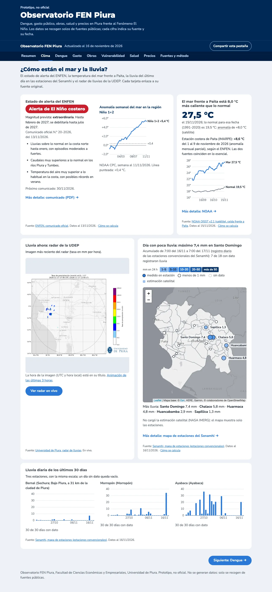
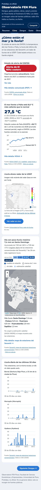
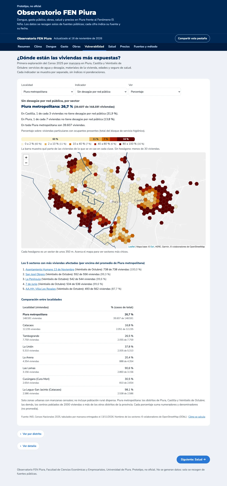
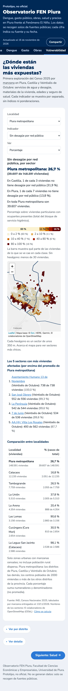
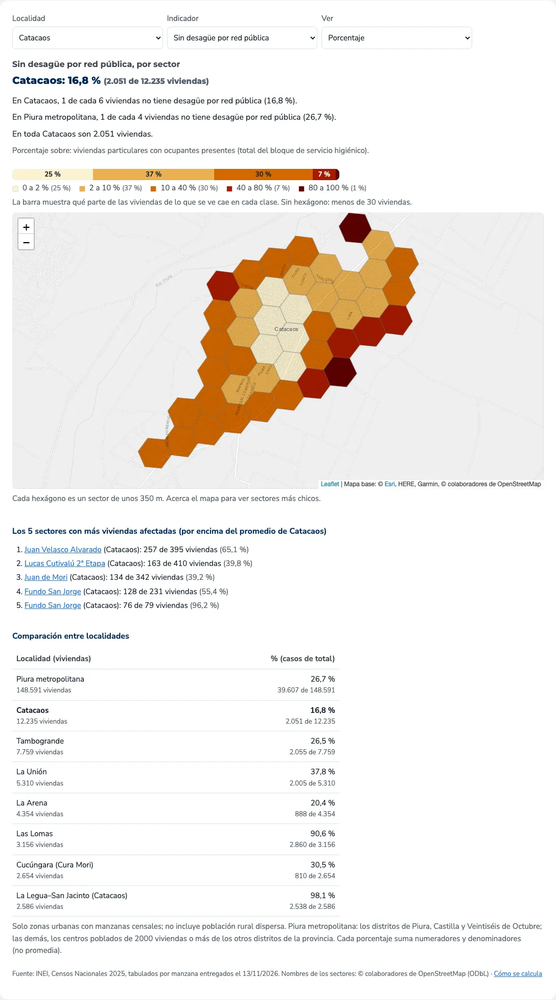
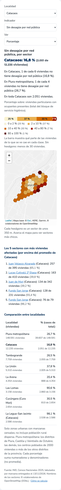

# Avance: ronda 16, fallas pendientes y rediseño

Fecha: 17 de noviembre de 2026. Los cambios tienen un commit local, sin push. Falta tu revisión.

Para verla en local: `python3 -m http.server 8000 -d docs` y abrir http://localhost:8000/#clima y http://localhost:8000/#vulnerabilidad.

## A. Fallas

### 1. Radar de la UDEP

- **Qué lo bloquea: no es el iframe.** El servidor no envía `X-Frame-Options` ni `Content-Security-Policy: frame-ancestors`, así que permite cualquier dominio (udep.edu.pe y GitHub Pages incluidos).
- **La falla es la conexión segura:** el servidor corta algunas conexiones HTTPS antes de responder (`SSL_ERROR_SYSCALL`).
  - Con curl falló 1 de cada 7 intentos.
  - Desde Brave falla siempre (`ERR_CONNECTION_CLOSED`); desde Chrome cargó bien.
- **Cambio:**
  - Ya no hay iframe: la tarjeta muestra la imagen más reciente (`src/live/radar.png`, 3000 × 2400 px), enlazada directo a su servidor y descargada por el navegador de quien mira, no por GitHub.
  - Lleva un enlace a la animación de 3 horas.
  - El servidor manda `no-cache`, así que siempre se pide la última imagen. La hora (UTC y local) está en el título de la propia imagen.
- **Nunca queda vacía:** si la imagen no carga, la tarjeta dice «El radar no respondió en este momento» y deja el botón «Ver radar en vivo». La prueba de la página lo revisa.
- **Correo al equipo del radar:** borrador en `privado/correo_radar.md`. Les pide revisar la configuración HTTPS del servidor.

### 2. Capa satelital IMERG

- **Por qué no cargó:** el workflow `imerg.yml` nunca corrió. Está solo en esta computadora (la rama tiene commits sin push), así que no hay registro; el token aún no se ha usado.
- **Mejoras:**
  - **Token:** con un 401 o un 403, o si NASA devuelve su página de inicio de sesión en vez de datos, el registro dice «token vencido o sin autorización» y recuerda autorizar la aplicación NASA GESDISC DATA ARCHIVE en la cuenta. La detección tiene prueba.
  - **Día incompleto:** si la ventana del día aún no está completa en la lista pública (latencia), usa la última completa, de hasta 3 días antes. El mapa dice de qué fechas es.
  - La lista pública tenía las 48 medias horas de la ventana de ayer.
- **Falta:** la prueba con el token real. Sería `! export EARTHDATA_TOKEN=… && python3 scripts/imerg_piura.py` en esta sesión, o correr `imerg.yml` en Actions después del push.

## B. Vulnerabilidad

1. **Carencia:** los 7 indicadores de carencia ya iban con «rojo = peor».
   - Las dos edades conservan su nombre, con la nota «Más alto = más población dependiente (no es una carencia)».
   - **Materiales precarios** (sin adobe, que en Piura metropolitana es el 1,4 % de las viviendas): tapia, quincha (caña con barro), piedra con barro, madera (pona, tornillo, etc.) y triplay, calamina o estera.
2. **Cinco clases por familia** (aprobado; ninguna clase con menos del 5 % de las viviendas o personas de Piura metropolitana):

| Familia | Cortes | Clase más chica |
| --- | --- | --- |
| Servicios por red pública (sin desagüe, sin agua por red) | 0–2, 2–10, 10–40, 40–80, 80–100 | 6,2 % |
| Agua todos los días, paredes precarias, piso de tierra | 0–5, 5–10, 10–20, 20–40, 40+ | 9,1 % |
| Sin agua las 24 horas | 0–25, 25–50, 50–75, 75–90, 90–100 | 16,3 % |
| Menores de 15 años | <15, 15–20, 20–25, 25–30, ≥30 | 5,4 % |
| 65 años o más | <4, 4–8, 8–12, 12–16, ≥16 | 14,3 % |
| Sin EsSalud ni seguro privado | <30, 30–50, 50–65, 65–80, ≥80 | 8,9 % |

   - Los servicios por red se separaron porque son «todo o nada» por barrio: con los cortes de la familia, tres clases quedaban por debajo del 5 %.
   - Los cortes están documentados en «Fuentes y método» y en el glosario («Rangos del mapa»).
3. **Paleta de 5 tonos:** `#fbf2d0` → `#eab151` → `#d36800` → `#a71a00` → `#5f0000`.
   - Validada con dataviz tal como se ve (multiplicada por el fondo del mapa): claridad pareja, vecinos con ΔE de 13,7 o más con daltonismo y de 16,6 o más con visión normal.
   - Falla a propósito las dos reglas ya aprobadas (crema casi neutra y tono de amarillo a rojo).
4. **Leyenda:** una barra apilada con la parte de las viviendas (o personas) de lo que se ve en cada clase, con las cifras, y los rótulos con su porcentaje.
5. **Rayas diagonales:**
   - **No eran dos capas a la vez:** en cada zoom se ve un solo nivel, y la prueba lo revisa también al cambiar de localidad.
   - **Eran las manzanas del mapa de OpenStreetMap,** que pinta las zonas residenciales de gris con calles blancas; en modo «multiplicar» se veían como un rayado.
   - **Con el fondo de Esri, que no rellena las manzanas, desaparecen.**
6. **Selector de localidad:** Piura metropolitana y los 7 centros poblados de 2000 viviendas o más (aprobado):

| Localidad | Viviendas | Archivo | Sin desagüe por red pública |
| --- | --- | --- | --- |
| Piura metropolitana | 148 591 | (base + 2 archivos) | 26,7 % |
| Catacaos | 12 235 | 0,26 MB | 16,8 % |
| Tambogrande | 7759 | 0,18 MB | 26,5 % |
| La Unión | 5310 | 0,13 MB | 37,8 % |
| La Arena | 4354 | 0,12 MB | 20,4 % |
| Las Lomas | 3156 | 0,09 MB | 90,6 % |
| Cucúngara (Cura Mori) | 2654 | 0,07 MB | 30,5 % |
| La Legua–San Jacinto (Catacaos) | 2586 | 0,10 MB | 98,1 % |

   - **Carga:** cada localidad tiene su archivo, que se carga al elegirla.
   - **Frases:** comparan la localidad con Piura metropolitana.
   - **Sectores críticos:** se calculan con el promedio de la localidad.
   - **Tabla:** debajo del mapa, compara las localidades en el indicador elegido, sumando numeradores y denominadores.
   - **Nota:** «Solo zonas urbanas con manzanas censales; no incluye población rural dispersa».
   - **Nombres de los sectores:** salen de OpenStreetMap; la respuesta de cada consulta queda en `data/raw/osm/` (fuera del repositorio) y se usa un espejo público si el servidor principal está cargado.
7. **Mapa base:** CARTO Positron pide clave desde 2026 (sus teselas dicen «API KEY REQUIRED»). Se usa Esri World Light Gray (sin clave) con sus nombres de calles encima en **todos** los mapas (dengue y camas, obras, vulnerabilidad, lluvia), con el crédito «Mapa base: © Esri, HERE, Garmin, © colaboradores de OpenStreetMap».

## C. Disposición de Clima

- **En la computadora:**
  - fila 1: ENFEN en 2/3 (texto a la izquierda y gráfico del Niño 1+2 a la derecha; el eje ya no se corta en −2) y el mar en 1/3;
  - fila 2: radar («Lluvia ahora») y mapa de lluvia de 24 horas, del mismo alto;
  - fila 3: series de 30 días.
- **En el celular,** una columna en este orden:
  - etiqueta de alerta + una línea + «Ver más» (puntos clave, próximo comunicado y gráfico del Niño 1+2);
  - mar con gráfico chico;
  - radar;
  - lluvia;
  - series.
- **Todos los mapas:**
  - alto fijo, el 60 % de la ventana (máximo 560 px; en celular, 420 px);
  - no atrapan el desplazamiento: en computadora se acerca con Ctrl + rueda y en celular el mapa se mueve con dos dedos;
  - el control de gestos es leaflet-gesture-handling 1.2.2, de jsDelivr con SRI, porque no está en cdnjs.

## D. Mapa de lluvia

1. **Encuadre:** solo el departamento de Piura, con lo de afuera oscurecido.
2. **Leyenda en dos líneas:** la barra de mm (1–5, 5–10, 10–20, 20–50, más de 50, en el azul validado) y los símbolos (medido en estación, menos de 1 mm, sin dato, estimación satelital).
3. **Rótulos:** nombre y mm en el mapa para las 5 estaciones con más lluvia; el resto, al pasar el cursor. Debajo, el top 5 en una línea, para lectores de pantalla.
4. **Periodo:** «Acumulado de 7:00 del 16/11 a 7:00 del 17/11».
   - **Titular:** si el máximo es menor de 10 mm, dice «Día con poca lluvia: máximo 7,4 mm en Santo Domingo» (hoy).
5. **Estaciones automáticas del Senamhi:**
   - **Qué publican:** las últimas 24 horas cada 10 minutos (144 registros; la lluvia solo en las horas en punto), en la misma ventana de estación del mapa que se usa para las convencionales.
   - **No hay descarga ni CSV.** El histórico pide registrarse y la tabla mensual tiene captcha. Es el mismo caso intermedio de la ronda 14 (ni secreto ni descarga oficial).
   - **No se integraron.**

## Pruebas

Pasan las 6 pruebas del proyecto.

- **`test_censo_inei.py`:**
  - 5 clases con los cortes aprobados;
  - paredes sin adobe;
  - 8 localidades, cada una con su archivo de menos de 1 MB;
  - sus hexágonos suman lo mismo que sus manzanas;
  - su total es igual a sus manzanas más sus dispersas.
- **`test_pagina.py`:**
  - leyenda de 5 clases;
  - barra que suma 100 %;
  - cortes y rótulos;
  - cambio a Catacaos: carga su archivo, la tabla y las frases la nombran y se ve un solo nivel;
  - radar con imagen y aviso si falla;
  - 5 tarjetas en Clima;
  - top 5 de lluvia.
- **`test_clima.py`:** detección de la página de inicio de sesión de NASA.

## Capturas

El radar sale en gris en las capturas porque el navegador de las pruebas (Brave) no logra conectarse a su servidor; es la misma falla de la sección A.

## Decisiones pendientes

1. **Hexágonos de 130 m en las localidades chicas:** con el mínimo de 20 viviendas ocultan mucho, porque son pueblos menos densos.
   - Las Lomas: 42,5 % de las viviendas.
   - La Legua–San Jacinto: 33,9 %.
   - Piura metropolitana, en cambio: 4,8 %.
   - Propuesta: en las localidades, pasar de los hexágonos de 350 m directo a las manzanas (sin el nivel de 130 m).
2. **Licencia del fondo de Esri:** sus condiciones permiten el uso no comercial con crédito. Si la página va a la web oficial de la UDEP, conviene confirmarlo con DIRCOM.
3. **IMERG:** la prueba con el token real.
4. **Radar:** enviar el correo del borrador cuando lo revises.
