# Avance: ronda 17, ajustes de lectura en Vulnerabilidad y Clima

Fecha: 17 de noviembre de 2026. Los cambios tienen un commit local, sin push. Falta tu revisión.

Para verla en local: `python3 -m http.server 8000 -d docs` y abrir http://localhost:8000/#vulnerabilidad y http://localhost:8000/#clima.

## A. Fecha de la lluvia (verificación)

- **Los datos no estaban corridos.** La serie y el mapa leen el mismo arreglo del Senamhi con la misma fecha.
  - Morropón tiene 34,3 mm el 15/11 y 0,0 mm el 16/11.
  - El gráfico sí incluía el 16/11, pero una barra de 0 mm no se veía, así que la última barra visible era la del 15/11.
- **Lo que estaba mal era la ventana «7:00 a 7:00 del día siguiente».** Los registros guardados muestran que la lluvia del día D aparece la noche de D:
  - a las 15:13 del 16/11 aún no estaba la del 16/11; a las 23:23 sí;
  - hoy a las 14:14 ya está la temperatura mínima del 17/11 (se lee a las 7:00), pero no la lluvia del 17/11.
  - El día va, probablemente, de 19:00 del día anterior a 19:00 (lecturas de 7:00 y 19:00). Es una deducción: falta confirmarlo con el Senamhi.
- **Cambios:**
  - Una sola función, `diaLluvia()`, rotula el mapa («Lluvia del lunes 16/11»), las series, los globos de las barras y la estimación satelital. La explicación de las horas está en «Cómo se calcula».
  - Un día con 0 mm lleva una marca gris en la base; un día sin dato queda vacío.
  - La estimación satelital (`imerg_piura.py`) pasó a sumar de 19:00 a 19:00, con el mismo día que las estaciones. Sigue sin probarse con el token real.
- **Prueba nueva:** para cada una de las 21 estaciones, el globo de la última barra de su serie tiene el mismo día y los mismos mm que su círculo en el mapa diario. Pasa.

## B. Vulnerabilidad

1. **Escala fija para servicios y vivienda:** sin desagüe, sin agua por red, sin agua todos los días, sin agua las 24 h, paredes precarias y piso de tierra.
   - Clases: Casi ninguna (0–5 %), Pocas (5–20 %), Menos de la mitad (20–50 %), Más de la mitad (50–80 %), Casi todas (80–100 %).
   - La leyenda muestra la palabra con la cifra.
   - Los demográficos mantienen sus cortes.
   - Se quitó la regla del 5 %.
   - Todo está documentado en «Fuentes y método» y en el glosario («Rangos del mapa»).
2. **Título en palabras** para cada indicador, por ejemplo «Viviendas sin desagüe por red pública» o «Personas sin EsSalud ni seguro privado».
3. **Vista de número → densidad neta:** afectados entre las hectáreas de las manzanas del sector, sin calles ni terreno vacío.
   - Con el área del hexágono la medida cambiaba unas cinco veces entre niveles; con el área de manzana se mantiene parecida.
   - Cada sector y cada manzana llevan su área (`ha`). La prueba comprueba que el área de los sectores suma la de sus manzanas.
   - Clases aprobadas: viviendas y 65 años o más, <5, 5–10, 10–20, 20–40, ≥40; menores de 15, <10, 10–20, 20–40, 40–80, ≥80; sin seguro, <25, 25–50, 50–100, 100–200, ≥200.
   - El globo muestra las dos medidas: el %, el número y la densidad, con las hectáreas.
   - La vista de número ahora usa los mismos niveles de zoom que la de %.
4. **Barra y frases:** se calculan siempre sobre los sectores de 350 m de toda la localidad, sin depender del zoom.
   - Las puntas de la frase de % van en positivo, para evitar la doble negación: «De cada 100 viviendas de Las Lomas, ninguna está en sectores donde casi todas tienen desagüe por red pública y 87 están en sectores donde casi ninguna lo tiene».
   - Frase de número: «De las 28.233 viviendas que no tienen desagüe por red pública en los sectores de Piura metropolitana, 56 % están en los sectores con 40 o más por hectárea: ahí se concentra el problema». Son 28.233 y no 39.607 porque quedan fuera las manzanas dispersas, las muy extensas y los sectores con menos de 30 viviendas.
   - Si la clase más alta está vacía: «Ningún sector de Las Lomas llega a 40 viviendas sin desagüe por red pública por hectárea; el más denso tiene 30».
   - Junto al selector: «% muestra dónde el problema es más común; número, dónde hay más hogares afectados».
5. **Comparación entre localidades:**
   - Barras de mayor a menor %, con el color de su clase.
   - Una línea punteada con el promedio de las 8 zonas urbanas, que suma numeradores y denominadores: 28,3 % en desagüe.
   - El % y «N viviendas afectadas» con el mismo peso.
   - La localidad elegida, destacada.
   - Titular generado: «En La Legua–San Jacinto (Catacaos) y Las Lomas, 9 de cada 10 viviendas no tienen desagüe por red pública; en número, la mayoría está en Piura metropolitana (39.607 de 52.814)».
   - La nota de cobertura dice el umbral real: 2000 viviendas; la localidad más chica incluida tiene 2586.
6. **Pendiente de la ronda 16:** las localidades van de los sectores de 350 m directo a las manzanas.
   - Ya no tienen el nivel de 130 m, que en Las Lomas ocultaba el 42,5 % de las viviendas; con 350 m se oculta el 6,6 %.
   - Al elegir una localidad, el mapa abre en sectores.
   - Sus archivos bajaron de 70–260 KB a 50–180 KB.

## C. Lluvia de los últimos 30 días

1. **Estaciones por defecto:** Bernal (costa, Sechura, a 31 km de la ciudad, 30 de 30 días), Morropón (valle medio, 30 de 30) y Ayabaca (sierra, 30 de 30).
   - En la ciudad, San Miguel tiene solo 5 de 30 días.
   - Bajo cada nombre hay una línea con el distrito y la distancia a la ciudad de Piura.
2. **Selector en cada gráfico** con las 21 estaciones convencionales del departamento y sus días con dato.
3. **Total de 30 días** como cifra destacada.
   - **Sin «% de lo normal».** La página de normales por estación del Senamhi redirige al portal gob.pe, y su nota técnica de normales también. No encontré normales mensuales por estación publicadas. Así lo dice «Cómo se calcula».
4. **Gráficos:**
   - barras más anchas;
   - fechas cada 7 días, contadas desde el último;
   - globo con «lunes 16/11» y los mm;
   - misma escala en los tres: el máximo, entre 20 y 60 mm. Lo que pasa de 60 mm se corta y lleva su valor encima; la prueba lo revisa con un día de 100 mm.

## Pruebas

Pasan las 6 pruebas del proyecto.

- **`test_censo_inei.py`:**
  - escala fija y palabras;
  - cortes de densidad;
  - área de manzana en cada sector y cada manzana;
  - localidades sin el nivel de 130 m.
- **`test_pagina.py`:**
  - clases y rótulos nuevos;
  - frase de la barra;
  - comparación ordenada, con el promedio y la localidad elegida destacada;
  - densidad en el globo;
  - nivel de manzanas al zoom 15 en una localidad;
  - lluvia: serie y mapa con el mismo día y valor en las 21 estaciones, marca de 0 mm, tope de 60 mm, fechas cada 7 días y selectores.

## Capturas

| Vista | 1280 px | 375 px |
| --- | --- | --- |
| Piura metropolitana, % | 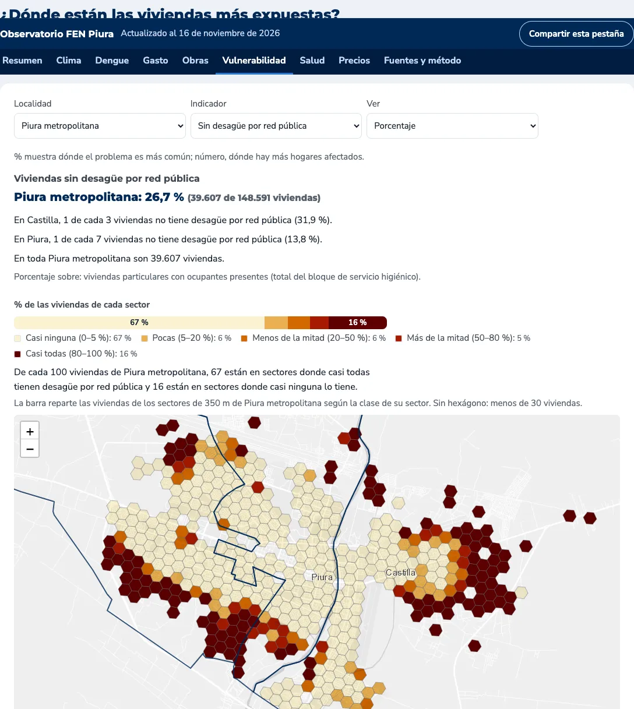 | 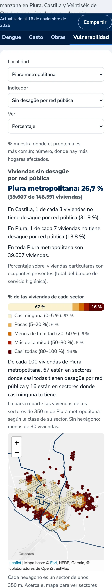 |
| Piura metropolitana, número | 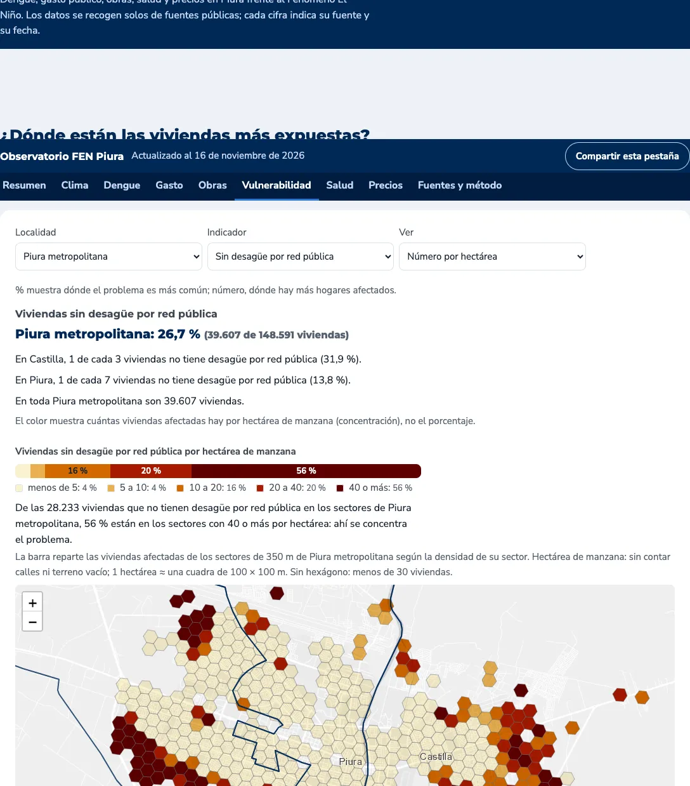 | 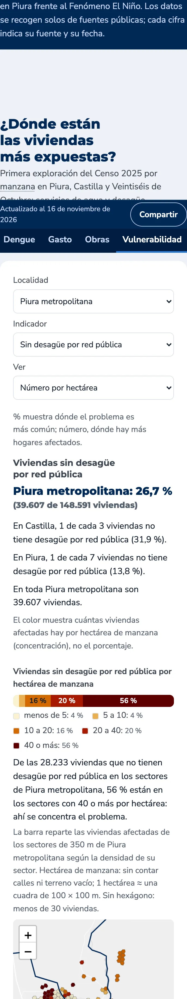 |
| Las Lomas, % | 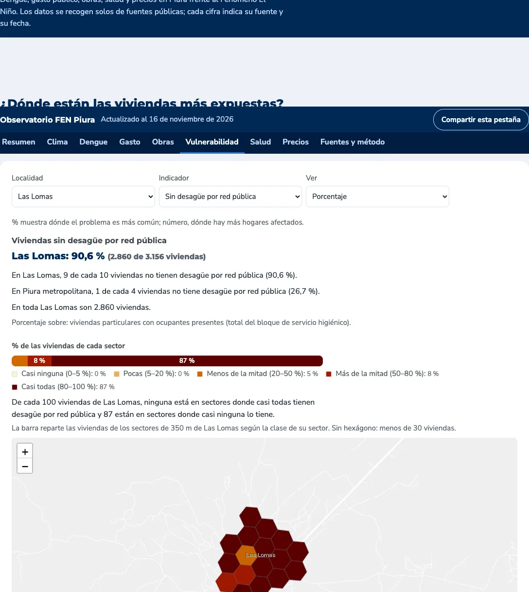 | 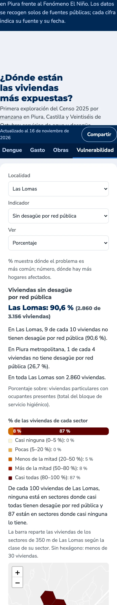 |
| Las Lomas, número | 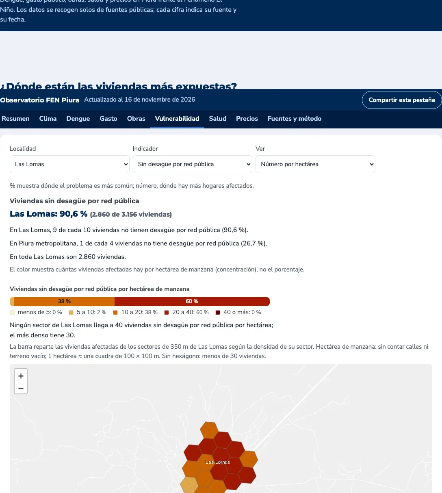 | 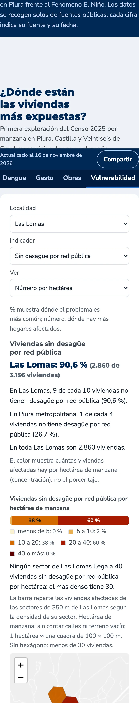 |
| Comparación entre localidades | 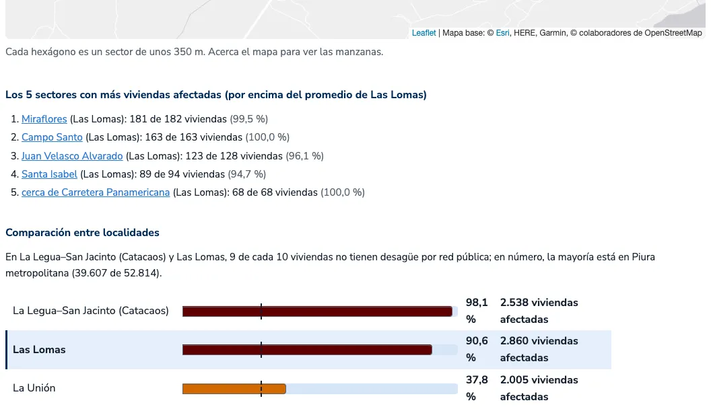 | 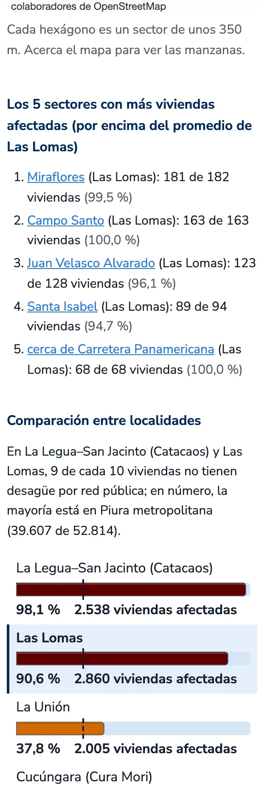 |
| Lluvia de 30 días | 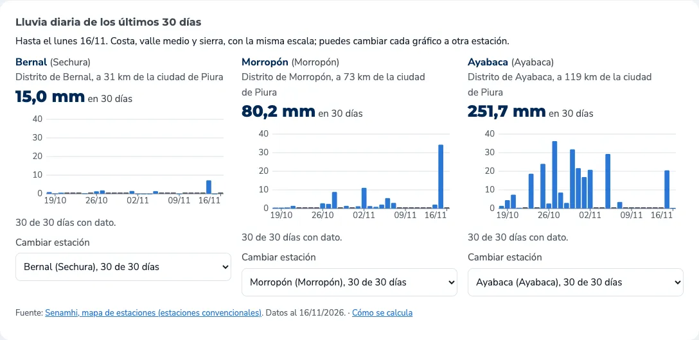 | 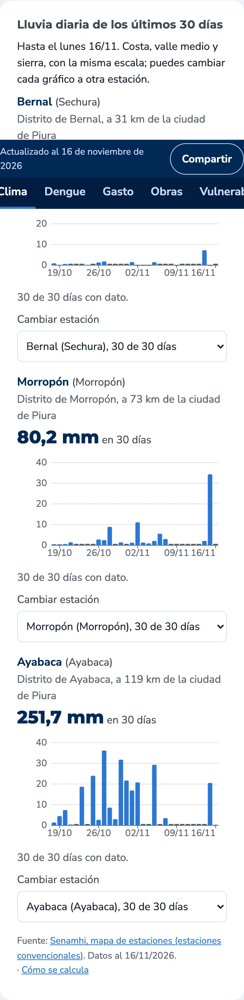 |
| Mapa de lluvia (fecha nueva) | 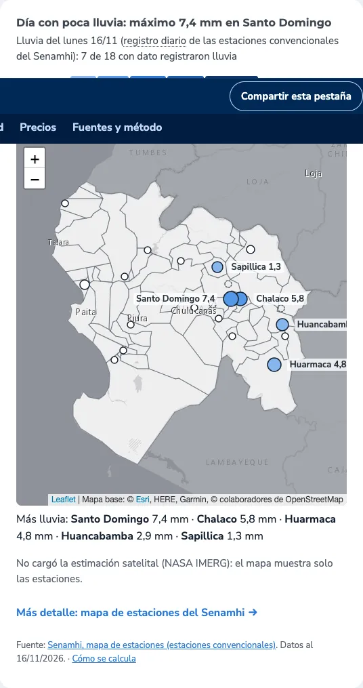 | 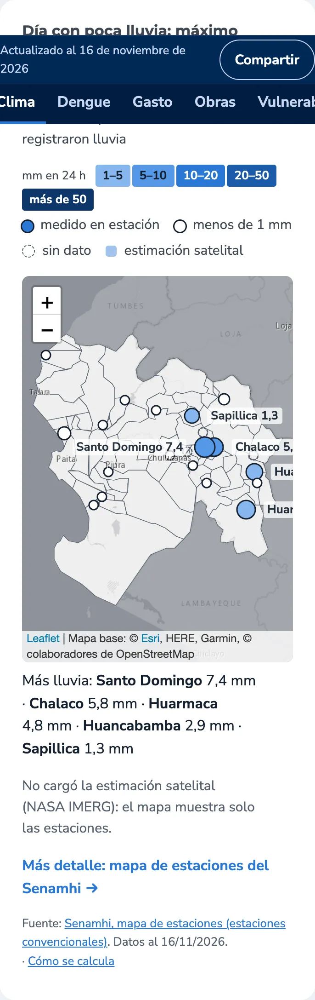 |

## Pendientes

1. **Ventana de 19:00 a 19:00:** confirmarla con el Senamhi. Si fuera otra, solo cambian el texto de «Cómo se calcula» y la hora de la estimación satelital.
2. **IMERG:** sigue sin probarse con el token real, ahora con la ventana nueva.
3. **Densidad en manzanas muy chicas:** puede salir alta (pocas viviendas en poca área). Se mitiga con el gris de «pocos casos» (menos de 10 viviendas o 30 personas).
