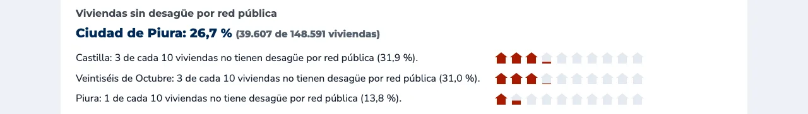
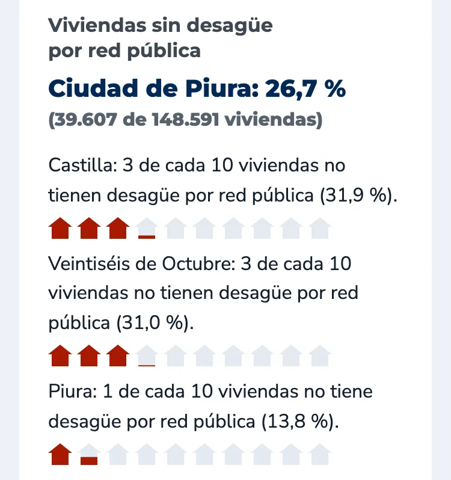
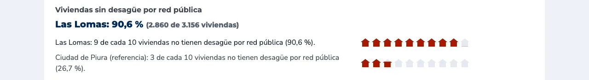
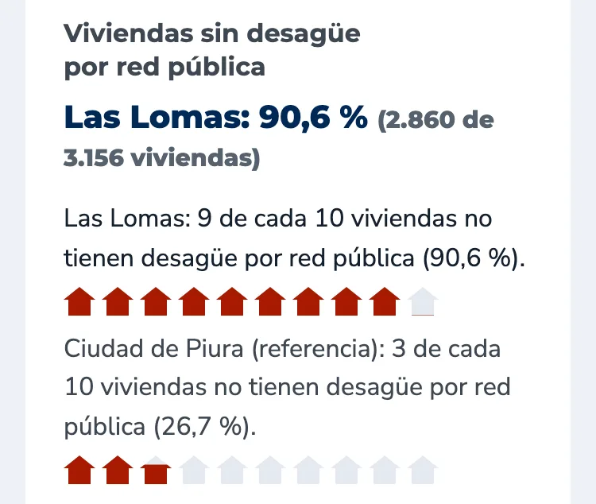
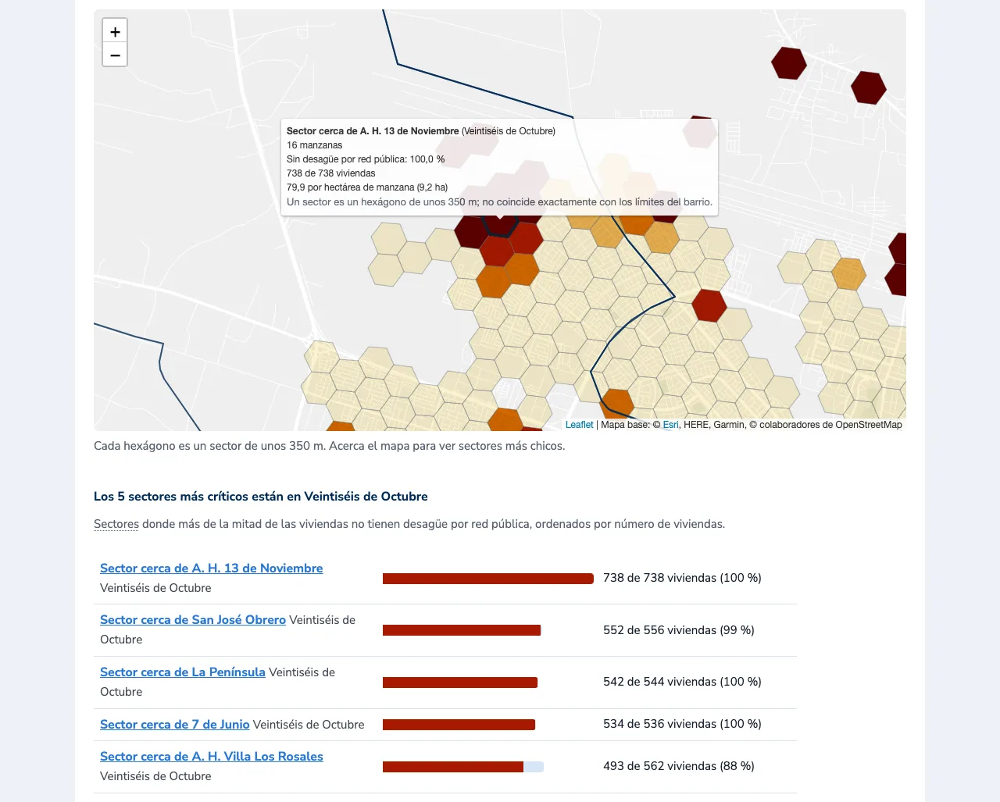
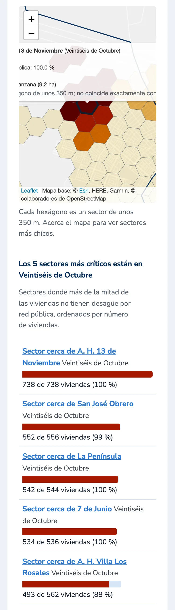
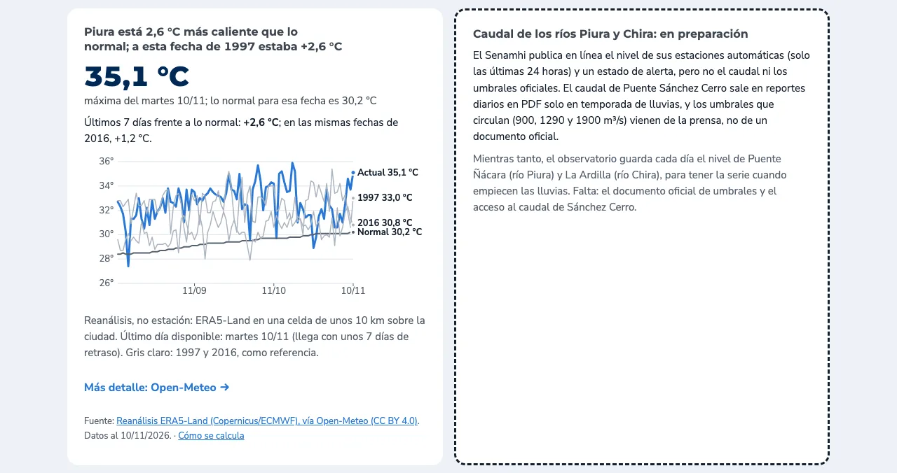
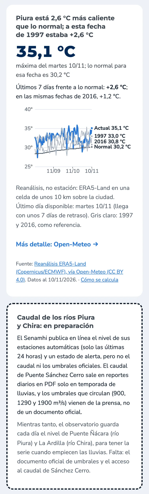

# Avance: ronda 18, Vulnerabilidad más visual, «Ciudad de Piura» y temperatura en Clima

Fecha: 17 de noviembre de 2026. Los cambios tienen un commit local, sin push. Falta tu revisión.

Para verla en local: `python3 -m http.server 8000 -d docs` y abrir http://localhost:8000/#vulnerabilidad y http://localhost:8000/#clima.

## A. «Ciudad de Piura»

- **Dónde cambió:** en la página, los datos (`censo_piura.json`), el script del censo, las pruebas y `design-system.md`.
  - **Rótulos** (selector, tablas, comparación): «Ciudad de Piura».
  - **Dentro de una frase:** «la ciudad de Piura» («De cada 100 viviendas de la ciudad de Piura…»).
  - **Primera mención,** en la introducción de la pestaña: «Ciudad de Piura (distritos de Piura, Castilla y Veintiséis de Octubre)».
- **Qué no cambió:**
  - el id interno (`metro`), que no se ve;
  - los resúmenes de rondas anteriores, que son históricos.
- **«Fuentes y método»** tiene el párrafo sobre el área metropolitana oficial (Plan de Desarrollo Urbano, con Catacaos) y por qué aquí Catacaos va aparte.
- **Otros usos de «metropolitana» en el repositorio:** solo Vulnerabilidad, más el nombre propio de un centro de EsSalud en `camas_piura.json` («CAP III Metropolitano»), que no se toca. En Dengue y Gasto no había ninguno.

## B. Frases con casas

- **Por qué faltaba Veintiséis de Octubre:** no era un error de cálculo. Desde la ronda 12 las frases mostraban solo el distrito más alto y el más bajo.
- **Ahora:**
  - En la Ciudad de Piura sale una fila por distrito, de mayor a menor %.
  - En una localidad salen dos filas: la localidad y la Ciudad de Piura, como referencia.
- **Texto:** «Castilla: 3 de cada 10 viviendas no tienen desagüe por red pública (31,9 %)». Siempre «de cada 10»:
  - «menos de 1 de cada 10» si no llega a media casa;
  - «casi 10 de cada 10» si redondea a 10 sin llegar al 99,5 %;
  - en «sin seguro», «al menos».
- **Casas:** 10 casas por fila, en SVG en línea. Las afectadas van en rojo (`--v4`), el resto en gris claro (`--neutro`). La fracción llena una casa de abajo hacia arriba; un corte vertical se leía como un «1».
- **Accesibilidad:** la fila de casas lleva `role="img"` con la misma frase y no es enfocable.
- **Celular:** las casas van debajo del texto.
- **Se quitó** la línea «En toda [localidad] son N viviendas».
- **Prueba:** verifica una fila por distrito, el orden, las 10 casas, el texto alternativo y que no esté la línea del total.

## C. Los 5 sectores más críticos

1. **Criterio:** sectores de 350 m donde más de la mitad de las viviendas (o personas) tiene la carencia, ordenados por número de afectados. En las dos edades, «más de la mitad» no funciona, porque solo había 1 sector y 0. Por eso se usa la clase más alta (30 % o más de menores de 15; 16 % o más de 65 años o más). El subtítulo dice el criterio.
2. **Titular generado:**
   - «Los 5 sectores más críticos están en Veintiséis de Octubre»;
   - «3 de los 5…» si se reparten;
   - «Solo 2 sectores cumplen…» si hay menos de 5;
   - en una localidad, cuántas viviendas afectadas suman.
3. **Filas:** nombre y distrito, una barra (largo = viviendas del sector; relleno = afectadas) y «738 de 738 viviendas (100 %)».
4. **Nombres:**
   - «Sector [nombre]» si el centro cae en la zona de OpenStreetMap, y «Sector cerca de [nombre]» si es un barrio o una vía cercana;
   - «Asentamiento Humano», «AA.HH.», «AAHH» y «A.H.» pasan a «A. H.»;
   - los nombres en mayúsculas pasan a mayúscula inicial, sin espacios dobles.
   - La aclaración «Un sector es un hexágono de unos 350 m; no coincide exactamente con los límites del barrio» va en el globo del mapa y en la ayuda junto a «Sectores».
5. **Clic o Enter en una fila:** el mapa va al sector (zoom 14), lo resalta con un borde y abre su globo.
   - **Arreglo de paso:** en la versión anterior el clic no abría el globo, porque está atado al grupo de hexágonos.
   - **Primer intento:** dejaba un globo sin posición, que daba un error de Leaflet al cambiar de localidad. Ahora se abre un globo propio en el centro del sector.
   - La prueba revisa el borde, el zoom y el globo.

## D. Clima: dos indicadores nuevos

### 1. Caudal de los ríos: fuentes encontradas, tarjeta «en preparación»

| Fuente | Qué trae | Frecuencia | ¿Automatizable? |
| --- | --- | --- | --- |
| Mapa de estaciones del Senamhi, estaciones automáticas | **Nivel** (m), no caudal; últimas 24 h cada 10 min | Continua | Se lee el gráfico de la ventana (como la lluvia); no hay histórico, la tabla tiene captcha |
| Monitoreo hidrológico del Senamhi (PHISIS), https://www.senamhi.gob.pe/?&p=monitoreo-hidrologico | **Estado de alerta** por estación (hoy 0 = normal), sin valores ni umbrales numéricos | Continua | Viene en el HTML del mapa |
| Reporte hidrológico diario del Senamhi en Piura (DZ01), PDF, p. ej. https://www.senamhi.gob.pe/load/file/03522SENA-608.pdf | **Caudal** a las 8:00 de todas las estaciones, con Sánchez Cerro (dato del Proyecto Especial Chira-Piura) y La Ardilla | Diaria, solo en temporada de lluvias | PDF numerado; habría que hallar el último. Hoy no se publica |
| Umbrales de Sánchez Cerro: 900, 1290 y 1900 m³/s (Tambogrande: 760, 1100, 1600; Ñácara: 647, 830, 1100) | — | — | **Solo en prensa** (El Tiempo); una nota da 1100 como rojo. No encontré el documento oficial |

Puente Sánchez Cerro no está en el mapa de estaciones del Senamhi. Tampoco encontré normales de caudal por fecha.

**Hecho:**

- **`scripts/rios_senamhi.py`:** guarda cada día un valor por hora del nivel de Puente Ñácara (río Piura) y La Ardilla (río Chira), y su estado de alerta en PHISIS. Los acumula en `docs/data/rios_piura.json` (últimos 60 días).
  - Tambo Grande no envía datos: sus 145 valores están vacíos.
  - Hoy: Ñácara 0,62 m, La Ardilla 4,95 m, ambos en alerta 0.
- **Tarjeta «Caudal de los ríos Piura y Chira: en preparación»:** explica qué falta.
- **Borrador de correo** al Proyecto Especial Chira-Piura y al COER pidiendo los umbrales oficiales y el acceso al caudal: `privado/correo_rios.md`, que no se publica.

### 2. Temperatura del aire en la ciudad de Piura

- **Fuente:** el reanálisis ERA5-Land vía Open-Meteo (sin clave), en una celda de unos 10 km sobre la ciudad.
  - San Miguel, la estación de la ciudad, publica solo 5 o 6 días y no tiene normales.
  - Un solo modelo para el último día, la normal 1991–2020 y las fechas de 1997 y 2016.
  - Llega con unos 7 días de retraso: hoy, el 10/11. La tarjeta lo dice: «Reanálisis, no estación».
- **Cifra:** máxima del último día (35,1 °C el 10/11; lo normal, 30,2 °C).
- **Titular:** usa el promedio de los últimos 7 días frente a la normal, suavizada con media móvil de 15 días. Hoy: «Piura está 2,6 °C más caliente que lo normal; a esta fecha de 1997 estaba +2,6 °C». En 2016, +1,2 °C.
- **Gráfico de 90 días:** actual, normal, y 1997 y 2016 en gris claro, con rótulos directos.
- **Aviso de dato viejo:** a los 12 días.

### 3. Disposición y actualización

- **Computadora:** nueva fila con temperatura y ríos lado a lado, debajo del ENFEN y el mar.
- **Celular:** después del mar y antes del radar.
- **`actualizar.yml`:** dos pasos nuevos con `continue-on-error`, `temperatura_piura.py` y `rios_senamhi.py`, que también figuran en el resumen de la ejecución.

## Pruebas

Pasan las 6 pruebas del proyecto.

- **`test_censo_inei.py`:** «Ciudad de Piura» en los datos y nombres de sector uniformes.
- **`test_clima.py`:** lectura de niveles (año en el cambio de año, vacíos), estados de alerta, normal suavizada, 29 de febrero y anomalía de 7 días.
- **`test_pagina.py`:**
  - frases con casas;
  - «de cada 10»;
  - los 5 sectores (criterio, orden, barras, titular);
  - clic en un sector;
  - tarjeta de temperatura en su lugar y con 4 líneas;
  - los textos nuevos con «la ciudad de Piura».

## Capturas

| Vista | 1280 px | 375 px |
| --- | --- | --- |
| Frases con casas, Ciudad de Piura |  |  |
| Frases con casas, Las Lomas |  |  |
| 5 sectores, después de un clic |  |  |
| Temperatura y ríos |  |  |

## Pendientes

1. **Ríos:** enviar el correo (cuando lo revises) y decidir la tarjeta cuando haya umbrales oficiales y caudal.
2. **Estados de alerta de PHISIS:** solo vi el 0 (normal). No sé a qué color corresponde cada número, así que la página aún no los muestra.
3. **Temperatura:** ERA5-Land suele diferir algunas décimas o más de una estación en la costa. La anomalía es más confiable que el valor absoluto.
