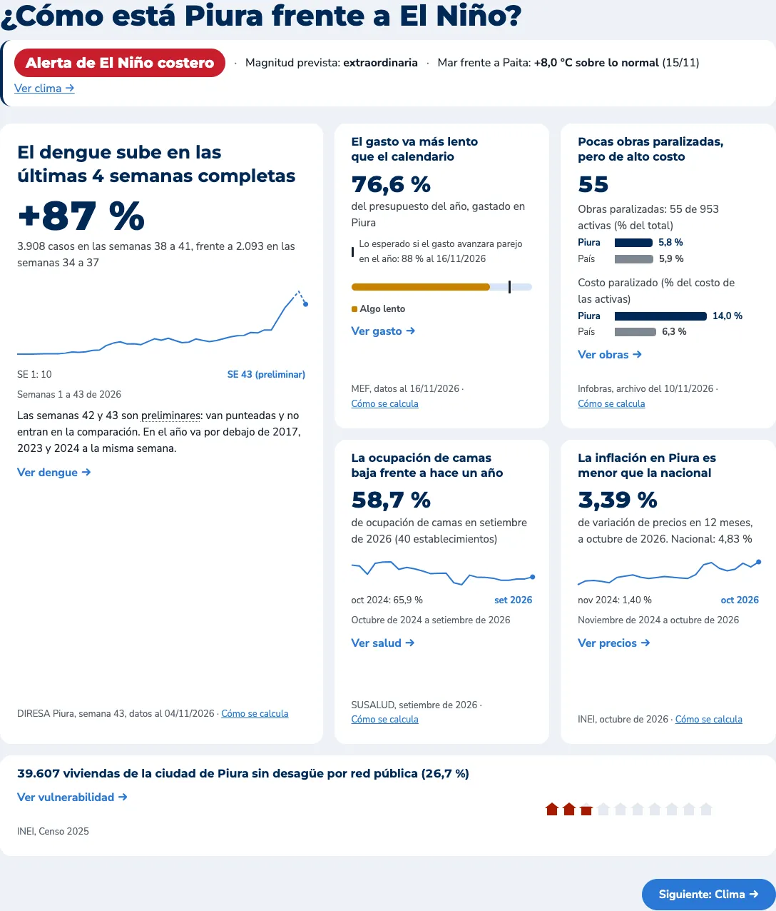
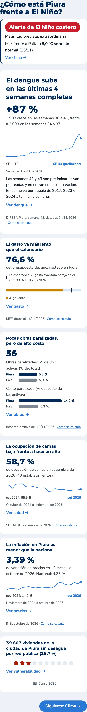
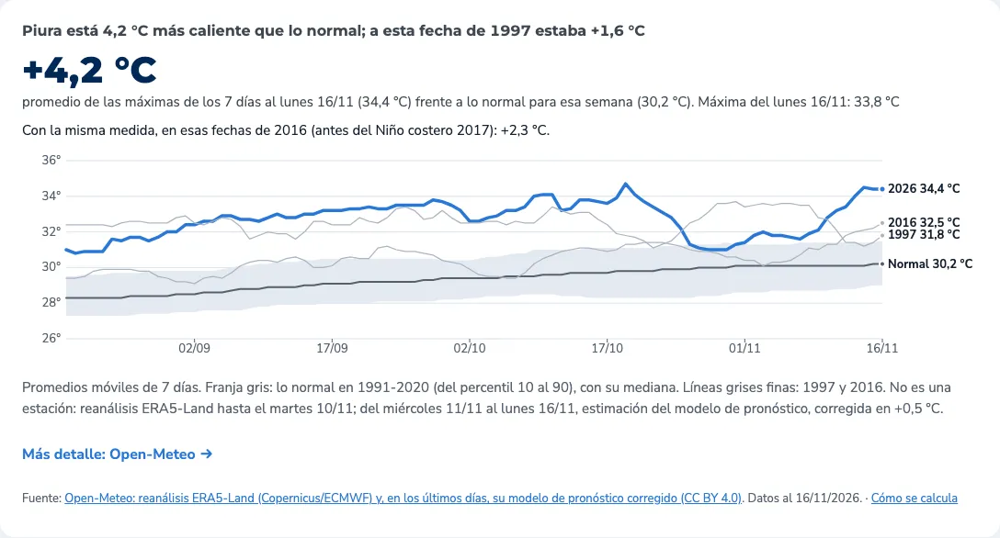
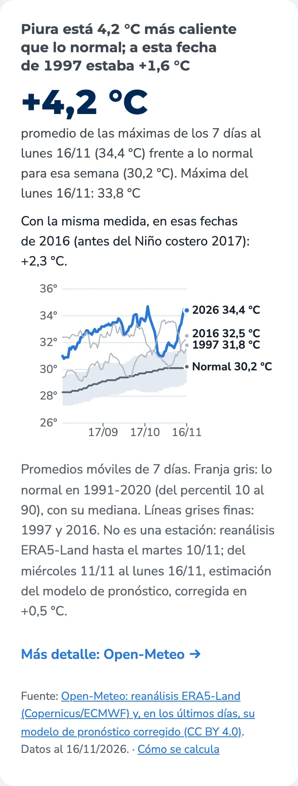
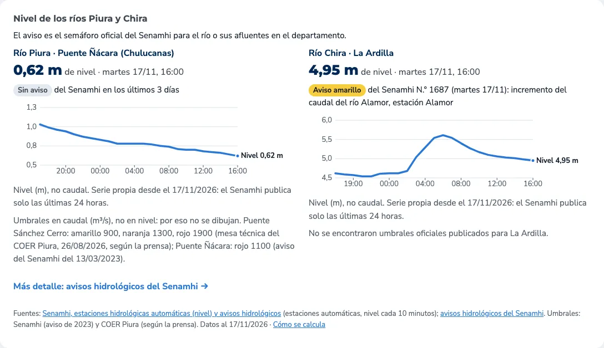
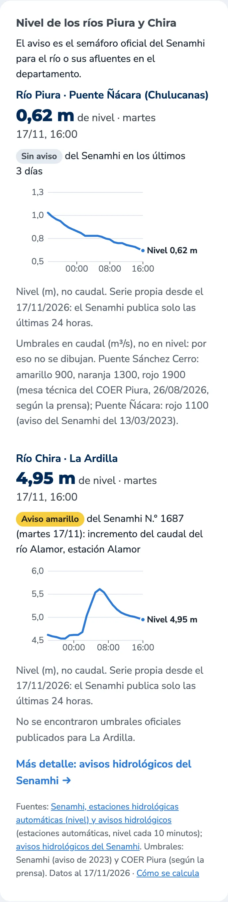

# Avance: ronda 19, temperatura y ríos a todo el ancho, y Resumen

Fecha: 17 de noviembre de 2026. Los cambios tienen un commit local, sin push. Falta tu revisión.

Para verla en local: `python3 -m http.server 8000 -d docs` y abrir http://localhost:8000/#resumen y http://localhost:8000/#clima.

## A. Temperatura (tarjeta de ancho completo)

1. **El dato de 1997 no reutiliza la serie actual.** Difiere de 2026 en 86 de los 90 días. El +2,6 °C de los dos fue casualidad: el promedio de 7 días era de 32,76 °C en 2026 y de 32,74 °C en 1997.
2. **Una sola métrica:** la anomalía del promedio de las máximas de los últimos 7 días frente a lo normal de esa semana. Es la cifra grande (+4,2 °C), el titular y la frase. La máxima del último día va como dato secundario.
   - **Titular de hoy:** «Piura está 4,2 °C más caliente que lo normal; a esta fecha de 1997 estaba +1,6 °C». En 2016, +2,3 °C.
3. **Días recientes sin retraso:**
   - ERA5-Land hasta su último día (10/11).
   - Del 11/11 a ayer, el modelo de pronóstico de Open-Meteo (`past_days`), corregido con su diferencia media con ERA5-Land en los últimos 30 días comunes: +0,54 °C.
   - **Lo medido antes de decidir:** en 86 días comunes el pronóstico marca 0,51 °C menos en promedio. Cada día difiere en promedio 1 °C, y la diferencia entre promedios de 7 días va de −1,46 a +0,20 °C.
   - La nota de la tarjeta dice qué días son estimación, y «Cómo se calcula» explica los dos tramos.
4. **Gráfico de 90 días:**
   - promedios móviles de 7 días;
   - franja de lo normal: percentiles 10 a 90 de 1991–2020, juntando los 30 años y ±7 días, con su mediana;
   - 1997 y 2016 en gris fino;
   - la actual en azul.

## B. Ríos (tarjeta de ancho completo, debajo de la temperatura)

1. **Umbrales:** no encontré un informe técnico del Senamhi con la tabla. Lo que hay:

| Estación | Umbrales | Unidad | Fuente |
| --- | --- | --- | --- |
| Puente Sánchez Cerro | Amarillo 900 · Naranja 1300 · Rojo 1900 | caudal (m³/s) | Mesa técnica del COER Piura, 26/08/2026, según Walac: https://walac.pe/rio-piura-establecen-umbrales-de-caudal-para-activar-alertas-y-restringir-el-transito/ (otras notas antiguas dicen 1290 para el naranja) |
| Puente Ñácara | Rojo 1100 | caudal (m³/s) | Aviso oficial del Senamhi del 13/03/2023: https://www.senamhi.gob.pe/?p=avisos-detalle-hidrologicos&ca=25617&ce=47E0415A |
| La Ardilla | — | — | No encontré umbrales |

   Están en caudal y lo que tenemos es nivel, así que van en texto y no como líneas.
2. **Cada columna** (río Piura | río Chira, apiladas en el celular):
   - el nivel actual con hora;
   - el **semáforo oficial**: el último aviso hidrológico del Senamhi para el río o sus afluentes en el departamento (en el Chira: Alamor, Macará, Quiroz y Chipillico), de los últimos 3 días, con número, fecha y nivel en palabras. Hoy: el Piura, sin aviso; el Chira, aviso amarillo N.° 1687 del río Alamor;
   - la serie propia, desde el 17/11/2026;
   - el eje con la hora mientras la serie tenga 1 o 2 días.
   - El script guarda los avisos de 30 días de la lista pública `?p=avisos-hidrologicos`. El estado numérico de PHISIS sigue guardándose, pero no se muestra porque no dice qué color es cada número.
3. **GloFAS no se muestra:**
   - en la época seca daba 100 a 200 m³/s en Ñácara, con un nivel medido de 0,62 m (unos pocos m³/s);
   - en La Ardilla, entre 170 y 1090 m³/s; el Senamhi midió 102 en abril y 656 en febrero, en plena lluvia;
   - en Sánchez Cerro, la celda cae fuera del cauce (0,1 m³/s);
   - el Chira está regulado por Poechos, y el modelo no lo sabe.

   Así lo explica «Cómo se calcula».
4. **Proyecto Especial Chira-Piura** (solo reporte): publica informes técnicos mensuales en PDF en gob.pe, con balances de Poechos en millones de m³. Por ejemplo: https://cdn.www.gob.pe/uploads/document/file/3274145/Informes%20T%C3%A9cnicos%20hidro%20N%C2%B0%2000003-2018.pdf. Los más recientes que encontré son de 2020. Los partes diarios no están en línea.

## C. Resumen

1. **Franja de El Niño,** arriba del panel destacado: etiqueta del estado del ENFEN, magnitud prevista, «Mar frente a Paita: +8,0 °C sobre lo normal (15/11)» y «Ver clima →». Usa los mismos datos que Clima. En el celular va en filas, sin separadores.
2. **Tarjeta de Vulnerabilidad:** «39.607 viviendas de la ciudad de Piura sin desagüe por red pública (26,7 %)», con 10 casas y el enlace. Usa `censo_resumen.json` (0,3 KB), que escribe `censo_inei.py`, así que la portada no carga el censo entero.
3. **Ríos:** un aviso naranja o rojo de los últimos 2 días (río Piura, Chira o afluentes) aparece debajo de la franja. Hoy no hay ninguno: el del Alamor es amarillo. La prueba simula los dos casos.
4. **Altura del Resumen:**

| | Antes | Después |
| --- | --- | --- |
| Celular (375 px) | 2357 px | 2779 px (+18 %) |
| Computadora (1280 px) | 1013 px | 1275 px (+26 %) |

   La primera versión subía +22 % en el celular y +54 % en la computadora, porque la fila nueva era tan alta como las otras. Ahora la 3.ª fila se ajusta a su contenido y la tarjeta usa la frase como título, sin repetir la cifra.

## Pruebas

Pasan las 6 pruebas del proyecto.

- **`test_clima.py`:**
  - franja normal;
  - unión con el pronóstico (corrección, hoy fuera);
  - anomalías;
  - lectura de la lista de avisos (solo las cuencas del Piura y del Chira).
- **`test_pagina.py`:**
  - título, cifra y frase de la temperatura con el mismo número;
  - franja dibujada;
  - dos columnas de ríos con su aviso;
  - franja de El Niño;
  - aviso de ríos solo si es naranja o rojo;
  - tarjeta de Vulnerabilidad con 10 casas;
  - 6 títulos en la portada.

## Capturas

| Vista | 1280 px | 375 px |
| --- | --- | --- |
| Resumen |  |  |
| Temperatura |  |  |
| Ríos |  |  |

## Pendientes

1. **Umbrales de los ríos:** confirmar los de Sánchez Cerro en un documento oficial. El borrador de correo de la ronda 18 sigue en `privado/correo_rios.md`.
2. **Temperatura:** la corrección del pronóstico es un promedio. Un promedio de 7 días puede diferir hasta 1,5 °C del reanálisis, así que el titular de los últimos días es una estimación.
3. **GloFAS:** descartado por ahora. Se podría revisar en temporada de lluvias, comparando con el caudal medido.
