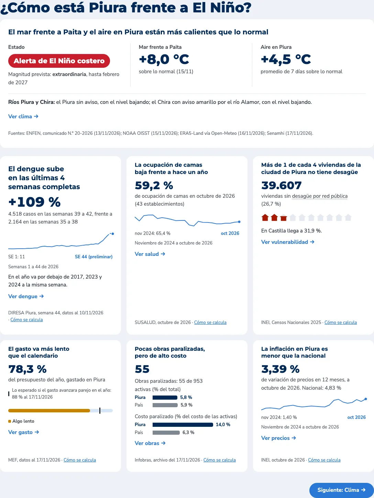
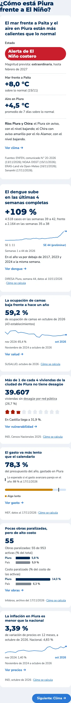
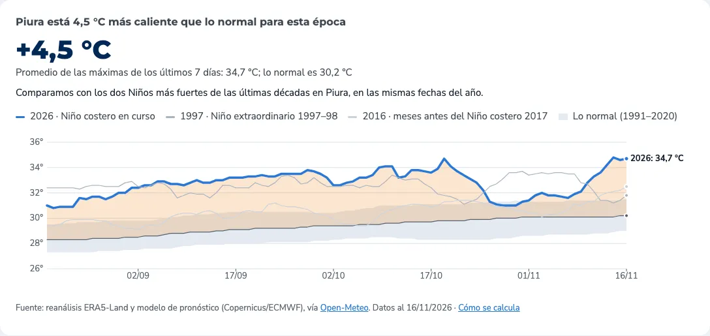
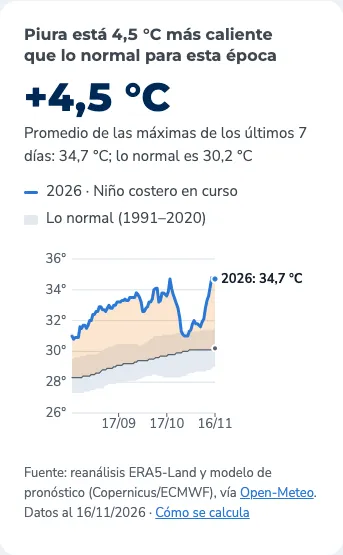
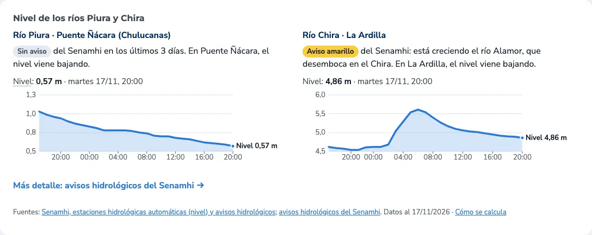
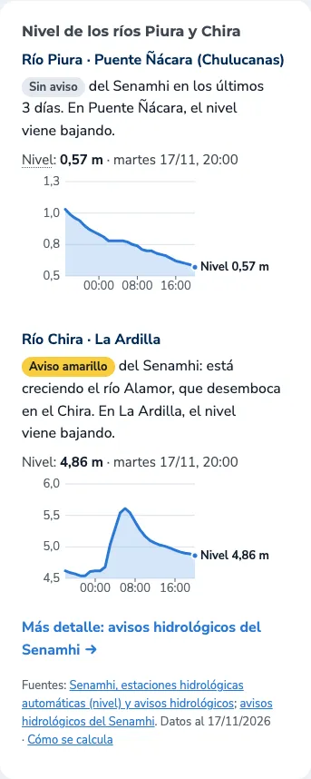

# Avance: ronda 20, textos de temperatura y ríos, y tarjetas de El Niño y Vulnerabilidad en el Resumen

Fecha: 17 de noviembre de 2026. Los cambios tienen un commit local, sin push. Falta tu revisión.

Para verla en local: `python3 -m http.server 8000 -d docs` y abrir http://localhost:8000/#resumen y http://localhost:8000/#clima.

**Regla general aplicada:** el cuerpo de cada tarjeta dice qué pasa y qué significa. Lo técnico pasó a «Cómo se calcula» o al globo de un término:

- en la temperatura, los tramos de reanálisis y pronóstico, la corrección y la celda;
- en los ríos, que el dato es nivel y no caudal, desde cuándo hay serie y los umbrales.

## Verificación de 1997

**Se sostiene:** hoy hace más calor que en 1997 a esta fecha, también con estaciones. No hizo falta la regla de respaldo. Igual, como pediste en A2, el titular ya no compara con 1997: 1997 queda solo en el gráfico y la leyenda.

**Estaciones usadas:**
- **1997 y 2016:** el Senamhi no ofrece datos históricos diarios descargables, así que usé NOAA GHCN-Daily, estación del aeropuerto de Piura (PEM00084401).
- **2026:** GHCN no tiene datos desde 2024, así que usé la estación Bernal del Senamhi (máximas de los últimos 31 días en su ventana del mapa). San Miguel, en Catacaos, publica solo algunos días.

**Promedio de las máximas de los 7 días al 16/11 de cada año:**

| Año | Estación | ERA5-Land (la tarjeta) |
| --- | --- | --- |
| 1997 | 32,7 °C, aeropuerto (6 de 7 días) | 31,8 °C |
| 2016 | 32,3 °C, aeropuerto (5 de 7 días) | 32,5 °C |
| 2026 | 33,8 °C, Bernal (7 de 7 días) | 34,7 °C (ERA5-Land más el pronóstico corregido) |

**Lo normal en el aeropuerto:** 30,5 °C (1991–2020, la misma medida que la tarjeta), muy cerca de lo normal de ERA5-Land (30,2 °C).

**Anomalías con estaciones:** 1997, +2,2 °C; 2026, unos +3,3 °C. Son estaciones distintas, a 32 km una de otra, así que la cifra es aproximada.

**Lo que muestra:**
- ERA5-Land marca menos que la estación en 1997 (−0,9 °C) y casi lo mismo en 2016.
- En 2026 marca algo más que Bernal, pero menos que San Miguel en los días que tiene (34 y 36,5 °C, frente a 33,0 y 33,8 °C).

El resultado está en «Cómo se calcula».

## A. Temperatura

- **Titular:** «Piura está 4,5 °C más caliente que lo normal para esta época». Debajo, la cifra (+4,5 °C) y una línea: «Promedio de las máximas de los últimos 7 días: 34,7 °C; lo normal es 30,2 °C».
  - Hoy la anomalía es de 4,5 °C, no de 4,2, porque los datos se actualizaron.
  - Se quitaron 1997 del titular, la línea de 2016 y la máxima del día.
- **Gráfico:**
  - un sombreado naranja (22 %) solo entre 2026 y la mediana normal, y azul (15 %) si va por debajo. No rellena hasta el eje, y la franja gris se sigue viendo;
  - solo 2026 lleva rótulo («2026: 34,7 °C»);
  - leyenda en una línea arriba, con la frase «Comparamos con los dos Niños más fuertes…»;
  - 1997 en gris y 2016 en gris más claro, con un token nuevo, `--gris-ref-claro`.
- **Celular (menos de 640 px):** no se dibujan 1997 ni 2016, ni su parte de la leyenda ni la frase. Quedan el sombreado, la franja y 2026.
- **Pie:** «Fuente: reanálisis ERA5-Land y modelo de pronóstico (Copernicus/ECMWF), vía Open-Meteo. Datos al 16/11/2026 · Cómo se calcula».
- **«Cómo se calcula»:** la celda de ~10 km, los dos tramos, la corrección (unos +0,5 °C) y los promedios móviles de 7 días. Debajo, «Datos de esta actualización» dice qué días son estimación y la corrección exacta (hoy, +0,68 °C).

## B. Ríos

- **Frase de cada río,** generada desde los datos: el aviso del Senamhi en palabras y la tendencia del nivel. Hoy:
  - Chira: «**Aviso amarillo** del Senamhi: está creciendo el río Alamor, que desemboca en el Chira. En La Ardilla, el nivel viene bajando».
  - Piura: «**Sin aviso** del Senamhi en los últimos 3 días. En Puente Ñácara, el nivel viene bajando».
- **Umbral de tendencia:** el último nivel frente al de 6 horas antes, o el más cercano entre 6 y 12 horas si falta.
  - Más de +5 cm: «está subiendo»; menos de −5 cm: «viene bajando»; si no, «está estable».
  - Si en las últimas 12 horas hubo un pico al menos 5 cm sobre los dos extremos, la frase dice «subió [de madrugada / en la mañana / en la tarde / de noche] y ya está bajando».
  - Con menos de 6 horas de serie no dice nada de la tendencia.
  - **Por qué 5 cm:** sin lluvia, las dos estaciones varían 1 a 3 cm por hora.
  - Está en «Cómo se calcula» y tiene prueba con 5 casos.
  - **Hoy:** La Ardilla subió de 4,6 a 5,6 m entre las 3:00 y las 6:00. Como el pico pasó hace más de 12 horas, la frase dice «viene bajando» y no «subió de madrugada…».
- **Con aviso naranja o rojo,** la frase va en negrita. La pastilla siempre usa el color oficial.
- **La cifra en metros pasa a dato secundario,** chico y junto a la hora: «Nivel: 0,57 m · martes 17/11, 20:00». «Nivel» abre el globo: «Nivel del agua en la regla de la estación; no es profundidad del río».
- **Gráfico:** área celeste (`--ll1`, 35 %) bajo la línea.
  - **Eje:** la hora cada 4 horas. Bajo 500 px de ancho de gráfico, cada 8 horas, porque a 375 px las de 4 horas se enciman (ver «Decisiones»).
- **Salieron del cuerpo** «Nivel (m), no caudal. Serie propia desde…» y los umbrales. Ahora están en «Cómo se calcula»:
  - los del COER, como «referencia no oficial, según la prensa»;
  - el de Ñácara, como «referencia histórica (aviso del Senamhi de 2023)».

## C. Resumen

1. **Tarjeta de El Niño** (reemplaza la franja), de ancho completo debajo de la pregunta:
   - **Titular:** «El mar frente a Paita y el aire en Piura están más calientes que lo normal».
   - **3 columnas en la computadora:**
     - Estado: la etiqueta «Alerta de El Niño costero» y «Magnitud prevista: extraordinaria, hasta febrero de 2027»;
     - Mar frente a Paita: «+8,0 °C sobre lo normal (15/11)»;
     - Aire en Piura: «+4,5 °C, promedio de 7 días sobre lo normal».
   - **Línea de los ríos:** la misma frase de Clima, resumida. Hoy: «Ríos Piura y Chira: el Piura sin aviso, con el nivel bajando; el Chira con aviso amarillo por el río Alamor, con el nivel bajando». Con aviso naranja o rojo se vuelve un recuadro destacado con borde del color oficial y en negrita (la prueba simula los dos casos).
   - «Ver clima →» y un pie con la fuente y la fecha de cada dato.
   - En el celular, las columnas se apilan en ese orden, con cifras más chicas.
2. **Vulnerabilidad,** tarjeta normal dentro de la grilla:
   - titular «Más de 1 de cada 4 viviendas de la ciudad de Piura no tiene desagüe»;
   - cifra «39.607»: «viviendas sin desagüe por red pública (26,7 %)», con globo que define el término;
   - 10 casas de unos 22 px, en `--v4`, el color del mapa;
   - «En Castilla llega a 31,9 %»;
   - enlace y pie «INEI, Censos Nacionales 2025 · Cómo se calcula».
   - **Proporción** (`fraccionTxt()`): «1 de cada n» con «Más de» o «Casi» si se aparta más de 1 punto. Sobre el 50 %, «X de cada 10».
   - **Datos:** el % por distrito sale de `censo_resumen.json`, que ahora trae los 3 distritos. Lo escribe `censo_inei.py` con la función `resumen()`, y se regeneró desde `censo_piura.json`, sin volver a procesar el censo.
3. **Grilla:** 6 tarjetas iguales, 3 × 2 en la computadora, 2 × 3 en la tablet y una columna en el celular. Sin filas huérfanas.
   - **Orden:**
     - fila 1: **Dengue · Camas · Vulnerabilidad**, lo que pesa en una emergencia (salud y vivienda);
     - fila 2: **Gasto · Obras · Precios**, la respuesta del Estado y la economía.
   - **Alturas:** el dengue ya no ocupa 2 filas. Cada fila toma el alto de su contenido; con filas iguales, la 2.ª quedaba con mucho espacio vacío.
   - **Espacio vacío:** para que la fila 1 no tenga huecos grandes, la explicación de las semanas preliminares del dengue pasó a «Cómo se calcula». El gráfico ya las marca punteadas y con «(preliminar)».
4. **Mismos datos y funciones que Clima:**
   - aire: `D.temp.anomalia_7d`, con la misma `conSigno()`;
   - mar: la última fila de `D.tsm`;
   - ríos: la misma `fraseRio()`;
   - fechas: la misma `fecha()`.
   - **Prueba nueva:** la cifra del aire en Clima es igual a la del Resumen, la anomalía del mar del Resumen aparece en la tarjeta del mar de Clima, la frase de cada río de Clima es exactamente `fraseRio()`, y la línea del Resumen contiene su versión resumida.

## Decisiones tomadas con la regla de respaldo (o por mi cuenta)

1. **Color del ENFEN:** no publica una paleta oficial para sus estados, así que la etiqueta usa el estilo de alerta de Clima (rojo `--alerta`). Los avisos del Senamhi sí usan sus colores oficiales.
2. **Eje de los ríos:** cada 4 horas pedido; cada 8 horas cuando el gráfico mide menos de 500 px (celular), porque se enciman.
3. **Tarjeta de El Niño:** le agregué un titular con el mensaje, por el patrón «titular, cifra, contexto».
4. **Grilla:** filas a la medida de su contenido en vez de filas iguales.
5. **Dengue:** la frase de semanas preliminares pasó a «Cómo se calcula».
6. **Arreglo de paso en el gráfico del dengue** (pestaña Dengue, 375 px): con la SE 44, el rótulo de 2026 se salía por la derecha. La prueba fallaba antes de esta ronda. Ahora, si no cabe, va debajo y a la izquierda del último punto.
7. **Datos locales:** corrí `rios_senamhi.py` y `temperatura_piura.py` para tener la serie de ríos de 24 horas en las capturas. Esos dos archivos van en el commit, como en las rondas 18 y 19.

## Pruebas

Pasan las 6 pruebas del proyecto.

- **`test_pagina.py`:**
  - tarjeta de El Niño;
  - Vulnerabilidad: titular, cifra, casas, distrito y proporciones;
  - orden de la grilla;
  - alerta de ríos solo con naranja o rojo;
  - temperatura: titular, línea, pie, sombreado y un solo rótulo;
  - ríos: frases, área, nada técnico en el cuerpo y 5 casos de tendencia;
  - mismas cifras en Clima y el Resumen.
- **`test_censo_inei.py`:** el resumen por distrito coincide con el censo completo y suma lo mismo que la ciudad.

## Capturas

| Vista | 1280 px | 375 px |
| --- | --- | --- |
| Resumen |  |  |
| Temperatura |  |  |
| Ríos |  |  |
