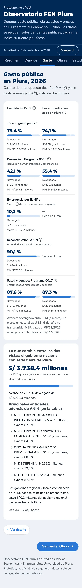
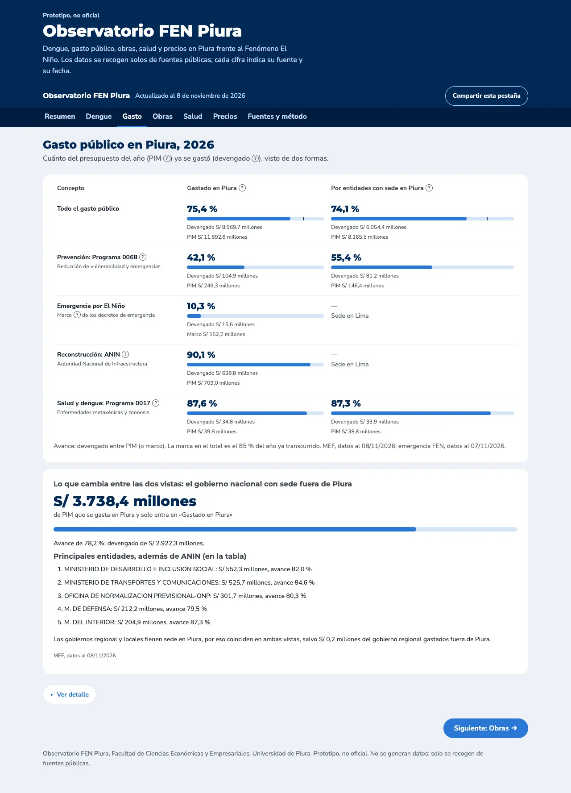
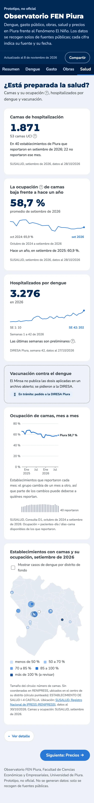
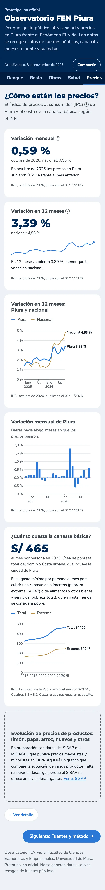
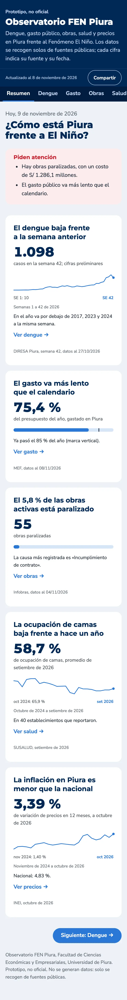
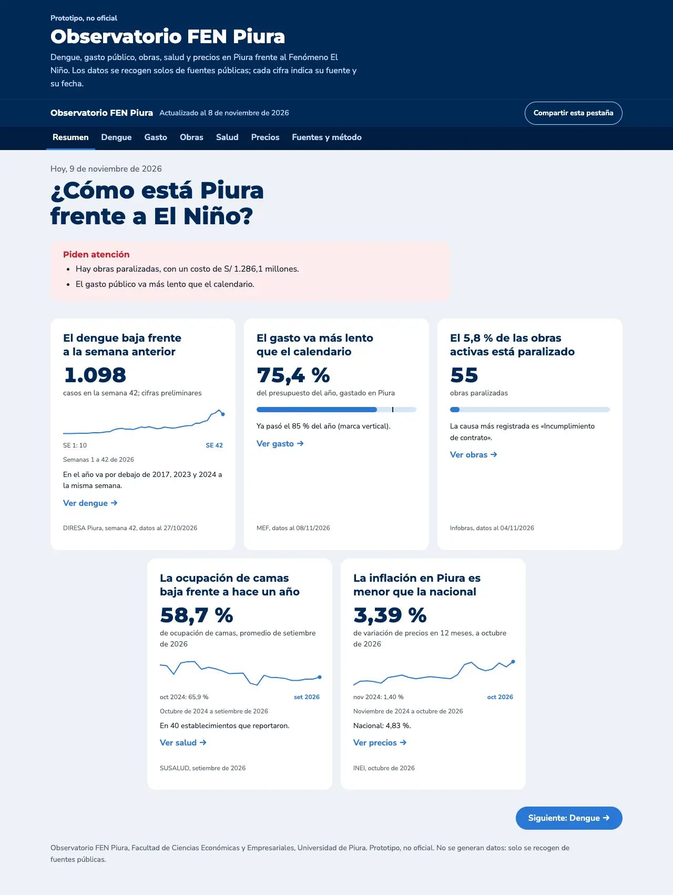
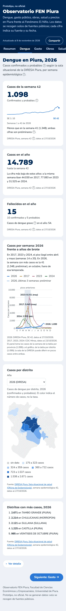
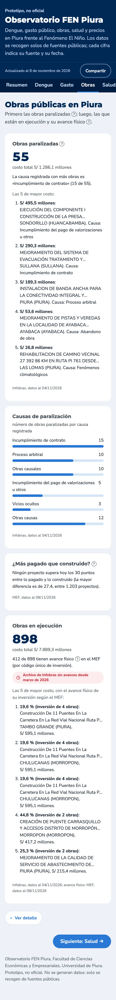
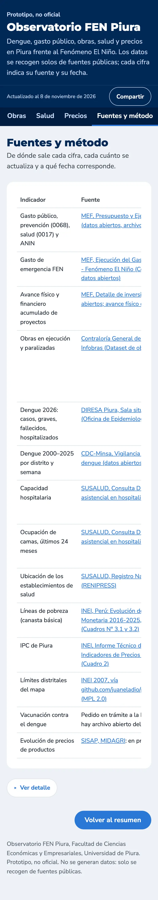

# Avance: ronda de contenido y diseño

Fecha: 9 de noviembre de 2026. Todo está en commits locales; **no se ha hecho push**. Falta tu revisión.

Para verla en local: `python3 -m http.server 8000 -d docs` y abrir http://localhost:8000.

## A. Gasto sin repeticiones

- **Tabla comparativa** en lugar de las tarjetas lado a lado:
  - filas: todo el gasto, prevención (0068), emergencia FEN, reconstrucción (ANIN) y salud y dengue (0017);
  - columnas: «Gastado en Piura» y «Por entidades con sede en Piura», cada una con avance, barra, devengado y PIM (en la emergencia FEN, el marco);
  - ANIN y FEN muestran «—» y «Sede en Lima» en la segunda vista;
  - en celular, el concepto va arriba y las dos vistas lado a lado.
- **Tarjeta «Lo que cambia entre las dos vistas»:**
  - el gasto en Piura del gobierno nacional con sede fuera de la región: S/ 3.738,4 millones de PIM, con su avance;
  - las 5 entidades con más PIM, sin ANIN, que ya tiene su fila;
  - la frase sobre los gobiernos regional y locales dice la excepción exacta: «salvo S/ 0,2 millones del gobierno regional gastados fuera de Piura».
- **Una sola vez en la pestaña:**
  - el desglose por nivel de gobierno va solo en el detalle;
  - los gobiernos locales dicen «Igual en ambas vistas» en vez de repetir sus cifras;
  - los S/ 10,9 millones del gobierno nacional con sede en Piura se explican en «Por qué difieren».

## B. Mini-gráficas

- Siguen sin ejes. Rotulan el valor inicial con su periodo, el periodo final y, debajo, el periodo que cubren («Semanas 1 a 42 de 2026»).
- El rótulo final no repite la cifra del panel. En dengue, además, la cifra sale de la tabla por provincia y la serie de la tabla por distrito, que difieren en pocos casos.
- En la portada, cada panel tiene su enlace «Ver dengue →», «Ver gasto →»…

## C. Salud

- **Ocupación mes a mes:**
  - `scripts/camas_serie.py` recalcula los últimos 24 meses (octubre de 2024 a setiembre de 2026), con el mismo cálculo validado de `camas_susalud.py`;
  - el último mes da 58,7 %, igual que la cifra que ya mostraba la página;
  - debajo del gráfico, barras finas con cuántos establecimientos reportaron cada mes (de 35 a 50), porque el grupo cambia.
- **Mapa de establecimientos:**
  - `scripts/renipress.py` toma las coordenadas del registro RENIPRESS de SUSALUD; 60 de los 62 establecimientos las tienen;
  - el círculo crece con las camas y el color va según la ocupación;
  - el «I-4 Castilla», sin coordenadas, va en el centro de su distrito con un círculo punteado y se nombra en la nota;
  - el dengue por distrito, en grises, es un fondo opcional.
- **Título por regla:** «La ocupación de camas baja frente a hace un año» (58,7 % frente a 60,9 % en setiembre de 2025). Si la serie no es del mismo mes que la cifra, el título vuelve a la pregunta.
- **`scripts/actualizar_local.sh`:** corre también los dos scripts nuevos y sube sus archivos.

## D. Precios

- **«¿Cuánto cuesta la canasta básica?»:**
  - S/ 465 al mes por persona en 2025, la línea de pobreza total del dominio Costa urbana; la extrema es S/ 247;
  - gráfico 2016 a 2025, y Costa rural y nacional en el detalle;
  - la fuente es el INEI, «Evolución de la Pobreza Monetaria 2016-2025», Cuadros N° 3.1 y 3.2;
  - el INEI ya no usa «Costa norte» y no publica líneas por departamento: Piura está en Costa urbana y Costa rural.
- **`scripts/lineas_pobreza.py`:**
  - lee el PDF con pypdf, porque pdfplumber desarma esos cuadros;
  - se detiene si los valores de 2025 no son los verificados a mano;
  - se corre a mano cada mayo.
- **Panel SISAP:** «Evolución de precios de productos: limón, papa, arroz, huevos y otros», en preparación y del tamaño de un gráfico. El pollo queda fuera hasta confirmar que el SISAP lo tiene: solo figura «Carne fresca».

## E. Diseño

- **Sistema de diseño:** tokens en CSS y su documentación en `docs/design-system.md` (color, escala tipográfica 1,25, espacios de 4 y 8 px, radios concéntricos, una sombra solo para lo que flota).
- **Un solo acento**, el azul `#2a78d6`, para Piura, 2026, enlaces, la pestaña activa y «Siguiente». El marino queda para la estructura y el rojo solo para alertas.
- **Sin íconos en los paneles.** Los únicos distintivos son «Dato no actualizado» y «En trámite»; «Prototipo, no oficial» es texto.
- **Tipografía:** números tabulares en toda la página, monoespaciada solo para el CUI, y `text-wrap: balance` en los títulos.
- **Títulos con el hallazgo**, por reglas descritas en «Fuentes y método». Por ejemplo: «El dengue baja frente a la semana anterior», «El gasto va más lento que el calendario», «El 5,8 % de las obras activas está paralizado» y «La inflación en Piura es menor que la nacional».
- **Paneles:** cifra de 39 px y mini-gráfica de 56 px. Superficies sin borde ni sombra, separadas por espacio.
- **«Piden atención»** dice el hallazgo sin repetir las cifras de los paneles.
- **Carga y movimiento:** esqueletos mientras cargan los datos y un mensaje claro si una fuente falla. Animaciones breves al cambiar de pestaña, abrir el detalle y copiar el enlace, desactivadas con `prefers-reduced-motion`.
- **Auditoría web-design-guidelines, corregido:**
  - enlace «Saltar al contenido»;
  - las anclas ya no quedan bajo la barra fija;
  - comillas tipográficas en «Fuentes y método»;
  - búsquedas sin autocompletar y con «…» en el texto de ejemplo;
  - precarga de las dos tipografías principales y `theme-color`;
  - códigos con `translate="no"`.

## F. Verificación

- **`scripts/test_pagina.py` pasa.** Ahora también revisa:
  - que todo `var(--…)` usado esté definido. Encontró dos tokens que faltaban después de la fase 1: las grillas de los gráficos y el gris de cero casos del mapa;
  - los 5 títulos de la portada y la regla del de salud.
- **Las cifras no cambiaron.** Comparé el texto de las 7 pestañas, con el detalle abierto, antes y después, con los mismos datos:
  - Dengue, Obras, Salud, Precios y Fuentes conservan todos sus números;
  - Gasto deja 7 porcentajes, el avance por nivel dentro de cada concepto, porque el desglose ahora va una sola vez;
  - la portada deja «semana 41», de la frase anterior.
- **`/ponytail-review`:** 3 hallazgos, corregidos.
  - el título de salud ya no mezcla meses si un script falla;
  - `camas_serie.py` resume cada mes una sola vez;
  - hay prueba de los títulos.

Las otras pestañas en celular:

## Posible siguiente indicador

La incidencia de la pobreza monetaria en Piura sale del mismo informe del INEI (Cuadro N° III.1): 28,1 % en 2025, con un intervalo de confianza de 24,9 % a 31,2 %, y serie desde 2016. No se agregó en esta ronda.

## Commits (locales)

`6fafcb5` y `369eec7` (fase 1), `2ce7f5b` (tokens), `a70b018` (SUSALUD), `b88f074` (INEI), `f18ab2e` (Salud y Precios), `1b9cccb` (prueba), auditoría, `3abfab9` (revisión) y este documento.
