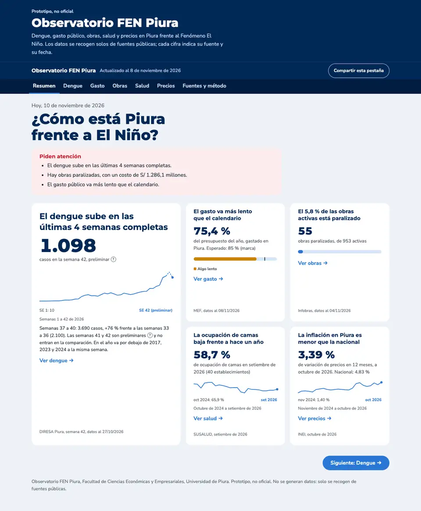
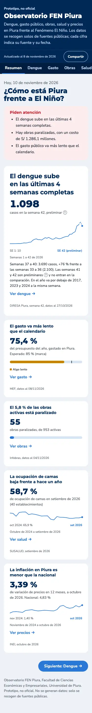
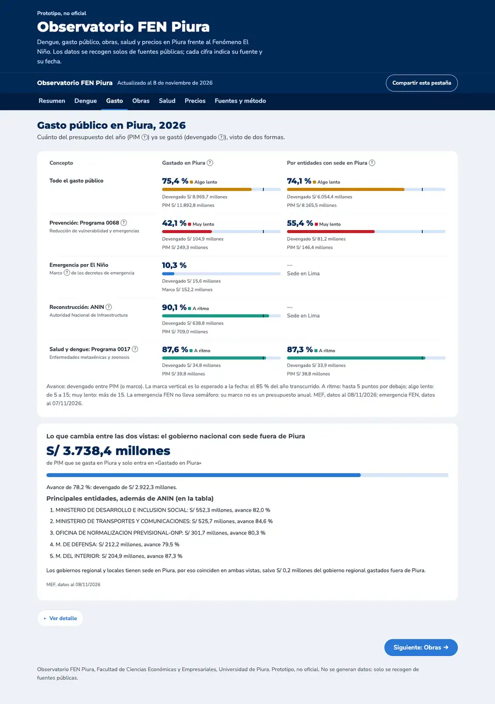
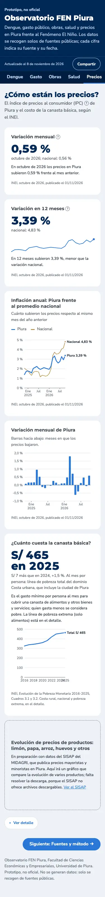
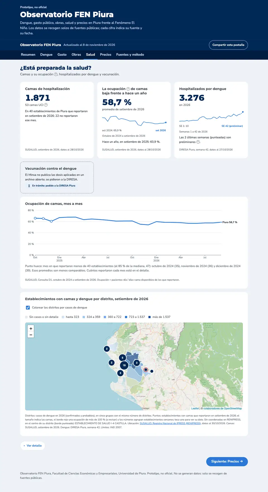
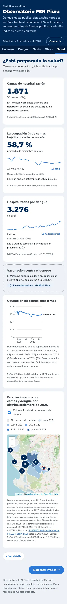
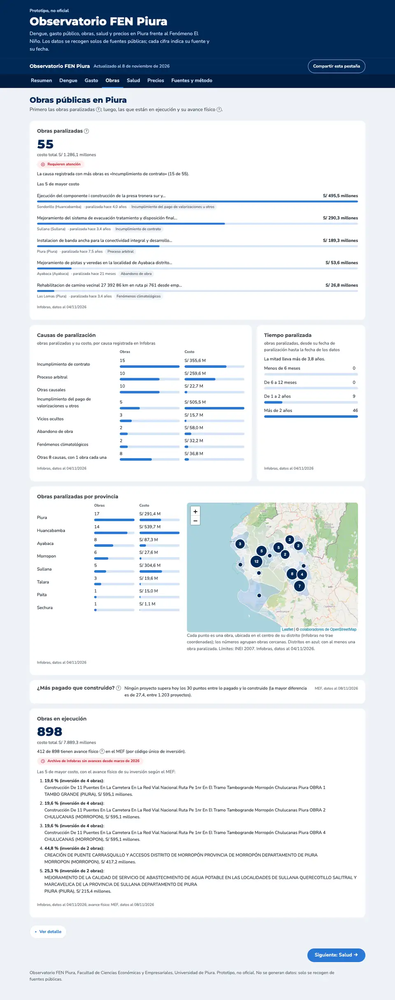
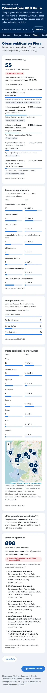
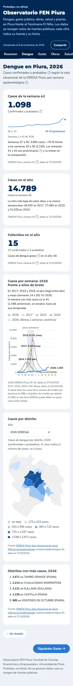
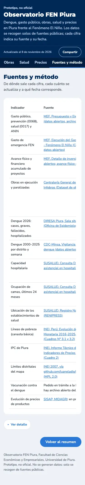

# Avance: segunda ronda de contenido y diseño

Fecha: 10 de noviembre de 2026. Todo está en commits locales; **no se ha hecho push**. Falta tu revisión.

Para verla en local: `python3 -m http.server 8000 -d docs` y abrir http://localhost:8000.

## A. Resumen

- **Panel destacado y 2 x 2:**
  - el dengue va destacado a la izquierda, con su cifra, la serie del año y la frase;
  - gasto, obras, salud y precios van compactos en 2 x 2, todos de igual alto;
  - los compactos llevan título, cifra, mini-gráfica, fuente y fecha, y «Ver X →»; su frase pasó a la línea bajo la cifra;
  - en tableta, el destacado ocupa todo el ancho; en celular, todo va apilado.
- **Regla del titular del dengue:**
  - las 2 últimas semanas son preliminares: van punteadas, dicen «preliminar» y no entran en la comparación;
  - se suman las últimas 4 semanas completas y se comparan con las 4 anteriores; más de +10 % es «sube», menos de −10 % es «baja», y si no, «se mantiene»;
  - hoy: semanas 37 a 40 con 3.690 casos, +76 % frente a las semanas 33 a 36 (2.100). El título dice «El dengue sube en las últimas 4 semanas completas»;
  - la misma regla se usa en «Piden atención», en la pestaña Dengue y en «Fuentes y método».
- **Cambio que no estaba en el pedido:** antes la gráfica de Dengue punteaba 3 semanas. Ahora son 2 en toda la página, para que la regla y las gráficas coincidan.

## B. Colores de avance

- **Semáforo** solo en la ejecución del presupuesto del año: gasto total, niveles de gobierno, 0068, ANIN y 0017.
  - Va en la tabla comparativa (las dos vistas), en el detalle por nivel y en el panel de la portada.
  - Lo esperado es el porcentaje del año transcurrido a la fecha de los datos, marcado con una línea vertical.
  - «A ritmo»: hasta 5 puntos por debajo. «Algo lento»: de 5 a 15. «Muy lento»: más de 15.
  - Hoy: el gasto total va «algo lento» (75,4 % frente a 85 %); la prevención 0068, «muy lento» (42,1 %); el ANIN y el 0017, «a ritmo».
- **Colores validados con dataviz:**
  - verde azulado `#1a9a8a`, ámbar `#c98200` y rojo `#c81e2b` (el mismo de las alertas);
  - pasan la prueba de daltonismo (separación mínima de 12,3 entre pares) y tienen contraste de 3:1 o más sobre blanco;
  - sobre la pista clara de la barra quedan entre 2,5:1 y 2,7:1. Por eso el texto «A ritmo / Algo lento / Muy lento» siempre va junto a la barra.
- La emergencia FEN, el avance físico de obras y la ocupación de camas siguen en azul. El criterio está en «Fuentes y método»: la referencia es lineal, y en noviembre casi todo sale lento porque el gasto se concentra en diciembre.

## C. Precios

- El gráfico del IPC se llama «Inflación anual: Piura frente al promedio nacional», con el subtítulo «Cuánto subieron los precios respecto al mismo mes del año anterior».
- **Canasta básica:** «S/ 465 en 2025», y debajo «S/ 7 más que en 2024, +1,5 %».
  - El gráfico muestra solo la línea de pobreza total.
  - La extrema, Costa rural y la nacional están en la tabla del detalle.

## D. Salud

- **Ocupación mes a mes:**
  - sin la franja de reportes bajo el gráfico;
  - un punto hueco marca los meses con pocos establecimientos: menos del 85 % de la mediana (47), o sea menos de 40. Hoy son octubre, noviembre y diciembre de 2024 (35, 36 y 39). Una nota los explica;
  - el gráfico de establecimientos que reportaron va al detalle, con su eje y su título.
- **Mapa con Leaflet 1.9.4 y Leaflet.markercluster 1.5.3**, desde cdnjs, con la versión fija y la comprobación de integridad (SRI):
  - los distritos se colorean por casos de dengue de 2026, en 5 grupos con leyenda; la capa se puede apagar;
  - los establecimientos se agrupan cuando se superponen y el punto crece con las camas; un borde rojo marca una ocupación de más de 100 % (a revisar);
  - al tocar un distrito o un establecimiento se ve su dato;
  - acercar y mover: con los botones o el teclado; en celular, con dos dedos, para que un dedo siga desplazando la página;
  - si el CDN no responde, el mapa lo dice y los datos siguen en el detalle;
  - los límites son los de piura_distritos.json, devueltos a latitud y longitud en el navegador. No se agregó ningún archivo.

### Mapa de fondo: cambio frente a lo acordado

El fondo claro de CARTO (Positron), aprobado en Q9, ahora pide una clave de API: cada tesela devuelve el letrero «API KEY REQUIRED». Lo comprobé desde localhost y con la dirección de GitHub Pages. El fondo gris de Esri funciona sin clave, pero no confirmé que sus términos lo permitan. Se usa **OpenStreetMap estándar**: no pide clave y su política permite un sitio con poco tráfico que muestre la atribución «© colaboradores de OpenStreetMap». Es más colorido que un fondo claro; para compensarlo, los distritos van con relleno opaco. Si se quiere un fondo claro, hay que crear una cuenta en CARTO o Stadia y poner su clave en la página.

## E. Obras

- **Las 5 paralizadas de mayor costo**, como lista visual:
  - una barra proporcional al costo;
  - el nombre en minúsculas, con provincias y distritos en mayúscula inicial y cortado en 70 caracteres; el nombre completo aparece al pasar el cursor y está en el detalle;
  - el distrito, el tiempo paralizada y la causa como etiqueta gris.
- **Causas de paralización**:
  - cada causa con dos barras, número de obras y costo, ordenadas por número de obras;
  - las causas se muestran tal como las escribe Infobras, sin fusionarlas;
  - las 8 causas con una sola obra van juntas en una fila, y la tabla completa está en el detalle.
- **Por provincia:**
  - ranking de barras: Piura 17, Huancabamba 14, Ayabaca 8, Morropón 6, Sullana 5, Talara 3, Paita 1 y Sechura 1;
  - a su lado, el mapa Leaflet con cada obra en el centro de su distrito (Infobras no trae coordenadas);
  - los puntos se agrupan; un grupo de obras del mismo distrito se abre en abanico al hacer clic (lo comprobé).
- **Tiempo paralizada:**
  - se cuenta desde la fecha de paralización hasta la fecha de los datos;
  - resultado: 0 obras con menos de 6 meses, 0 de 6 a 12 meses, 9 de 1 a 2 años y 46 con más de 2 años; la mitad lleva más de 3,8 años;
  - no se usa el campo «días paralizado» de Infobras, que no cuadra con la fecha: 27 obras paralizadas hace años dicen 30 o 31 días;
  - el detalle tiene una columna nueva, «Tiempo paralizada».
- **«¿Más pagado que construido?»** queda en una línea cuando no hay alertas. Si las hay, muestra las 5 primeras.
- **Etiqueta sobria:** el panel de obras paralizadas lleva el distintivo «Requieren atención», con el mismo estilo que «Dato no actualizado» y «En trámite».

## F. Verificación

- **`scripts/test_pagina.py` pasa.** Ahora también comprueba:
  - que el título del dengue siga la regla, que borrar las semanas preliminares no lo cambie y que la regla dé «sube» y «baja» con series de prueba;
  - los cortes del semáforo en 5 y 15 puntos;
  - que los dos mapas dibujen sus 63 distritos, o muestren su mensaje si el CDN no respondió;
  - los nombres cortos: un nombre vacío y uno largo sin espacios.
  La prueba detectó un error que metí al corregir la revisión (una constante usada antes de definirse), y lo corregí antes del commit.
- **Las cifras no cambiaron.** Comparé el texto de las 7 pestañas, con el detalle abierto, antes (`8035685`) y después, con los mismos datos. Solo se fueron:
  - el «3» de «3 semanas preliminares», que ahora son 2;
  - el «202» del rótulo final de hospitalizados, que ahora dice «SE 42 (preliminar)»;
  - el «70» de la leyenda de ocupación del mapa SVG anterior.
  Los demás números se agregaron.
- **Auditoría web-design-guidelines, corregido:**
  - botones del mapa en español («Acercar», «Alejar», «Cerrar»);
  - cada punto del mapa tiene nombre para teclado y lector de pantalla, y foco visible;
  - conexión anticipada (`preconnect`) a cdnjs y a OpenStreetMap.
- **`/ponytail-review`:** 3 hallazgos, corregidos:
  - un nombre de obra vacío ya no detiene el arranque de la página;
  - el gráfico de reportes del detalle se dibuja aunque la serie y la cifra sean de meses distintos, y una nota lo explica;
  - un solo umbral de 5 puntos para el título del gasto y el semáforo.

Las otras pestañas en celular:

## Pendiente

- Probar el mapa en un celular real (el gesto de dos dedos). Se probó en un navegador de escritorio a 375 px.
- Decidir el mapa de fondo, si se quiere uno claro.

## Commits (locales)

`214ab6b` (fase 1: portada y Obras), `39129e2` (fase 2: Salud, Precios y auditoría), revisión y este documento.
