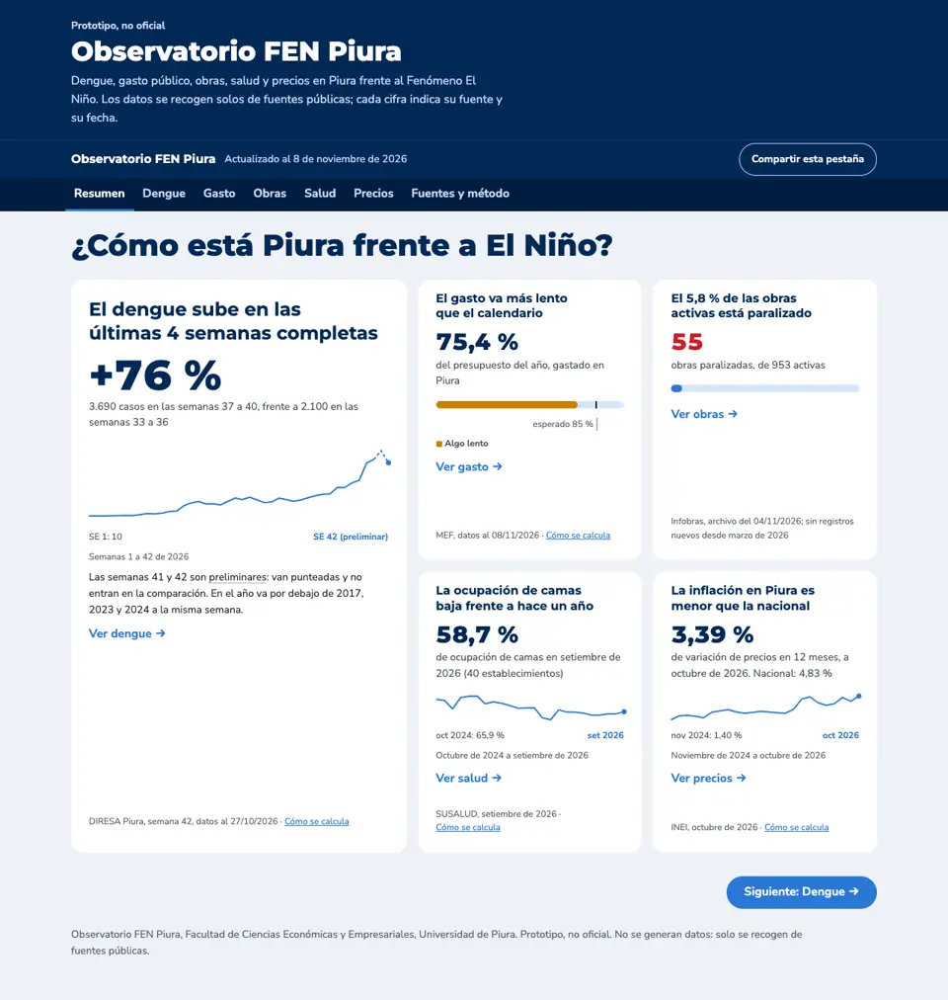
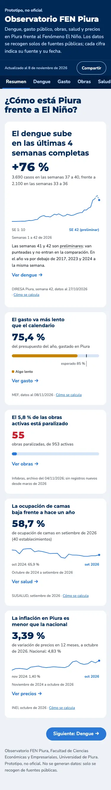
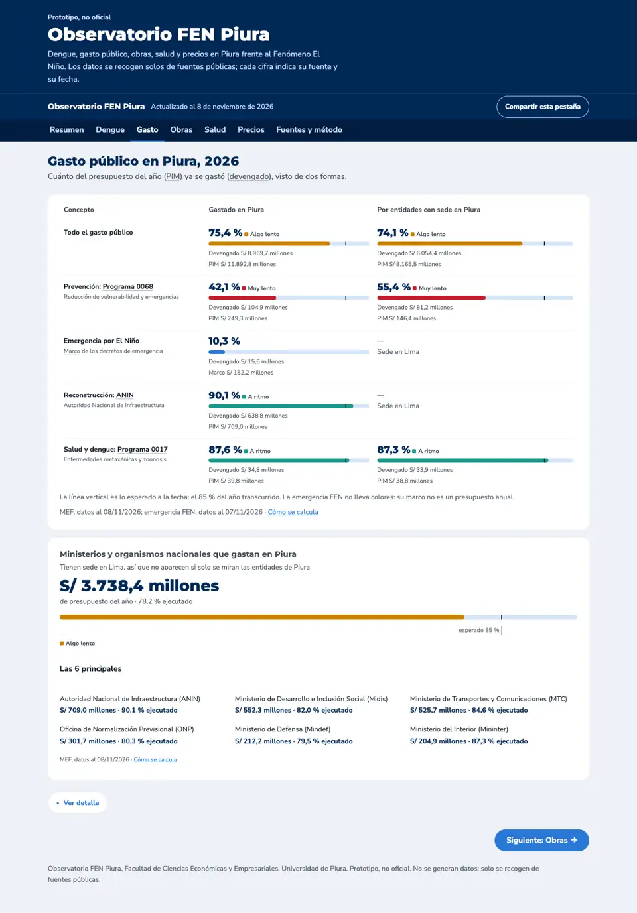
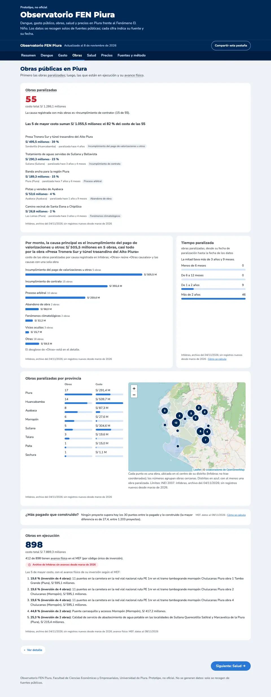
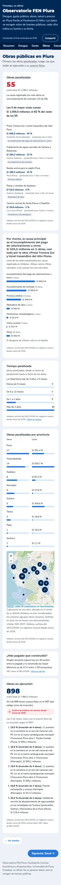
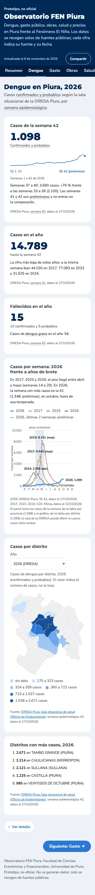
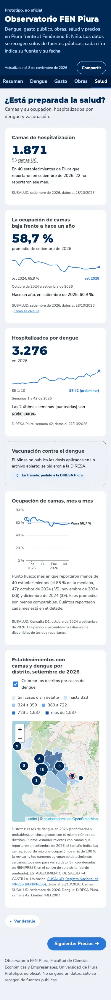
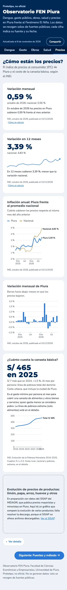
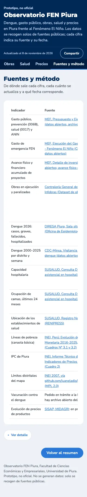

# Avance: ronda 8 de redacción y diseño

Fecha: 10 de noviembre de 2026. Todo está en commits locales; **no se ha hecho push**. Falta tu revisión.

Para verla en local: `python3 -m http.server 8000 -d docs` y abrir http://localhost:8000.

## A. Resumen

- **Título:** «¿Cómo está Piura frente a El Niño?» en una línea en escritorio, alineado a la izquierda (de 2,75 a 2,5 rem). En celular salta de línea.
- **Sin «Hoy, [fecha]»:** la única fecha general es «Actualizado al…» de la barra superior.
- **Sin el recuadro «Piden atención»:**
  - ningún enlace ni prueba dependía de él; el enlace antiguo `#alertas` sigue abriendo Obras;
  - se quitó su explicación de «Fuentes y método» y su mención en el sistema de diseño.
- **Dengue:**
  - la cifra principal es **+76 %**, con la línea «3.690 casos en las semanas 37 a 40, frente a 2.100 en las semanas 33 a 36»;
  - las semanas 41 y 42 (preliminares) solo están en la curva, punteadas y rotuladas;
  - si las semanas completas bajan, la cifra sale negativa y el título dice «baja»;
  - si las 4 semanas anteriores suman 0, la cifra pasa a ser el número de casos.
- **Gasto:** sin «(marca)». Junto a la línea vertical va el rótulo «esperado 85 %».

## B. Definiciones sin «?»

- **No queda ningún ícono «?».**
- **Términos subrayados:**
  - PIM, devengado, preliminar, avance físico, semana epidemiológica, confirmados y probables, dengue grave, ANIN, programas 0068 y 0017, marco, obra paralizada, camas UCI e IPC;
  - llevan un subrayado punteado sutil, solo la primera vez en cada tarjeta o párrafo;
  - cada término es un botón con `aria-describedby`; la definición se abre con el cursor, con el teclado o al tocarlo, y se cierra con Esc o al tocar fuera;
  - probado con el ratón, el foco, Esc, el clic fuera y el toque.
- **«Cómo se calcula»:** va al final del pie («Fuente, datos al dd/mm/aaaa · Cómo se calcula») y despliega la nota debajo, sin ventana. Explica:
  - el avance del año, las dos vistas del gasto y los colores del avance;
  - la tendencia del dengue y la ocupación de camas;
  - la variación mensual y la variación en 12 meses;
  - el tiempo paralizada y «más pagado que construido».
- **Un solo objeto:** todas las definiciones están en `DEFINICIONES`. El glosario de «Fuentes y método» sale del mismo objeto.

## C. Gasto: entidades nacionales

- **Nueva tarjeta «Ministerios y organismos nacionales que gastan en Piura»:**
  - subtítulo: «Tienen sede en Lima, así que no aparecen si solo se miran las entidades de Piura»;
  - cifra: **S/ 3.738,4 millones** de presupuesto del año · 78,2 % ejecutado;
  - barra con el semáforo («Algo lento») y el rótulo «esperado 85 %».
- **Las 6 principales:**
  - Autoridad Nacional de Infraestructura (ANIN): S/ 709,0 millones, 90,1 %;
  - Midis: S/ 552,3 millones, 82,0 %;
  - MTC: S/ 525,7 millones, 84,6 %;
  - ONP: S/ 301,7 millones, 80,3 %;
  - Mindef: S/ 212,2 millones, 79,5 %;
  - Mininter: S/ 204,9 millones, 87,3 %.
  - Cada una va con su nombre completo y la sigla entre paréntesis.
- **Nota de los S/ 0,2 millones:** la del gobierno regional pasó a «Fuentes y método», en «Dos puntos de vista del gasto».
- **Nombres legibles en toda la página** (gasto, filtros, tablas y obras), desde `docs/data/nombres_entidades.json`:
  - 63 entidades del MEF por código y 24 de Infobras por nombre, escritos a mano. Las dos municipalidades de Salitral llevan su provincia: «Municipalidad Distrital de Salitral (Morropón)» y «(Sullana)»;
  - una lista de tildes («Morropón», «Colán», «Máncora», «Los Órganos», «Sícchez»…);
  - si falta una entidad, una regla la escribe con mayúscula inicial y conectores en minúscula a partir del nombre original: «Municipalidad Distrital de La Unión».
  - Provincias y distritos también llevan sus tildes.

## D. Obras

- **Cifra:** el «55» va en el rojo de alerta, en Obras y en la portada. Ya no hay etiqueta «Requieren atención».
- **Nombres cortos:**
  - una regla quita los prefijos genéricos y la ubicación del final, y corrige mayúsculas de lugares y siglas;
  - `docs/data/nombres_cortos_obras.json` tiene los 10 nombres que aprobaste, por código Infobras;
  - nada se corta con «…»: si no cabe, salta de línea;
  - el nombre completo queda en el detalle y al pasar el cursor.
- **Las 5 de mayor costo:**
  - sin barras;
  - el título dice «Las 5 de mayor costo suman S/ 1.055,5 millones: el 82 % del costo de las 55»;
  - cada obra lleva su monto y su porcentaje («S/ 495,5 millones · 39 %»), y debajo el distrito, el tiempo y la causa.
- **Duraciones:** en años y meses completos («4 años», «1 año y 9 meses»). La mitad lleva más de 3 años y 9 meses.
- **Causas de paralización:**
  - un solo gráfico de barras ordenado por monto, con el monto al final de cada barra y el número de obras como texto;
  - «Otras» reúne «Otras causales» y las 8 causas con una obra (18 obras, S/ 59,5 millones) y va siempre al final;
  - el título dice «Por monto, la causa principal es el incumplimiento del pago de valorizaciones u otros: S/ 505,5 millones en 5 obras, casi todo por la obra «Presa Tronera Sur y túnel trasandino del Alto Piura»»;
  - el color pasa el validador de dataviz.
- **Fecha de Infobras:**
  - el «04/11/2026» es la «Fecha de consulta» del Excel, o sea el día en que se generó el archivo;
  - el mes de avance más reciente es marzo de 2026 y la última paralización es del 01/09/2025;
  - por eso el pie ahora dice «Infobras, archivo del 04/11/2026; sin registros nuevos desde marzo de 2026».
- **Fuera del pedido:** la lista «Obras en ejecución» también usa nombres cortos. Antes recortaba los nombres en mayúsculas a 2 líneas con «…».

## E. Verificación

- **`scripts/test_pagina.py` pasa.** Además comprueba:
  - los nombres cortos (un nombre vacío, uno largo y uno con prefijo y ubicación);
  - las duraciones en años y meses;
  - tres nombres de entidades con la regla.
- **Cifras.** Comparé el texto de las 7 pestañas, con el detalle abierto, antes (`d410d3a`) y después, con los mismos datos. Ninguna cifra validada cambió. Lo que ya no aparece:
  - en la portada, los 1.098 casos de la semana 42 (preliminar) y el «Hoy, 10» de la fecha. Los S/ 1.286,1 millones de «Piden atención» siguen en Obras;
  - en Gasto, el devengado de las entidades nacionales (S/ 2.922,3 millones); queda su 78,2 % ejecutado. Los S/ 0,2 millones se movieron a «Fuentes y método»;
  - en Obras, las duraciones con decimales («3,4 años», «21 meses»), ahora en años y meses;
  - en Obras, «Otras causales» (S/ 22,7 millones) y las 8 causas sueltas (S/ 36,8 millones), ahora juntas en «Otras» (S/ 59,5 millones);
  - en Obras, los números del nombre largo del camino vecinal.
- **La portada coincide con cada pestaña:** +76 %, 3.690 y 2.100 (Dengue); 75,4 % (Gasto); 55 de 953 (Obras); 58,7 % (Salud); 3,39 % (Precios).
- **Las causas suman 55 obras y S/ 1.286,1 millones.** Las provincias también suman 55 obras.
- **Auditoría web-design-guidelines, corregido:**
  - «Cómo se calcula» responde al pasar el cursor;
  - los términos conservan el color de toque de la página;
  - espacio fijo en «85 %»;
  - los nombres muy largos pueden partirse;
  - las barras decorativas están ocultas para los lectores de pantalla.
- **`/ponytail-review`, 4 hallazgos corregidos:**
  - el título de causas ya no dice «el no registrada» si un día esa es la principal;
  - prueba de la regla de nombres de entidades;
  - el signo de la cifra del dengue se toma del valor redondeado, para que nunca diga «−0 %»;
  - se borraron dos copias de nombres que no se usaban.

Las otras pestañas en celular:

## Pendiente

- Probar los términos subrayados con un lector de pantalla real (VoiceOver o NVDA). Se probaron con teclado y con el navegador.
- Sigue pendiente lo de la ronda 7: probar el mapa en un celular real y decidir el mapa de fondo.

## Commits (locales)

`25291ed` (fase 1: portada y Obras) y la fase 2 (definiciones, nombres, Gasto, revisión y este documento).
