# Avance: ronda 9 de ajustes

Fecha: 10 de noviembre de 2026. Todo está en commits locales; **no se ha hecho push**. Falta tu revisión.

Para verla en local: `python3 -m http.server 8000 -d docs` y abrir http://localhost:8000.

## A. Marca de lo esperado

- **El 85 % frente al 86 %.**
  - El cálculo ya era uno solo y usaba la fecha de los datos del MEF, no la de hoy.
  - La diferencia venía de la fecha de los datos: con los del 08/11 el año transcurrido era 85,3 % («85 %»); con los del 10/11 es 85,9 % («86 %»).
  - Ahora hay una función con nombre propio, `esperadoGasto()`, y un solo redondeo, `esperadoFmt()`, para la portada, la tabla, su nota y la tarjeta de entidades nacionales. Con los datos de hoy, todas dicen 86 %.
- **La marca se ve más.**
  - Mide 3 px de ancho y sobresale 4 px arriba y abajo de la barra, en el azul marino del texto.
  - Lleva un borde de 1 px del color de la tarjeta, porque el azul marino sobre el rojo daba solo 2,9:1 y el borde blanco sobre el rojo da 5,7:1.
  - Sobre el verde azulado da 4,7:1, sobre el ámbar 5,2:1 y sobre la pista vacía 13:1.
- **Rótulo.**
  - En la tabla, «esperado 86 %» aparece una sola vez, sobre la marca de la primera fila, en las dos vistas.
  - En las tarjetas con una sola barra, el rótulo va siempre junto a la marca.
  - La nota de la tabla dice «La marca vertical es lo esperado al 10/11/2026: el 86 % del año transcurrido».

Antes y después, en escritorio y en celular:

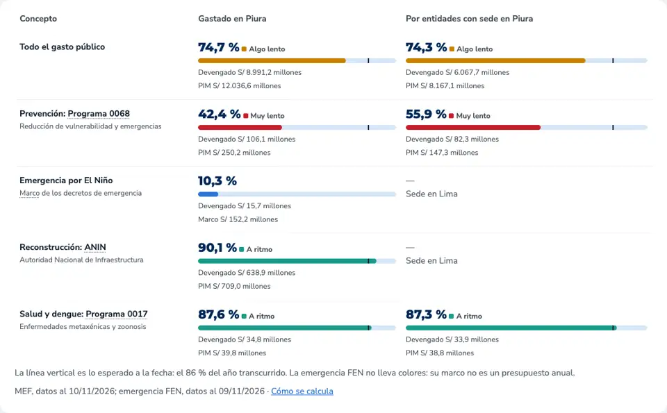
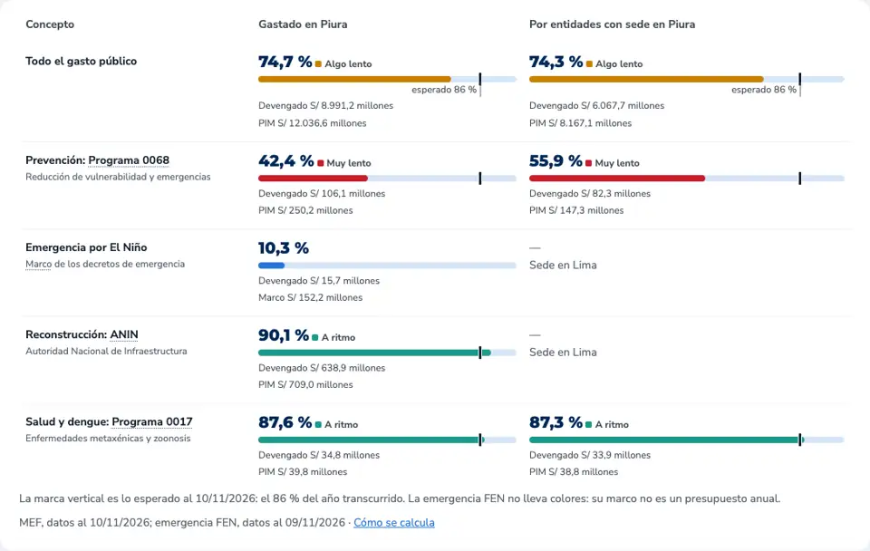
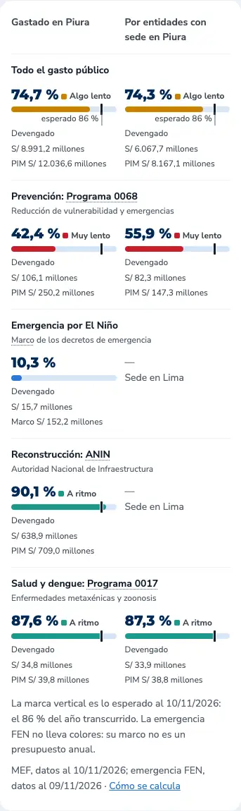

## B. Obras paralizadas frente al país

- **El archivo de Infobras es nacional.** `scripts/infobras.py` ahora guarda, en la misma pasada, un resumen por departamento en `docs/data/infobras_departamentos.json` (2 KB). Trae obras activas, paralizadas y el costo de cada grupo.
  - El archivo completo nunca se sube.
  - `actualizar_local.sh` incluye el nuevo JSON en su commit.
  - El JSON actual sale del archivo de Infobras del 10/11/2026.
- **Decisiones:**
  - **Lima y Callao:** quedan como vienen. Infobras separa «LIMA» (Lima Metropolitana y provincias) de «P C DEL CALLAO», sin mezclas.
  - **Filas que no son departamentos:** «SIN DATO» y «NO APLICA» cuentan en el total del país, no en el puesto.
  - **Piura:** usa las mismas cifras que el resto de la página, sin la obra de Petroperú.
  - **Promedio nacional:** es el total del país, todas las paralizadas entre todas las activas, no el promedio de los porcentajes.
- **Resultado:** Piura tiene 5,8 % de sus obras activas paralizado; el país, 5,9 %. Está en el puesto 11 de 25.
  - El título dice «Piura tiene una proporción de obras paralizadas similar a la del país».
  - El 55 va en **azul marino**, porque la diferencia (−0,1 puntos) no pasa de 1 punto.
- **El umbral de 1 punto se mantiene.** Los departamentos van de 2,3 % a 11,3 %, con mediana de 5,0 % y desviación de 2,7 puntos.
- **Segunda línea:** «Representan el 14,0 % del costo de las obras activas de Piura (país: 6,3 %)». En costo, Piura está a más del doble del país.
- **Dónde está:**
  - en la tarjeta de la portada, sin la barrita;
  - en la pestaña Obras, con un gráfico de puntos de todos los departamentos ordenados, Piura resaltado y una línea punteada para el país;
  - en el detalle, con la tabla completa por departamento;
  - la regla se explica en «Cómo se calcula» y en «Fuentes y método».
- **El gráfico y dataviz:**
  - el gris de los demás departamentos no pasa el piso de saturación del validador, que está pensado para paletas de categorías;
  - aquí el gris es contexto a propósito, y Piura va en el color de acento, más grande y con su nombre y valor en negrita;
  - la separación entre los dos colores pasa la prueba de daltonismo (diferencia de 16,2).

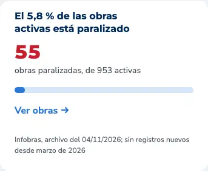
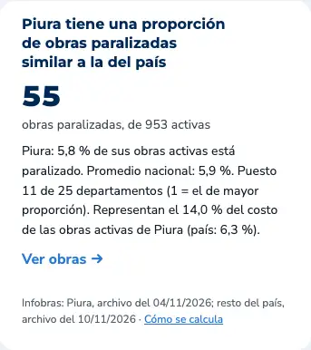
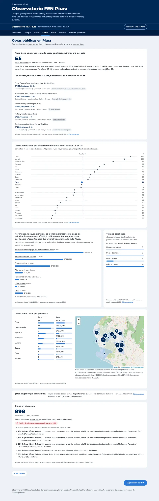

## C. Definiciones de las causas de paralización

- **Las 15 causas** que hay hoy en Piura, más el grupo «Otras», tienen una definición en `DEFINICIONES.causas`, con causa, definición, fuente y URL. Son las mismas que revisaste.
- **En la página:** se subrayan en el gráfico de causas y en las etiquetas de la lista de las 5 obras. Funcionan con el cursor, al tocar y con el teclado; probé el toque en un celular simulado y la tecla Esc.
- **Fuentes:** el glosario de «Fuentes y método» lista todas las causas con su fuente y su enlace.
  - [Ley 32069, texto consolidado del Congreso](https://leyes.congreso.gob.pe/Documentos/2021_2026/ADLP/Texto_Consolidado/32069-TXM.pdf), artículos 63.3, 67, 68.1 a y b, 69.2 b, 76.1 y 83.1;
  - [Ley 31589 en El Peruano](https://busquedas.elperuano.pe/normaslegales/ley-que-garantiza-la-reactivacion-de-obras-publicas-paraliza-ley-n-31589-2118030-3/), artículos 2.2 y 2.4, en su texto de 2022.
- **Redacción propia:** siete definiciones no tienen una norma que las defina. En el archivo dicen «Redacción propia», y algunas mencionan una norma relacionada.
- **Pendiente de verificar:**
  - el Texto Único Ordenado de la Ley 31589 (DS 206-2024-EF), por si cambió la numeración;
  - la Directiva 005-2023-CG/GMPL de Infobras.

## D. Verificación

- **`scripts/test_pagina.py` pasa.** Además comprueba que el título y el color de las obras sigan la regla frente al país, que un caso de prueba con más paralizadas dé «más», y que cada causa de Piura tenga definición.
- **Las cifras no cambiaron.** Comparé las 7 pestañas, con el detalle abierto, entre la versión publicada (`3aff323`) y la nueva, con los mismos datos.
  - No desapareció ningún número; solo se agregaron los de la comparación con el país, la tabla por departamento y las fuentes.
  - Con estos datos, la versión publicada ya decía 86 % en todas partes.
- **Auditoría web-design-guidelines:** no encontró problemas nuevos.
  - El gráfico de puntos tiene una descripción para lectores de pantalla y su tabla en el detalle.
  - Las cifras usan números tabulares.
  - Las definiciones de causas usan el mismo botón accesible de la ronda 8.
- **`/ponytail-review`:** sin hallazgos que corregir. Una nota de redacción: «Puesto 11 de 25 departamentos» cuenta al Callao, que es provincia constitucional. Se podría decir «25 regiones»; lo dejé con tu palabra.

Las otras pestañas:

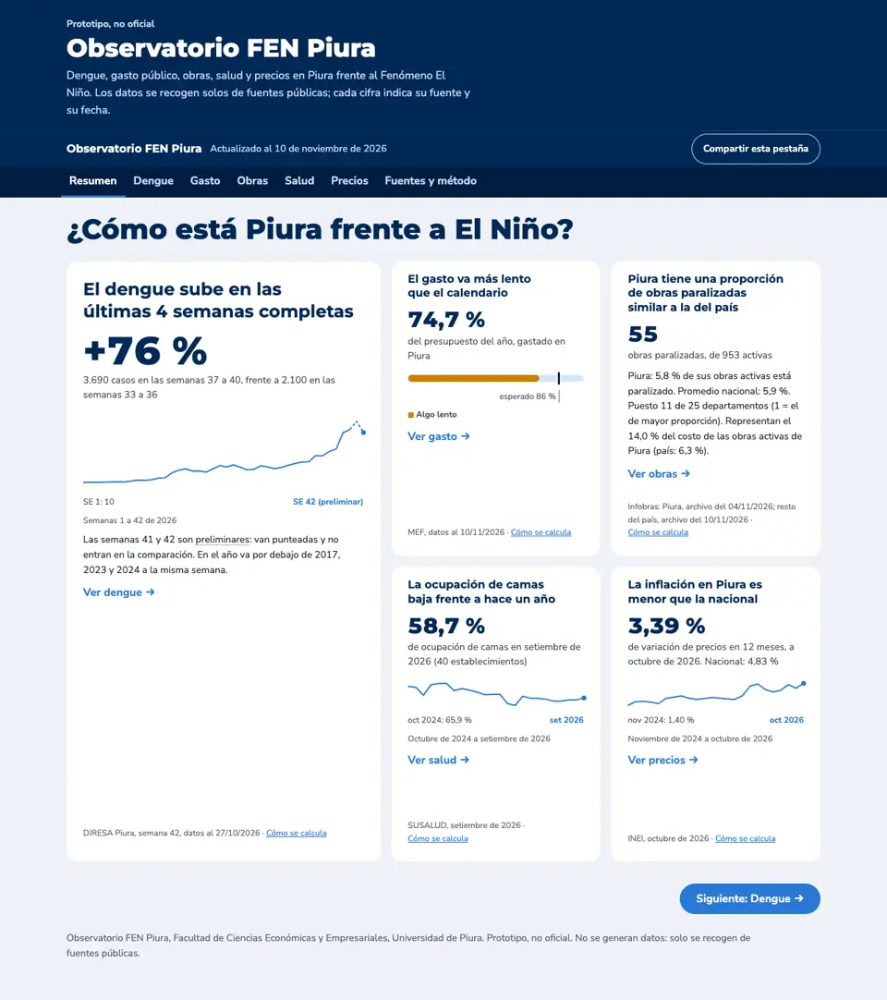
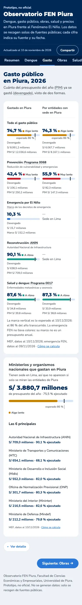

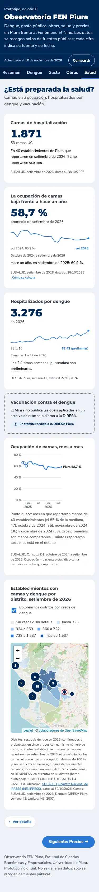

## Pendiente

- Correr `scripts/actualizar_local.sh` el próximo mes para comprobar que el resumen por departamento se genere junto con el de Piura. Hoy el JSON se generó desde el mismo Excel con un script de prueba.
- Las dos verificaciones legales de la sección C.

---

# Ronda 10: ajustes pequeños

## Marca de lo esperado

- **Fecha de lo esperado:** es la de los datos del MEF, el **10/11/2026**. Al mediodía de ese día el año va en el 85,9 %, que se muestra como **86 %**.
- **Sin rótulo colgante:** las barras ya no llevan «esperado X %» ni su rayita. La marca vertical queda igual.
- **Leyenda:** arriba va una leyenda con una muestra de la marca, «Lo esperado a la fecha: 86 % del año». Está en la tabla de gasto, en la tarjeta de gasto de la portada y en la tarjeta de ministerios y organismos nacionales.
- **Pie de la tabla:** se quitó la frase sobre la línea vertical. Queda «La emergencia FEN no lleva colores: su marco no es un presupuesto anual».

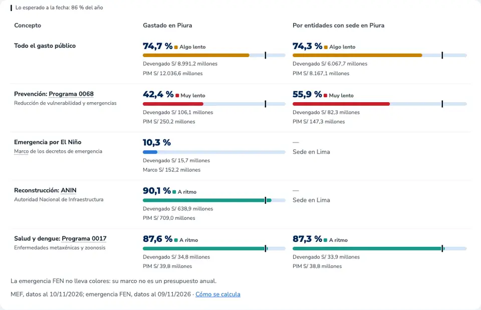
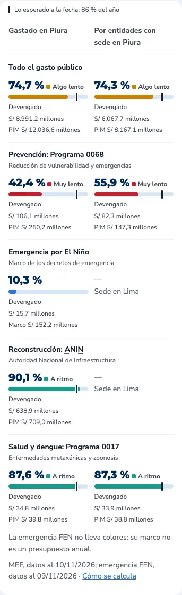

## Obras: un solo archivo y título según los datos

- **Mismo archivo para Piura y el país.** Corrí `scripts/infobras.py` y los dos JSON salen del archivo de Infobras del **10/11/2026**.
  - Ninguna cifra de Piura cambió: 55 paralizadas de 953 activas (5,8 %), S/ 1.286,1 millones (14,0 % del costo).
  - No cambió ninguna obra (estado, costo, causa ni fecha de paralización).
  - El pie muestra una sola fecha.
  - Hubo que liberar espacio: el disco tenía menos de 500 MB libres y el script se detuvo la primera vez. Borré solo archivos temporales de esta sesión.
- **Efecto esperado del archivo nuevo:** el tiempo paralizada se cuenta hasta la fecha del archivo. Al pasar del 04/11 al 10/11, algunas obras suman un mes; por ejemplo, el camino vecinal de Las Lomas pasa de «3 años y 4 meses» a «3 años y 5 meses».
- **Título según dos comparaciones con el país.**
  - **Obras:** «similar» si Piura está a ±1 punto del país; si no, «más» o «menos».
  - **Costo:** «alto costo» si el porcentaje del costo paralizado es al menos 1,5 veces el del país.
  - Hoy da **«Pocas obras paralizadas, pero de alto costo»**: 5,8 % frente a 5,9 % en número de obras, y 14,0 % frente a 6,3 % en costo, 2,2 veces.
  - El 55 sigue en azul marino: el rojo es solo para «más obras» que el país.
- **Tarjeta de la portada:**
  - «55 obras paralizadas de 953 activas: 5,8 % (país: 5,9 %)»;
  - «14,0 % del costo de las obras activas (país: 6,3 %)».
  - Sin el puesto. El encabezado de la pestaña Obras usa las mismas líneas.
- **Pestaña Obras:** dos gráficos de puntos por región, uno por número de obras y otro por costo, cada uno con «Piura: puesto N de 25 (1 = el de mayor proporción)».
  - Por obras, Piura está en el puesto 11; por costo, en el **puesto 2**, después de Cajamarca (21,2 %).
  - La tabla del detalle suma el porcentaje del costo y el puesto por costo.
  - Ahora se habla de «25 regiones (24 departamentos y el Callao)».

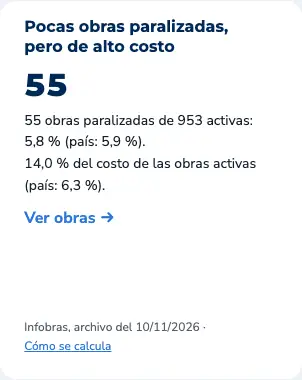
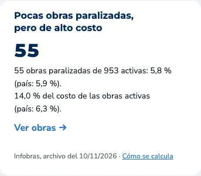
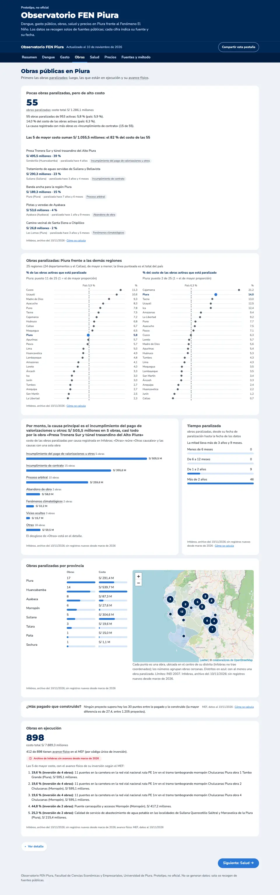

## Verificación de la ronda 10

- **`scripts/test_pagina.py` pasa.** Ahora también comprueba la regla del costo alto: el umbral de 1,5, el título de hoy y el título cuando el costo no es alto.
- **Las demás pestañas no cambiaron.** Comparé con la versión anterior (`74598a4`) y Dengue, Salud y Precios no tienen ni un número distinto. Lo que se fue, a propósito:
  - en Gasto, el «86 %» de los rótulos y la fecha de la nota;
  - en la portada, el puesto «11 de 25»;
  - en Obras y en «Fuentes y método», la fecha antigua de Infobras (04/11).
  - Lo nuevo es la comparación por costo.
- **`/ponytail-review`, 3 hallazgos corregidos:**
  - se quitó de «Fuentes y método» un «Hoy: …» escrito a mano, que habría quedado viejo al cambiar los datos;
  - prueba de la regla del costo;
  - se borró un dato que no se usaba.
- **Disco:** quedan unos 600 MB libres. La próxima actualización de Infobras necesita al menos 500 MB, así que conviene liberar espacio antes de correr `actualizar_local.sh`.

## Salitral y nombres con conectores colgantes

Piura tiene dos distritos llamados Salitral: uno en Morropón (200406) y otro en Sullana (200608). Los datos ya estaban bien asignados; se corrigió solo cómo se muestran.

- **Dengue:** la tabla por distrito decía «SALITRAL (MOR) (MORROPON)».
  - Ahora quita la abreviatura de la DIRESA cuando la provincia ya va al lado y escribe los nombres con la regla de nombres legibles: «Salitral (Morropón)», «Tambo Grande (Piura)», «Veintiséis de Octubre (Piura)».
  - Lo mismo en la lista de distritos con más casos.
- **Nombres cortos de obras:** al cortar la ubicación quedaba un conector colgando. Por ejemplo, «…Salitral y Marcavelica de la» seguido de «Piura (Piura)».
  - Ahora se borran los conectores finales («de», «de la», «del», «y»…).
  - Ningún nombre de obra termina ya en un conector.
- **Pruebas y cifras:** `test_pagina.py` suma los dos casos y pasa. Ninguna cifra cambió.

## Camas: datos de SUSALUD que no cuadran (opción 3)

- **El caso:** el C.S. Salitral salía con borde rojo porque SUSALUD reporta 98 pacientes-día sobre 95 días-cama (103,2 %). Además reporta 95 días-cama para 8 camas, cuando lo esperable en setiembre serían unos 240.
- **Lo que cambió:** el rojo indicaba «alerta» para algo que es un problema de calidad del dato. Ahora:
  - se marcan «a revisar» los establecimientos cuyos días-cama no están entre el 90 % y el 105 % de camas × días del mes, o cuya ocupación pasa de 100 %;
  - en setiembre son 7 de 40: Clínica Auna, E.S. Consuelo de Velasco, Hospital Militar, Hospital II Talara, Clínica Virgen del Pilar, E.S. La Unión y C.S. Salitral;
  - en el mapa van como **punto gris**, no rojo, y al tocarlos dicen qué no cuadra, por ejemplo: «SUSALUD reporta 95 días-cama para 8 camas (lo esperable en el mes serían unos 240)…»;
  - en la tabla del detalle llevan «dato a revisar»;
  - «Fuentes y método» explica la regla y nombra los 7.
- **Lo que no cambió:** no se corrige ni se excluye ningún dato, y la ocupación de Piura sigue en **58,7 %**.
  - Excluir solo los que pasan de 100 % habría dejado dentro a los otros 6, con datos igual de dudosos.
  - Además, habría roto la comparación con hace un año, porque la serie de 24 meses viene ya sumada por mes, sin detalle por establecimiento.
- **Pruebas:** `test_pagina.py` comprueba que un dato que no cuadra se marque y uno normal no, y que febrero de un año bisiesto tenga 29 días.

## Ventana del mapa y texto de lo esperado

- **Ventana del mapa de Salud:**
  - **El problema:** en celular la ventana medía 301 px en un mapa de 295 px, y la nota iba en una sola línea, así que se cortaba y no se leía.
  - **El arreglo:** la ventana nunca es más ancha que el mapa, el texto salta de línea y el mapa se desplaza para mostrarla entera.
  - **El texto:** es más corto y tiene el mismo formato para todos los establecimientos: nombre; distrito · camas; «Ocupación (set. 2026): 103,2 %»; y, si aplica, en gris pequeño, «Dato a revisar: 95 días-cama para 8 camas (se esperan unos 240)».
  - La explicación completa sigue en la tabla del detalle, al pasar el cursor, y en «Fuentes y método».
- **Lo esperado es el mismo para todos los conceptos de gasto.** Es el porcentaje del año transcurrido a la fecha de los datos del MEF (86 % al 10/11/2026): la vara del calendario, «si el gasto avanzara parejo».
  - Como todos los conceptos salen del mismo archivo y la misma fecha, la vara es la misma.
  - La leyenda ahora dice «Lo esperado si el gasto avanzara parejo en el año: 86 % al 10/11/2026».
  - «Cómo se calcula» aclara que es la misma referencia para todos los conceptos, no el ritmo habitual de cada programa.
- **Idea para una tarea futura (no se hizo):** comparar cada programa con su propio ritmo de años anteriores, por ejemplo cuánto llevaba gastado el 0068 a la misma fecha en 2023, 2024 y 2025.
  - Sería más justo con los programas que gastan casi todo en diciembre.
  - Pero cambia un cálculo validado y necesita los archivos mensuales del MEF de esos años, que pesan varios GB, cuando el disco tiene unos 600 MB libres.
  - Conviene conversarlo con el profesor Vega.

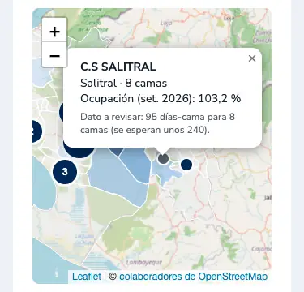
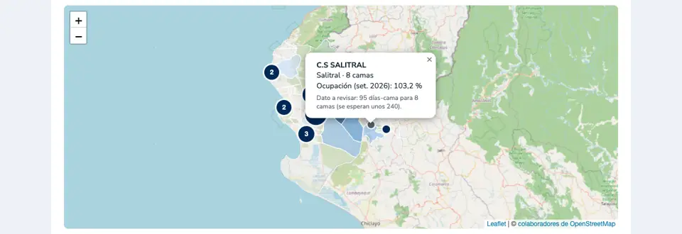
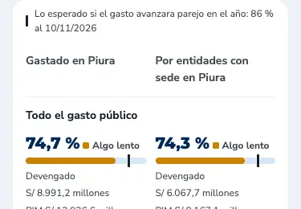

## Camas: «posible error de registro» e historial de los establecimientos marcados

- **Texto:** «Dato a revisar» pasó a **«Posible error de registro»** (en SUSALUD), en la ventana del mapa, la leyenda, la tabla y «Fuentes y método».
- **Margen:** la regla acepta días-cama entre el 90 % y el **110 %** de camas × días del mes; antes era 105 %.
  - Así dejan de marcarse el Hospital II Talara y el E.S. Consuelo de Velasco, que reportan unos 31 días-cama por cama en meses de 30 días: casi seguro cuentan 31 días todos los meses.
  - Quedan **5 de 40**: C.S. Salitral, Hospital Militar, Clínica Auna, Clínica Virgen del Pilar y E.S. La Unión.
- **Historial de los últimos 12 meses** (archivos mensuales de la Consulta D1 de SUSALUD, revisados uno por uno):
  - **C.S. Salitral:** días-cama erráticos (200, 91, 120, 28, 140, 32, 95…) y ocupación sobre 100 % en junio, agosto y setiembre de 2026. Es un registro irregular mes a mes.
  - **Hospital Militar:** siempre unos 1,1 días-cama por cama; las camas saltan de 11 a 69 entre julio y setiembre. Es un error sistemático.
  - **Clínica Auna:** pasó de 63 a 142 camas en enero, pero sus días-cama siguen como los de unas 57 camas. Las camas probablemente están infladas; la ocupación se afecta poco.
  - **Clínica Virgen del Pilar:** siempre entre 10 y 14 días-cama por cama, con camas erráticas. Es un error sistemático.
  - **E.S. La Unión:** siempre unos 20 días-cama por cama. Es un error sistemático, o camas que no funcionan todo el mes.
- **Qué se puede comprobar:** desde aquí solo se puede comprobar si los datos son coherentes, no cuál es el valor verdadero. Para confirmarlo hay que preguntar a SUSALUD. El borrador del mensaje está en la carpeta local `privado/mensaje_susalud.md`, que no se sube al repositorio, para que lo envíen ustedes.
- **Total de camas (1.871):** no se tocó. «Fuentes y método» aclara que incluye establecimientos con posible error en el número de camas. Por la Clínica Auna y el Hospital Militar, podría estar inflado en unas 100 a 150 camas. La ocupación (58,7 %) se calcula con días-cama y se afecta menos.
- **Idea futura:** que `camas_serie.py` guarde el historial por establecimiento, para que la ventana diga si el problema es de ese mes o de siempre («pasa en 9 de los últimos 12 meses»).

## Texto pequeño más legible

- **Lo que se veía más chico en GitHub** que en local era el zoom del navegador, que se guarda por sitio. Al 100 % las dos versiones se ven iguales: lo comprobé con el mismo navegador y el mismo ancho.
- **No se aplicó un 110 % general.** Habría agrandado también títulos y cifras, y quitado espacio en celular. Además, la página se incrustará en udep.edu.pe/fen, donde conviene un texto base estándar de 16 px.
- **Se subieron solo los tamaños pequeños:** `--t-xs` de 12 a 13 px y `--t-sm` de 14 a 15 px. Así se leen mejor los pies con fuente y fecha, las notas, las leyendas y los rótulos de los gráficos. El texto normal, los títulos y las cifras no cambian.
- **Pendiente de decidir:** subir el texto normal a 17 px solo en escritorio.
- `test_pagina.py` pasa: nada se sale de la pantalla a 375 ni a 1280 px.

Antes (izquierda) y después (derecha), en celular:

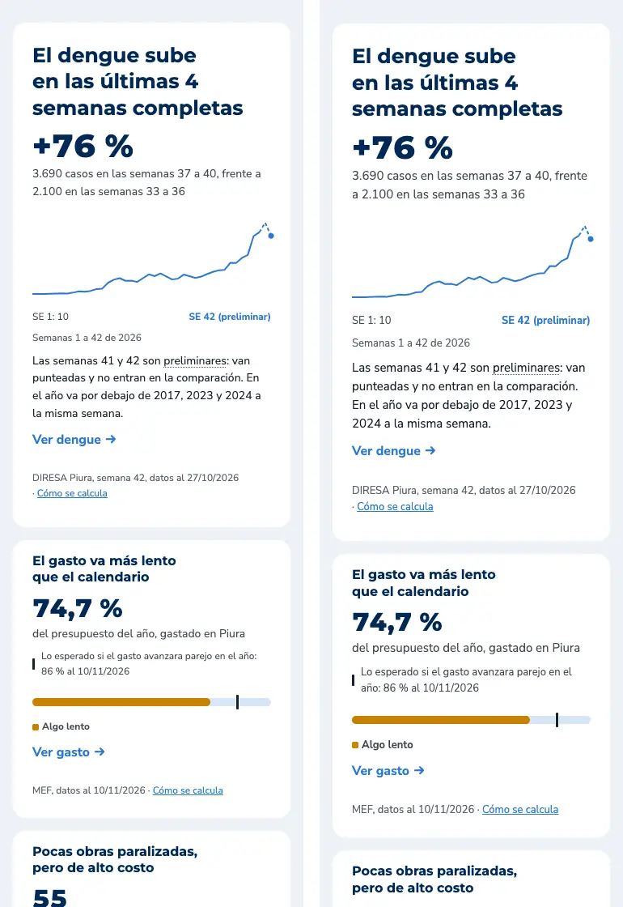
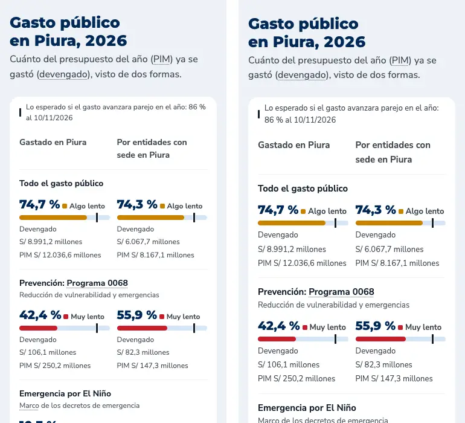
